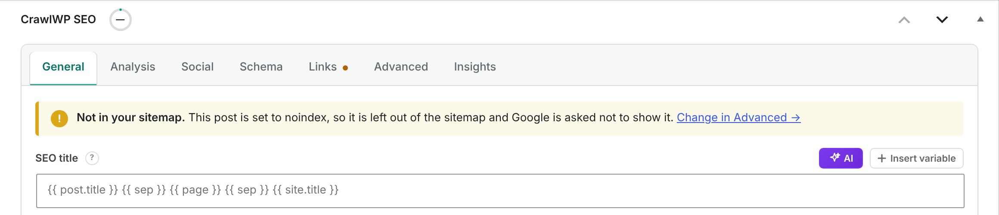
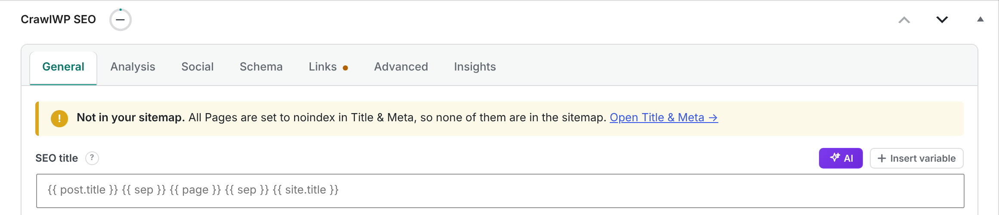
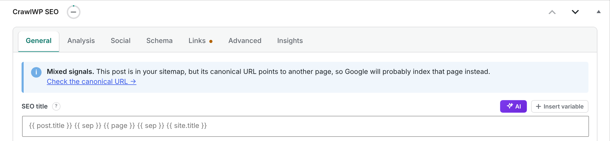

# Why the SEO box says a post isn't in your sitemap

Your XML sitemap is the list of pages you ask search engines to crawl. If a post is left out of it, Google may find it late or not at all. The CrawlWP SEO box now tells you when that happens, and why.

It also warns you about "mixed signals": a post that is in the sitemap, but whose settings tell Google to look somewhere else. You can fix most of these in a few clicks.

In this article:

- [Where the warning appears](#where-the-warning-appears)
- [What each message means and how to fix it](#what-each-message-means-and-how-to-fix-it)
- [When no warning is shown](#when-no-warning-is-shown)
- [Frequently asked questions](#frequently-asked-questions)
- [For developers](#for-developers)
- [Related articles](#related-articles)

## Where the warning appears

1. Open a post or page in the WordPress editor.
2. Scroll to the **CrawlWP SEO** box. The warning sits at the top of the **General** tab, above **SEO title**.

There are two kinds of message:

- **Not in your sitemap.** The post is left out of the sitemap. This is shown as a warning.
- **Mixed signals.** The post is in the sitemap, but another setting points search engines elsewhere. This is shown as information.

Many messages end with a link that takes you straight to the setting to change. Links to the **Advanced** tab only appear if your role can use that tab.

The message updates as you change settings in the SEO box. In the block editor, it also updates when you publish the post, make it private or add a password.

## What each message means and how to fix it

CrawlWP checks the reasons in the order below and shows the first one that applies. Fix it, and the next one (if any) appears.

### Not in your sitemap

| Message | Why it happens | How to fix it |
|---|---|---|
| Your site has no XML sitemap because Settings > Reading is set to discourage search engines. | WordPress turns its sitemaps off when **Discourage search engines from indexing this site** is ticked under **Settings » Reading**. | Click **Open Reading settings →**, untick **Discourage search engines from indexing this site** and click **Save Changes**. Leave it ticked only if the site isn't ready for search engines yet. |
| Your site has no XML sitemap right now. Another plugin or a code snippet has turned WordPress sitemaps off. | Search engines are allowed, but something has switched off the WordPress sitemaps that CrawlWP builds on. | Find the plugin or code snippet that turns sitemaps off and remove it, or ask your developer. |
| All [post type] are set to noindex in Title & Meta, so none of them are in the sitemap. | **Hide from search results** is turned on for this whole post type in **Title & Meta**. For example, "All Pages are set to noindex…". | Click **Open Title & Meta →**, open the screen for that post type, turn off **Hide from search results** and click **Save Changes**. Only do this if you want this type of content in search results. |
| [Post type] aren't public, so WordPress doesn't list them in the sitemap. | The plugin or theme that created this post type registered it as not public. | Nothing to change in CrawlWP. If these posts should be in search, ask the developer of the plugin or theme that adds them. |
| Another plugin or a code snippet keeps [post type] out of the sitemap. | The post type is public, but a plugin or snippet removes it from WordPress sitemaps. | Find the plugin or snippet that removes it, or ask your developer. |
| Private and password-protected posts are left out of the sitemap. | The post's visibility is **Private**, or it has a password. Search engines can't read these posts. | If the post should be in search, set its visibility to **Public** and remove the password in the editor, then update the post. |
| A setting or another plugin keeps this page out of the sitemap. For example, WooCommerce leaves out the cart, checkout and account pages. | This post is excluded on purpose, usually because it's a page with nothing to rank, such as the WooCommerce cart, checkout or account page. | For those WooCommerce pages, nothing: this is expected. For any other page, check which plugin excludes it. |
| This post is set to noindex, so it is left out of the sitemap and Google is asked not to show it. | **Allow indexing** in the SEO box's **Advanced** tab is set to **No — keep it out of search results**. | Click **Change in Advanced →** and set **Allow indexing** to **Default (Yes)** or **Yes — index this post**. Then update the post. If you want the post hidden from search, leave it: the warning is just confirming it. |

### Mixed signals

| Message | Why it happens | How to fix it |
|---|---|---|
| This post is in your sitemap, but it is set to tell visitors it is gone (410/451). Set it to noindex, or remove that setting. | **Redirect type** in the **Advanced** tab is set to **410 — Content deleted** or **451 — Unavailable for legal reasons**. | Click **Check the redirect →**. If the post is really gone, set **Allow indexing** to **No — keep it out of search results**. If not, change the **Redirect type** back. |
| This post is in your sitemap, but it redirects visitors elsewhere. Remove the redirect, or set the post to noindex. | A **Redirect URL** is filled in, so visitors and search engines are sent to another address. | Click **Check the redirect →**. Empty **Redirect URL** to keep the post, or set the post to noindex if the redirect should stay. |
| This post is in your sitemap, but its canonical URL points to another page, so Google will probably index that page instead. | The **Canonical URL** field holds the address of a different page. | Click **Check the canonical URL →**. Empty the field so the post uses its own address, unless this post really is a copy of the other page. |

**Note:** A redirect to the post's own address doesn't count, because CrawlWP ignores it when the page loads. A canonical URL that only differs by `http`/`https`, `www.` or a trailing slash also counts as the post's own address.

## When no warning is shown

You won't see a message when:

- the post can be listed in the sitemap and nothing sends mixed signals;
- the post is a draft or scheduled. It joins the sitemap when it's published. (A draft set to noindex still shows the noindex warning.)
- another SEO plugin is making your sitemap. CrawlWP can't tell what that sitemap lists, so it says nothing.

## Frequently asked questions

**I fixed the setting. Why does the post still not show in my sitemap file?**
Save or update the post first: the SEO box only previews the result. If your site uses a caching plugin, clear its cache too.

**The noindex warning has no "Change in Advanced →" link.**
If your role can't use the **Advanced** tab, the link isn't shown. Ask an administrator to change the setting, or to give your role access. See [Choosing which roles can use CrawlWP](https://crawlwp.com/article/roles-and-permissions/).

**Do I need to fix every message?**
No. Some are expected, such as a WooCommerce checkout page or a post you set to noindex on purpose. They tell you what's happening so nothing is left out by mistake.

## For developers

- Posts excluded through the `crawlwp_sitemap_excluded_post_ids` filter get the "A setting or another plugin keeps this page out of the sitemap." message.
- Public post types removed with WordPress's `wp_sitemaps_post_types` filter get the "Another plugin or a code snippet keeps [post type] out of the sitemap." message.

## Related articles

- [Understanding CrawlWP sitemaps](https://crawlwp.com/article/understanding-crawlwp-sitemaps/)
- [Search appearance settings for post types](https://crawlwp.com/article/search-appearance-settings-for-post-types/)
- [Creating a redirect rule in WordPress](https://crawlwp.com/article/creating-redirect-rule-wordpress/)
- [Using the image sitemap](https://crawlwp.com/article/image-sitemap/)
