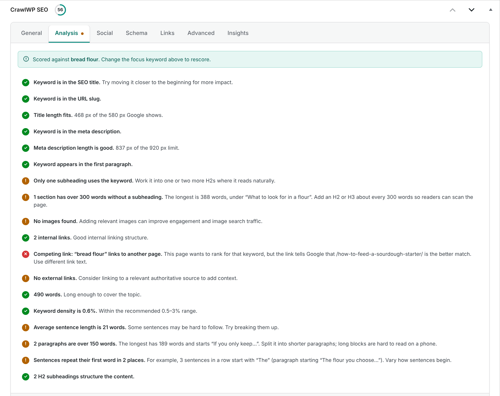
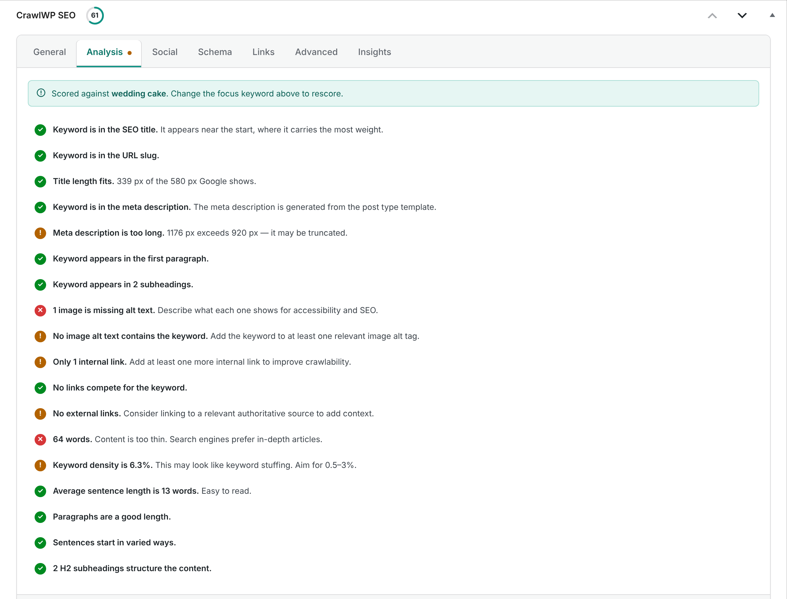

# Readability and structure checks in the SEO box

A page that is easy to scan keeps readers longer, and it's easier for search engines to understand. The **Analysis** tab of the CrawlWP SEO box checks your post as you write and tells you what to fix.

This release adds four checks: links that compete for your keyword, long paragraphs, long sections without a subheading, and sentences that start the same way. Analysis also now handles Chinese, Japanese, Thai, Lao, Khmer and Myanmar text properly, and reads pages built with Divi, Avada and Bricks.

**Before you start:** Analysis runs against a focus keyword. Add one in the **Focus keywords** field on the **General** tab first. See [Using focus keyword suggestions](https://crawlwp.com/article/using-focus-keyword-suggestions/).

In this article:

- [How to run the analysis](#how-to-run-the-analysis)
- [The new checks at a glance](#the-new-checks-at-a-glance)
- [How to fix each check](#how-to-fix-each-check)
- [Chinese, Japanese, Thai, Lao, Khmer and Myanmar content](#chinese-japanese-thai-lao-khmer-and-myanmar-content)
- [Pages built with Divi, Avada or Bricks](#pages-built-with-divi-avada-or-bricks)
- [Frequently asked questions](#frequently-asked-questions)
- [Related articles](#related-articles)

## How to run the analysis

1. Open a post or page in the WordPress editor.
2. In the **CrawlWP SEO** box, type your keyword in **Focus keywords** on the **General** tab.
3. Click the **Analysis** tab.

You'll see a list of checks. Each has a badge:

- a green tick (**✓**): this check passes;
- an amber **!**: a warning, worth improving;
- a red cross (**✕**): a problem to fix.

The list updates as you type in the editor. The score in the SEO box header counts the checks that pass, so every warning and problem lowers it.

If you entered secondary keywords, each keyword has its own tab above the list. The four new checks run for every keyword.

## The new checks at a glance

Checks don't have separate names in the SEO box. Each line shows a short message in bold, followed by details. The table uses the message you see when the check passes.

| Check (message when it passes) | When it runs | Warning (**!**) when | Problem (**✕**) when |
|---|---|---|---|
| **No links compete for the keyword.** | The content has at least one link. | A link to another site has your keyword in its link text. | A link to another page on your own site has your keyword in its link text. |
| **Subheadings are well spread out.** | The content has more than 300 words. | Any stretch of text has more than 300 words without a subheading. | Never: this check only warns. |
| **Paragraphs are a good length.** | The content has at least one paragraph and at least 50 words. | Any paragraph has more than 150 words. | Never: this check only warns. |
| **Sentences start in varied ways.** | The content has at least three sentences, and is mostly in a language written with spaces between words. | Three or more sentences in a row, in the same paragraph, start with the same word. | Never: this check only warns. |

## How to fix each check

### Competing links

When it fails, you'll see **Competing link: “your link text” links to another page.** It's followed by:

> This page wants to rank for that keyword, but the link tells Google that [address] is the better match. Use different link text.

If more links do the same, the message adds "1 more link does the same." (or the number of links).

Link text (also called anchor text) is a strong hint about what the linked page is about. Using your own keyword as link text to another page tells Google that page is the better answer.

To fix it:

1. Find the link quoted in the message.
2. Rewrite its link text to describe the other page instead, for example "our sizing guide" rather than your keyword.

How CrawlWP matches the keyword:

- It looks for the whole keyword in the link text. Capital letters and punctuation don't matter.
- Links to the post itself and links that are only an image are ignored.
- Links to your own site are checked first, and count as a problem. Links to other sites only count as a warning, because quoting a source with your keyword is common and does less harm.

### Long sections without a subheading

When it fails, you'll see "1 section has over 300 words without a subheading." (or the number of sections). The details quote the longest one:

> The longest is 412 words, under “Choosing a size”. Add an H2 or H3 about every 300 words so readers can scan the page.

If the longest stretch is your introduction, the details say it's "before the first subheading" instead.

To fix it, add an H2 or H3 subheading that sums up the next part of the text. Any heading from H1 to H6 starts a new section.

### Long paragraphs

When it fails, you'll see "1 paragraph is over 150 words." (or the number of paragraphs). The details name the longest one by its first words:

> The longest has 183 words and starts “When you first start…”. Split it into shorter paragraphs; long blocks are hard to read on a phone.

To fix it, split the paragraph where the topic shifts. Aim for a few sentences per paragraph.

### Repeated sentence openings

When it fails, you'll see "Sentences repeat their first word in 1 place." (or the number of places). The details give the first example:

> For example, 3 sentences in a row start with “The” (paragraph starting “The shoe is light…”). Vary how sentences begin.

To fix it, reword one or two of those sentences so they start differently, or join two of them.

**Tip:** What the checks count: paragraphs, list items and headings. Tables, code blocks and scripts are left out. List items count towards the length of a section, but they aren't treated as paragraphs.

## Chinese, Japanese, Thai, Lao, Khmer and Myanmar content

These languages are written without spaces between words, so counting words the usual way doesn't work. CrawlWP adjusts the analysis for them:

| What | Chinese and Japanese | Thai, Lao, Khmer and Myanmar |
|---|---|---|
| Word count | Every 2 characters count as 1 word. | Words are found with your browser's built-in word splitter. |
| Long paragraphs | Reported in characters: a warning above 300 characters. | Reported in words: a warning above 150 words. |
| Long sections without a subheading | Reported in characters: a warning above 600 characters. | Reported in words: a warning above 300 words. |
| Average sentence length check | Reported in characters. The problem message says "Sentences are too long. Aim for under 40 characters on average." | Skipped. Sentences in these languages end with a space, not a full stop, so they can't be told apart reliably. |
| Repeated sentence openings | Skipped: there's no single "first word" to compare. | Skipped, for the same reason. |
| Reading-ease score (on the **General** tab) | Not shown. You'll see "No reading-ease score: the formula only works for languages written with spaces between words." | Not shown, with the same message. |
| Keyword in the URL slug and in link text | Matched anywhere, not only as a whole word. | Matched anywhere, not only as a whole word. |

The reading-ease score and the skipped checks are only switched off when more than half of the letters in your post are in these languages. A post that is mostly in English with a few Chinese words is checked as usual.

**Note:** Korean, Greek, Arabic, Hebrew and Hindi put spaces between words, so they're analysed the same way as English.

## Pages built with Divi, Avada or Bricks

Page builders often store your text somewhere the WordPress editor can't see. The SEO box analysis and the automatic meta description now read it from:

- **Divi 4 and Avada.** The text sits in the post content, wrapped in builder codes. CrawlWP removes the codes as you type and reads headings, buttons and images from the module settings. Avada code blocks are skipped.
- **Divi 5 and Bricks.** The text sits in the builder's own data. CrawlWP reads it when you open the post's edit screen.

To check a Divi 5 or Bricks page after changing it:

1. Save your changes in the page builder.
2. Open the page's edit screen in WordPress, or reload it if it's already open.
3. Open the **Analysis** tab in the **CrawlWP SEO** box.

**Note:** On very large Divi 5 or Bricks pages, only about the first 300 KB of the page's content is analysed.

## Frequently asked questions

**Do warnings lower my score?**
Yes. The score counts only the checks with a green tick, so a warning lowers it as much as a problem does. Warnings are still less urgent to fix.

**The Analysis tab says "Enter a focus keyword above to run the analysis."**
The checks need a focus keyword. Type one in **Focus keywords** on the **General** tab.

**My Divi 5 page shows "Multiple H1 tags found".**
A Divi 5 Heading module with no heading level set is read as an H1. Set those headings to H2 or H3 in Divi, so the page title stays the only H1.

**I changed my Bricks page, but the analysis didn't change.**
The Bricks and Divi 5 text is read when the edit screen opens. Save in the builder, then reload the WordPress edit screen.

## Related articles

- [Using focus keyword suggestions](https://crawlwp.com/article/using-focus-keyword-suggestions/)
- [Setting up automatic internal linking](https://crawlwp.com/article/setting-up-automatic-internal-linking/)
- [Image SEO and automatic alt text](https://crawlwp.com/article/image-seo-and-automatic-alt-text/)
- [Generating SEO titles and descriptions with AI](https://crawlwp.com/article/generating-seo-titles-and-descriptions-with-ai/)
