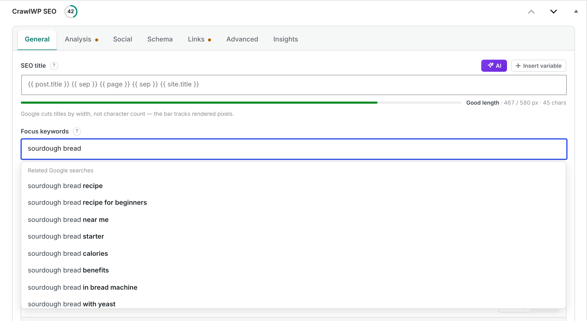
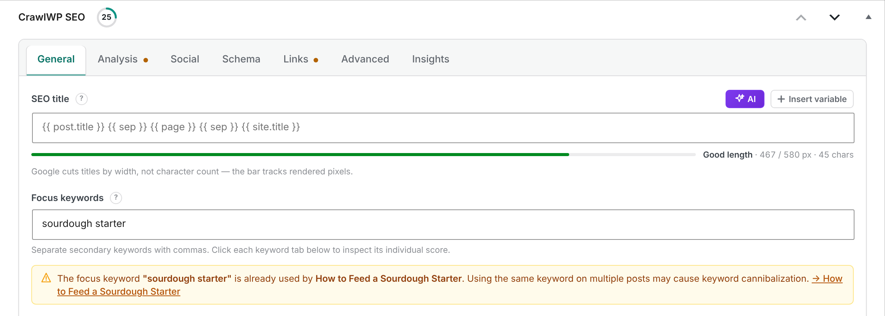
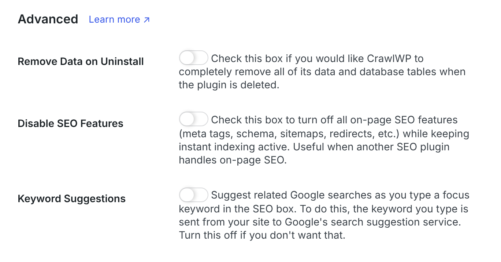

# Using focus keyword suggestions

Choosing a focus keyword is easier when you can see what people actually search for. As you type in the **Focus keywords** field of the CrawlWP SEO box, CrawlWP lists related Google searches that you can pick with one click.

CrawlWP also warns you when another published post already uses the same focus keyword. That helps you avoid two of your own pages competing for the same search.

In this article:

- [How to use keyword suggestions](#how-to-use-keyword-suggestions)
- [Where the suggestions come from](#where-the-suggestions-come-from)
- [The "already used" keyword warning](#the-already-used-keyword-warning)
- [How to turn keyword suggestions off](#how-to-turn-keyword-suggestions-off)
- [Troubleshooting](#troubleshooting)
- [For developers](#for-developers)
- [Related articles](#related-articles)

## How to use keyword suggestions

1. Open a post or page in the WordPress editor.
2. Scroll to the **CrawlWP SEO** box and open the **General** tab.
3. Click in the **Focus keywords** field and start typing.
4. After two characters, wait a moment. A list headed **Related Google searches** opens under the field.

5. Click a suggestion. You can also use the up and down arrow keys and press Enter. Press Esc to close the list.
6. To add a secondary keyword, type a comma and start typing the next phrase. Suggestions appear for that phrase too.
7. Save or update the post.

The suggestion replaces the phrase you were typing. In the list, the words Google added to your phrase are in bold. Phrases that are already in the field aren't suggested again.

The first phrase in the field is your primary keyword. Any phrases after it are secondary keywords. Each one gets its own tab in the **Analysis** tab, so you can check its score separately. See [Readability and structure checks in the SEO box](https://crawlwp.com/article/readability-and-structure-checks/) for what the analysis looks at.

## Where the suggestions come from

The suggestions come from Google's search suggestion service, the one that suggests searches as people type into Google. To get them, the phrase you type is sent from your website to Google.

Here's exactly what happens:

- Only the phrase you're typing is looked up: the text after the last comma in **Focus keywords**. Your post content is not sent.
- The request goes from your website's server to Google, not from your browser. It includes the phrase and your site's language. Like any request WordPress makes, it also identifies your website.
- Suggestions follow your site's language, set in WordPress under **Settings » General » Site Language**.
- You get up to eight suggestions.
- Phrases shorter than two characters or longer than 100 characters aren't looked up.
- Each answer is kept on your site for a day. Typing the same phrase again in that time doesn't ask Google again.
- Each user can make up to 60 lookups a minute. After that, new phrases get no suggestions until the minute is up.

**Note:** Keyword suggestions are on by default, including on sites that updated from an earlier version of CrawlWP. If you don't want typed keywords sent to Google, [turn them off](#how-to-turn-keyword-suggestions-off).

## The "already used" keyword warning

When you stop typing in **Focus keywords**, CrawlWP checks each keyword in the field against the focus keywords of your other published posts. If one matches, a warning appears under the field:

> The focus keyword **"best running shoes"** is already used by **Running shoes for beginners**. Using the same keyword on multiple posts may cause keyword cannibalization.

Keyword cannibalization means two of your pages compete for the same search, which can make both rank lower. If you're allowed to edit the other post, the warning ends with a link to it (**→** and the post title). The link opens in a new tab.

How the check works:

- A keyword matches only when it's the same whole keyword. Capital letters don't matter. "running shoes" doesn't match "running shoes for women".
- Only published posts are checked. Drafts and scheduled posts aren't.
- The warning names the first match it finds.
- The warning doesn't stop you saving. It's there to help you decide.
- It works whether keyword suggestions are on or off.

To fix it, give one of the two posts a more specific keyword, or combine the two posts into one.

**Tip:** With CrawlWP Premium, the [Opportunities report](https://crawlwp.com/article/seo-opportunities-report/) also lists pages that compete for the same keyword.

## How to turn keyword suggestions off

1. In your WordPress dashboard, go to **CrawlWP » Settings** and click **Advanced** in the list of sections on the left.
2. Turn off **Keyword Suggestions**.

3. Click **Save Changes**.

The **Focus keywords** field now works as a plain text field. Nothing you type there is sent to Google. The "already used" warning keeps working, because it only looks at your own site.

## Troubleshooting

**The suggestion list doesn't appear.**
Check that **Keyword Suggestions** is turned on in the **Advanced** section of **CrawlWP » Settings**. Type at least two characters and pause. The list only opens when Google returns suggestions that aren't already in the field, so a very unusual phrase may get none.

**Suggestions worked, then stopped for a while.**
Each user can make up to 60 lookups a minute. Wait a minute and try again. If they never come back, your web host may be blocking your server from contacting Google.

**The suggestions are in the wrong language.**
CrawlWP asks Google for suggestions in your site's language. Check **Settings » General » Site Language** in WordPress.

**I don't see the Focus keywords field at all.**
Your role may not be allowed to use the SEO box. An administrator can check this, see [Choosing which roles can use CrawlWP](https://crawlwp.com/article/roles-and-permissions/).

## For developers

- `crawlwp_keyword_suggestions` (bool): return `false` to turn suggestions off in code. It receives the **Keyword Suggestions** setting.
- `crawlwp_keyword_suggestions_rate_limit` (int): lookups per user per minute. The default is 60. Return `0` for no limit.

## Related articles

- [Readability and structure checks in the SEO box](https://crawlwp.com/article/readability-and-structure-checks/)
- [Finding quick wins with the Opportunities report](https://crawlwp.com/article/seo-opportunities-report/)
- [Choosing which roles can use CrawlWP](https://crawlwp.com/article/roles-and-permissions/)
- [Generating SEO titles and descriptions with AI](https://crawlwp.com/article/generating-seo-titles-and-descriptions-with-ai/)
