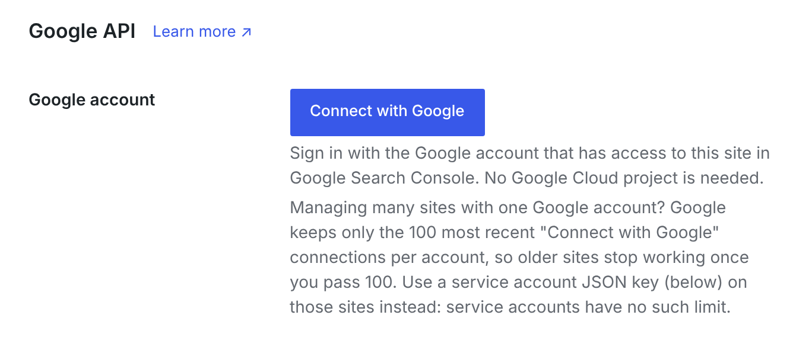
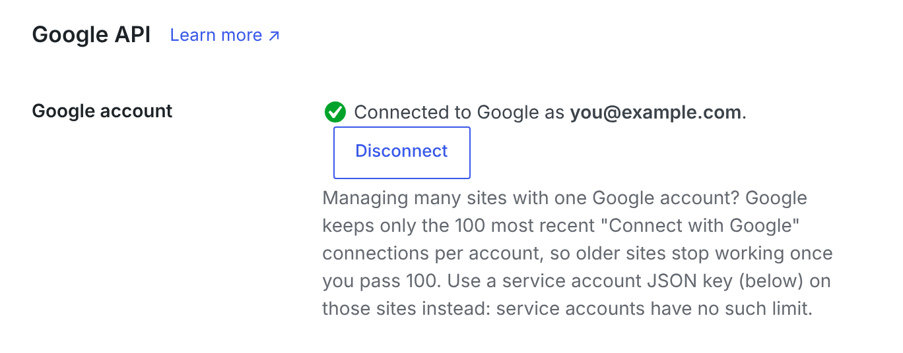
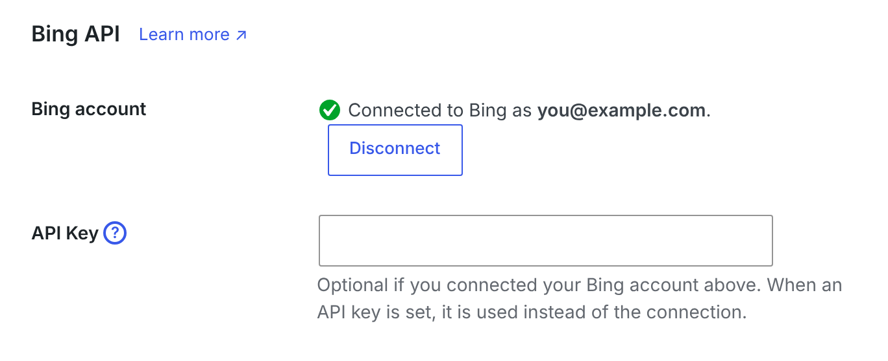
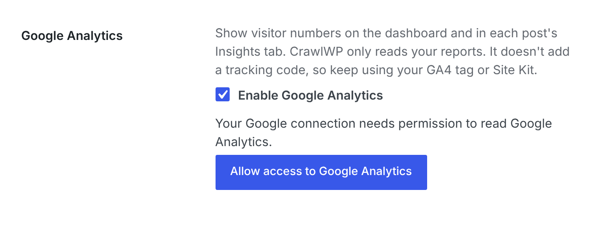

# Connecting CrawlWP to Google Search Console and Bing

You want CrawlWP to talk to Google and Bing, but you don't want to create a Google Cloud project or copy API keys around. With **Connect with Google** and **Connect with Bing**, you sign in with your Google or Microsoft account instead, and CrawlWP does the rest.

The connection lets CrawlWP read your Search Console and Bing Webmaster Tools data, and lets it send pages to Bing. This article shows you how to connect, what each connection is used for, and what to do when something goes wrong.

**Note:** Connecting is free. The Bing connection is used by the free plugin to send pages to Bing. The Google connection is what CrawlWP Premium uses for SEO Stats, SEO Indexing, the Insights tab and email reports.

**Before you start:**

- Add and verify your site in Google Search Console and, for Bing, in Bing Webmaster Tools. CrawlWP only accepts the connection if your account already has your site. See [verifying your site in Google Search Console](https://crawlwp.com/article/verify-website-google-search-console/).
- Sign in to WordPress as an administrator. Only administrators can connect or disconnect.

In this article:

- [What each connection is used for](#what-each-connection-is-used-for)
- [Making sure your site is in Search Console and Bing Webmaster Tools](#making-sure-your-site-is-in-search-console-and-bing-webmaster-tools)
- [How to connect with Google](#how-to-connect-with-google)
- [How to connect with Bing](#how-to-connect-with-bing)
- [Giving CrawlWP access to Google Analytics](#giving-crawlwp-access-to-google-analytics)
- [Sending pages to Google still needs a service account key](#sending-pages-to-google-still-needs-a-service-account-key)
- [Checking the connection and disconnecting](#checking-the-connection-and-disconnecting)
- [Connecting many sites with one Google account](#connecting-many-sites-with-one-google-account)
- [How the connection fits with API keys](#how-the-connection-fits-with-api-keys)
- [Messages you might see](#messages-you-might-see)
- [Troubleshooting](#troubleshooting)

## What each connection is used for

| Connection | Free plugin | CrawlWP Premium |
|---|---|---|
| Google | Nothing on its own. It is ready for Premium. | SEO Stats, SEO Indexing (including URL inspection), the Insights tab and email reports. With the extra permission, Google Analytics visitor stats. |
| Bing | Sending pages through the Bing Webmaster API, both automatically and from **Submit URLs**. | Bing data in SEO Stats, SEO Indexing, the Insights tab and email reports, and sending pages to Bing from SEO Indexing. |

Google treats indexing requests differently. Sending pages to Google through the Google Indexing API still needs a service account key. See [Sending pages to Google still needs a service account key](#sending-pages-to-google-still-needs-a-service-account-key).

## Making sure your site is in Search Console and Bing Webmaster Tools

After you sign in, CrawlWP checks that your account has your site, and that the site is verified. If it doesn't, no access is handed over and you see an error instead. This stops a connection being made with the wrong account.

Google Search Console has two kinds of property (a property is a site you've added to Search Console):

- **Domain property** (for example `example.com`). It covers the whole domain, including every subdomain. A domain property for `example.com` also covers `blog.example.com` and `www.example.com`.
- **URL-prefix property** (for example `https://www.example.com/`). It covers one address and everything below it. It must be on the same host name as your WordPress site, but `www.` doesn't matter: `https://www.example.com/` covers `https://example.com/`.

If WordPress is installed in a folder (for example `https://example.com/blog/`), a URL-prefix property must start at or above that folder. `https://example.com/` and `https://example.com/blog/` both work. `https://example.com/shop/` doesn't.

For Bing, the site must be added and verified in Bing Webmaster Tools, under the same host name as your WordPress site.

**Tip:** CrawlWP checks the address WordPress itself runs at (the one in your WordPress dashboard's address bar, without `/wp-admin/`). The error message shows the address it checked, so you can compare it with your properties.

## How to connect with Google

1. In your WordPress dashboard, go to **CrawlWP » Settings » API Settings**.
2. In the **Google API** section, find the **Google account** row and click **Connect with Google**.

3. A CrawlWP page titled **Connect Google Search Console to CrawlWP** opens. It shows the address of the WordPress site asking for access. Check that it is your site.
<!-- SCREENSHOT (needs live site): The CrawlWP confirmation page "Connect Google Search Console to CrawlWP" showing the site address and the Continue to Google button -->
4. Click **Continue to Google**. Only do this if you just clicked **Connect with Google** in your own site's dashboard.
5. Choose the Google account that has your site in Search Console.
6. On Google's consent screen, allow CrawlWP to view your Search Console data, then continue.

You're taken back to **API Settings** with the notice "Connected to Google." The **Google account** row now says "Connected to Google as" followed by your email address, with a **Disconnect** button next to it.

**Note:** The confirmation page warns that the site will be able to read the data of every site in the account you sign in with, not only this one. If you reached it from a link in an email, a message or another website, close it.

You can also connect from the last step of the setup wizard. Look for the **Connect Google & Bing (optional)** box and click **Connect Google**.

## How to connect with Bing

1. Go to **CrawlWP » Settings » API Settings**.
2. Click **Bing API** in the list on the left. In the **Bing account** row, click **Connect with Bing**.
3. On the **Connect Bing Webmaster Tools to CrawlWP** page, check the site address and click **Continue to Microsoft**.
4. Sign in with the Microsoft account that has your site in Bing Webmaster Tools.
5. Allow all the permissions Microsoft asks for.

You're taken back to **API Settings** with the notice "Connected to Bing." The **Bing account** row shows the connection and a **Disconnect** button.

In the setup wizard, the same option is the **Connect Bing** button in the **Connect Google & Bing (optional)** box.

Once Bing is connected, you can switch on Bing under **CrawlWP » Settings » Indexing** to send pages through the Bing Webmaster API. See [setting up search engine indexing](https://crawlwp.com/article/setting-up-search-engine-indexing-for-wordpress/).

## Giving CrawlWP access to Google Analytics

**Note:** Google Analytics stats need CrawlWP Premium.

Google Analytics is an extra permission on top of the Search Console connection. You give it from the Google Analytics block in API Settings. Connect with Google first: until you do, the block says "Connect CrawlWP to Google above first." If you use a service account JSON key instead, there is no **Allow access to Google Analytics** button; the block tells you to add the service account as a Viewer on your GA4 property.

1. Go to **CrawlWP » Settings » API Settings**.
2. In the **Google API** section, find the **Google Analytics** row and tick **Enable Google Analytics**.
3. Under "Your Google connection needs permission to read Google Analytics.", click **Allow access to Google Analytics**.

4. The confirmation page now reads **Connect Google Search Console and Google Analytics to CrawlWP**. Click **Continue to Google**.
5. On Google's consent screen, tick the Google Analytics permission as well as the Search Console one. <!-- CHECK: Google's exact wording for the Analytics permission on its consent screen; it is not in CrawlWP's code -->
6. Back in **API Settings**, choose your property in **GA4 property**.

When access is granted, the block shows "Access allowed for" followed by your email address. For the rest of the setup, see [viewing Google Analytics in WordPress](https://crawlwp.com/article/google-analytics-in-wordpress/).

If you untick the Google Analytics permission on the consent screen, Google still connects for Search Console. You see: "Google was connected, but without access to Google Analytics. To see visitor stats, click Allow access again and tick the Google Analytics permission."

**Tip:** Reconnecting Google later keeps the Analytics permission you already gave. You don't need to tick it again.

## Sending pages to Google still needs a service account key

Google only accepts Indexing API requests from a service account (a special Google Cloud account that belongs to your project, not to a person). So **Connect with Google** is not enough to send pages to Google.

To send pages to Google, paste a key into **Service Account JSON Key** in the **Google API** section of **CrawlWP » Settings » API Settings**. [Integrating WordPress with Google Search](https://crawlwp.com/article/integrating-wordpress-with-google-search/) shows how to create one.

If Google is switched on under **Indexing** but you've only connected your Google account, the **Google** section shows this warning: "Google only accepts indexing requests from a service account, so connecting with Google is not enough for this setting. Paste a service account JSON key under API Settings to submit pages to Google."

This applies everywhere CrawlWP sends pages to Google: automatic submissions, **Submit URLs**, and sending pages from SEO Indexing in Premium.

Bing is different. Its connection covers sending pages too, so you don't need a Bing API key.

## Checking the connection and disconnecting

The **Google account** and **Bing account** rows in **API Settings** show the current state:

- **Not connected:** a **Connect with Google** or **Connect with Bing** button.
- **Connected:** a green tick, "Connected to Google as" (or Bing) and the account's email address, and a **Disconnect** button.

To disconnect:

1. Go to **CrawlWP » Settings » API Settings**.
2. Click **Disconnect** next to the connection. For Bing, click **Bing API** in the list on the left first.

You see "Disconnected from Google." (or Bing). CrawlWP deletes the connection from your site and tells the CrawlWP connection service never to renew it.

**Note:** Disconnecting doesn't remove CrawlWP's access in your Google or Microsoft account. Removing it there would also disconnect every other site you connected with that account.

## Connecting many sites with one Google account

Google keeps only the 100 most recent **Connect with Google** connections per Google account. Each connect, including a reconnect, counts as a new one. When you pass 100, the oldest sites stop working.

Disconnecting a site doesn't free up a place. If you manage many sites with one Google account, use a service account JSON key on those sites instead. Service accounts have no such limit.

When a key is set, the **Google account** row says: "In use: your service account JSON key. It takes priority over a Google account connection, so connecting is optional."

## How the connection fits with API keys

The connection doesn't replace the keys. You can use either, and the key wins when both are set.

| Service | Sign-in connection | Key | Which is used |
|---|---|---|---|
| Google | **Connect with Google**: Search Console data (and Google Analytics with the extra permission). | **Service Account JSON Key**: Search Console data and sending pages with the Google Indexing API. | The key, for all Google requests, when one is set. |
| Bing | **Connect with Bing**: Bing data and sending pages. | **API Key**: the same things. | The API key, when one is set. |

If you already set up a key with [Integrating WordPress with Google Search](https://crawlwp.com/article/integrating-wordpress-with-google-search/) or [Integrating WordPress with Bing](https://crawlwp.com/article/integrating-wordpress-with-bing/), it keeps working. You don't need to connect.

## Messages you might see

| Message | What it means |
|---|---|
| Connected to Google. / Connected to Bing. | The connection worked. |
| Google connection was cancelled. / Bing connection was cancelled. | You cancelled on the Google or Microsoft screen. Nothing was saved. |
| This Google account has no Google Search Console property for example.com. Add and verify your site in Google Search Console (or sign in with the account that has it), then connect again. | The account you signed in with doesn't have a verified property that covers your site. The Bing version names Bing Webmaster Tools. |
| Google didn't answer while CrawlWP checked that your account has this site in Google Search Console. Please try connecting again in a few minutes. | Google or Microsoft didn't reply in time. Try again later. |
| Google was connected without access to Search Console. Please connect again and allow CrawlWP to view your Search Console data. | You unticked the Search Console permission on Google's consent screen. |
| Bing was connected without access to Bing Webmaster Tools. Please connect again and allow all requested permissions. | A Microsoft permission was refused. |
| Google was connected, but without access to Google Analytics. To see visitor stats, click Allow access again and tick the Google Analytics permission. | Search Console works, but the Analytics permission wasn't given. |
| The connection request expired. Please click Connect again. | More than 15 minutes passed, or the page was opened outside a connect attempt. |
| This confirmation has expired. Go back to your WordPress dashboard and click Connect again. | Shown on the CrawlWP confirmation page when it was left open too long. "This connection request has expired…" is the same problem after the Google or Microsoft screen. |
| Google connection failed: no access was granted. Please try again. | Your site couldn't collect the connection. Try again. |
| The CrawlWP connection service had a problem. Please try again in a few minutes. | A temporary problem on CrawlWP's side. |
| Google connection failed (code). Please try again. | Another error. The code in brackets helps our support team. |
| Could not refresh the Google connection right now. CrawlWP will retry in a few minutes. | Shown in logs and reports when the connection couldn't be renewed for a moment. It retries on its own. |
| Google is not connected. Connect Google under API Settings. | Shown in logs and reports when nothing is connected. |

## Troubleshooting

**I see "Update CrawlWP Premium to its latest version" under the Connect button.**
Your CrawlWP Premium is older than the connection feature, so it only works with API keys. The full message is: "Update CrawlWP Premium to its latest version to use this connection in SEO Stats, SEO Indexing, the Insights tab and email reports. The Premium version on this site only works with an API key." Update Premium, and the note goes away.

**A notice says my Google connection has stopped working.**
Google no longer accepts the connection. Either access was removed in the Google account, or the account was connected to more than 100 sites. Click **Reconnect Google** in the notice. If you manage many sites with one Google account, use a service account JSON key instead.

**A notice says my Bing connection has stopped working.**
Microsoft no longer accepts the connection, usually because access was removed in the Microsoft account. Click **Reconnect Bing** in the notice.

**Premium says "No matching Search Console property found for this website."**
Premium shows the property it detected in the **Search Console Property** row under **API Settings**. If none is found, make sure the Google account you connected has your site's property in Search Console, then save the **API Settings** page to detect it again.

**I gave Google Analytics access on another site, but this site still asks for it.**
Each site keeps its own connection. Click **Allow access to Google Analytics** on this site too, and tick the Analytics permission.

**Premium says "Update the free CrawlWP plugin to use Google Analytics with your Google connection, or add a service account JSON key."**
The free plugin on your site is older than the connection feature. Update it, then come back to **API Settings**.

## Related articles

- [Integrating WordPress with Google Search](https://crawlwp.com/article/integrating-wordpress-with-google-search/)
- [Integrating WordPress with Bing](https://crawlwp.com/article/integrating-wordpress-with-bing/)
- [Verifying your site in Google Search Console](https://crawlwp.com/article/verify-website-google-search-console/)
- [Submitting URLs to search engines by hand](https://crawlwp.com/article/submitting-urls-to-search-engines/)
- [Viewing Google Analytics in WordPress](https://crawlwp.com/article/google-analytics-in-wordpress/)
