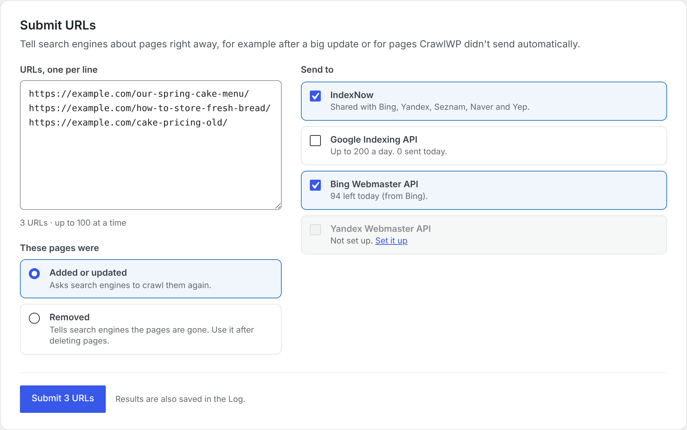
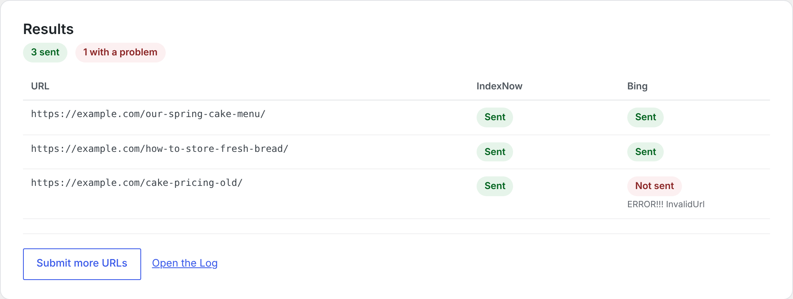

# Submitting URLs to search engines by hand

CrawlWP sends your posts to search engines on its own when you publish or update them. Sometimes you want to tell search engines about pages right away, though. Maybe you made a big update, deleted a batch of pages, or have pages CrawlWP didn't send automatically.

**Submit URLs** lets you paste up to 100 addresses and send them to IndexNow, Google, Bing and Yandex in one go. This article also explains how the automatic submissions work behind the scenes.

**Before you start:**

- You need to be an administrator. Only administrators see the **Submit URLs** tab.
- Set up at least one service under **CrawlWP » Settings » Indexing** and **API Settings**. See [setting up search engine indexing](https://crawlwp.com/article/setting-up-search-engine-indexing-for-wordpress/).

In this article:

- [How to submit URLs](#how-to-submit-urls)
- [Which services you can send to](#which-services-you-can-send-to)
- [Reading the results](#reading-the-results)
- [Limits to know about](#limits-to-know-about)
- [How automatic submissions work](#how-automatic-submissions-work)
- [Troubleshooting](#troubleshooting)

## How to submit URLs

1. In your WordPress dashboard, go to **CrawlWP » Settings » Submit URLs**.
2. In **URLs, one per line**, paste the addresses you want to send. Put each one on its own line.
3. Under **These pages were**, choose **Added or updated** (asks search engines to crawl the pages again) or **Removed** (tells search engines the pages are gone; use it after deleting pages).
4. Under **Send to**, tick the services you want. Services that are set up are ticked for you.

5. Click **Submit URLs**. The button shows how many URLs will go, for example **Submit 3 URLs**.

CrawlWP sends the URLs ten at a time and shows "Sending 3 of 10…" while it works. When it's done, a **Results** table shows what happened to each URL at each service. The results are also saved in the [indexing log](https://crawlwp.com/article/reading-the-indexing-submission-log/).

To send another batch, click **Submit more URLs**. To see the full record, click **Open the Log**.

As you type, the line under the box counts your URLs and warns about lines that will be skipped:

- "Too many: send up to 100 at a time."
- "2 not on this site, will be skipped"
- "1 not a web address, will be skipped"

Duplicate lines are only sent once.

**Note:** CrawlWP sends the addresses you enter as they are. Unlike automatic submissions, it doesn't skip pages set to noindex here, so only paste pages you want in search results (or pages you've removed, with **Removed**).

## Which services you can send to

| Service | What it needs | Note shown under it |
|---|---|---|
| **IndexNow** | IndexNow switched on under **CrawlWP » Settings » Indexing**. See [what IndexNow is](https://crawlwp.com/article/what-is-indexnow/). | "Shared with Bing, Yandex, Seznam, Naver and Yep." |
| **Google Indexing API** | A **Service Account JSON Key** under **API Settings**. **Connect with Google** alone isn't enough. | "Up to 200 a day. … sent today.", with the number sent so far today. |
| **Bing Webmaster API** | **Connect with Bing**, or a Bing **API Key**, under **API Settings**. | "… left today (from Bing).", with the number Bing reports. |
| **Yandex Webmaster API** | Yandex connected under **API Settings**, with a **Host ID** chosen. | None. |

A service that isn't ready shows "Not set up." and a **Set it up** link, which opens the **Indexing** tab. The keys and connections themselves are on the **API Settings** tab. See [connecting CrawlWP to Google Search Console and Bing](https://crawlwp.com/article/connect-google-search-console-and-bing/).

Apart from IndexNow, you don't need to switch a service on under **Indexing** to use it here. It only needs to be set up.

**Removed pages** only go to **IndexNow** and the **Google Indexing API**. When you choose **Removed**, Bing and Yandex are greyed out with "Removed pages reach it through IndexNow." Bing and Yandex both take part in IndexNow, so they still hear about it when IndexNow is ticked.

## Reading the results

The **Results** table has one row per URL and one column per service. A summary at the top counts the results as "sent", "with a problem" and "skipped".

| Label | What it means |
|---|---|
| **Sent** | The service accepted the URL. |
| **Not sent** | The service refused it or couldn't be reached. The reason is shown next to it. |
| **Skipped** | The URL wasn't sent anywhere. The reason is shown next to it. |
| **Waiting…** | Still in the queue on this page. |

Reasons you may see:

| Message | What it means |
|---|---|
| Not on this site. Search engines only accept URLs from the site that sends them. | The address is on a different host name from your site. |
| Not a web address. / Not a valid web address. | The line isn't a full `http://` or `https://` address. |
| Paused after reaching the daily limit. Try again later. | Google, Bing or Yandex said you'd hit your quota, so CrawlWP paused sending to it. |
| Paused after IndexNow asked CrawlWP to slow down. Try again later. | IndexNow asked for fewer requests, so CrawlWP paused sending to it. |
| The request failed. Reload the page and try again. | Your site didn't answer the request. |
| Your session has expired or this page is too old. Reload the page and try again. | You were signed out, or the page was open too long. |
| Not sent: an earlier request was refused. Reload the page and try again. | The URLs after a refused batch weren't sent. Reload and send them again. |

Any other message under **Not sent** comes straight from the search engine.

## Limits to know about

- **100 URLs at a time.** Send more in several batches.
- **Your own site only.** The host name must match your site's address exactly. If your site is `https://www.example.com`, then `https://example.com/page/` is skipped as not on this site.
- **Google: 200 a day by default.** That's Google's standard Indexing API quota. The count shown under **Google Indexing API** resets at midnight Pacific Time, when Google resets its quota.
- **Bing: Bing's own daily quota.** The number under **Bing Webmaster API** comes from Bing.

A URL that's sent successfully also updates its post's last-submitted date, the same as an automatic submission.

## How automatic submissions work

When you publish or update a post, CrawlWP no longer makes you wait while it talks to search engines. It adds the post to a queue and sends it in the background a moment later, using WP-Cron (WordPress's built-in scheduler). Which posts are sent, and when, is set under **CrawlWP » Settings » Indexing**; see [setting up search engine indexing](https://crawlwp.com/article/setting-up-search-engine-indexing-for-wordpress/).

What a site owner needs to know:

- **Timing.** Posts are usually sent within moments of saving. A post saved in the block editor waits until its SEO box has been saved too, or 45 seconds, so a noindex choice you made in the same save counts. Your **Ping Delay** setting still applies.
- **Noindex is respected.** A post set to noindex in the CrawlWP SEO box isn't sent. Neither is a post or term set to noindex in Yoast SEO, Rank Math, All in One SEO, SEOPress, The SEO Framework or Slim SEO. CrawlWP checks again just before sending, so a post you switch to noindex while it waits isn't sent.
- **Removals go to Google.** When you move a published post to the trash or delete it, CrawlWP tells Google the address is gone. This needs Google switched on under **Indexing** and a service account key under **API Settings**. It is skipped if another published page now uses the same address. To protect your quota for new content, at most 50 removals are sent to Google a day. Switching a post back to draft doesn't tell Google. IndexNow, when it's on, is told when a published post is unpublished, trashed or deleted.
- **Sites without WP-Cron.** If your site turns WP-Cron off (`DISABLE_WP_CRON`), submissions are sent at the end of the save instead. Posts saved in the block editor are held for the 45 seconds and then sent at the end of the next request to your site, such as the next page view.
- **Deactivating CrawlWP** clears anything still waiting to be sent.

The [indexing log](https://crawlwp.com/article/reading-the-indexing-submission-log/) records what happened. Removals appear with "(removed)" after the title. Messages about the queue include:

| Log message | What it means |
|---|---|
| Not sent: another published page now uses this address. | A trashed or deleted post's address belongs to a live page, so Google wasn't told it was gone. |
| Not sent: the daily limit of 50 removals sent to Google was reached, to keep Google's quota for new and updated content. | Today's removal limit was used up. |
| Not queued: … submissions to search engines were left out because 50,000 are already waiting to be sent. | The queue is full. Usually a sign that WP-Cron isn't running. |
| Not sent: these submissions to search engines were dropped after failing 3 times: … | A submission kept failing and was given up. |

**Tip:** If posts are never sent and the queue keeps growing, your site's scheduled tasks may not be running. See [fixing missing cron schedules](https://crawlwp.com/article/fix-cron-events-missing-schedules/).

## Troubleshooting

**The Submit button stays greyed out.**
Check that you've entered at least one URL from your site, no more than 100, and ticked at least one service. When no service is ticked, hovering over the button shows "Choose at least one service."

**Google Indexing API says "Not set up." but I connected Google.**
**Connect with Google** covers Search Console data only. Google accepts indexing requests only from a service account, so add a **Service Account JSON Key** under **API Settings**. See [integrating WordPress with Google Search](https://crawlwp.com/article/integrating-wordpress-with-google-search/).

**All my URLs were skipped as not on this site.**
Compare the start of your URLs with your site's address under **Settings » General** in WordPress. A `www.` difference is enough to skip them.

**A published post didn't show up in the log.**
It may be noindex (in CrawlWP or another SEO plugin), its post type may not be selected under **Indexing**, or it may be inside the **Ping Delay** window. Use **Submit URLs** to send it now.

## For developers

- `crawlwp/submit_in_background`: return `true` to keep sending in the background on a site that runs WP-Cron from a server cron job with `DISABLE_WP_CRON` set.
- `crawlwp/submission_save_delay`: seconds a block editor save waits before sending (default 45; 0 to not wait).
- `crawlwp/google_daily_removals`: removals sent to Google per day (default 50).

## Related articles

- [Setting up search engine indexing for WordPress](https://crawlwp.com/article/setting-up-search-engine-indexing-for-wordpress/)
- [Reading the indexing submission log](https://crawlwp.com/article/reading-the-indexing-submission-log/)
- [Connecting CrawlWP to Google Search Console and Bing](https://crawlwp.com/article/connect-google-search-console-and-bing/)
- [What is IndexNow?](https://crawlwp.com/article/what-is-indexnow/)
