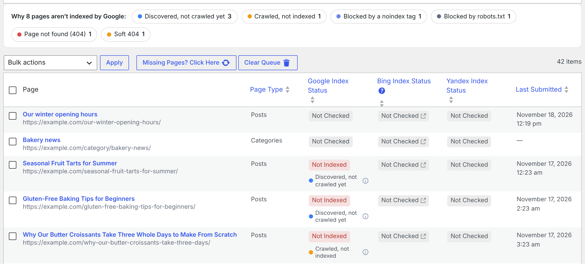
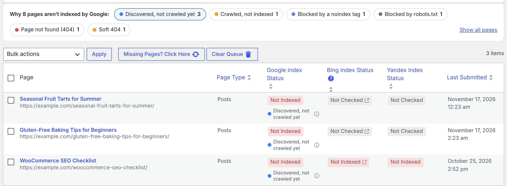
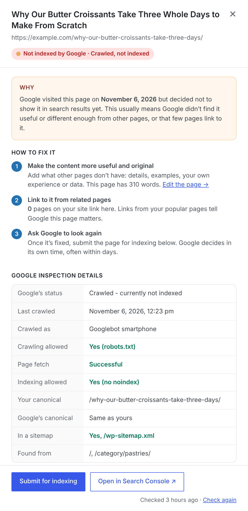
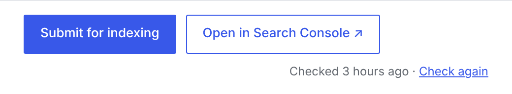

# Finding out why Google hasn't indexed a page

A page that Google hasn't indexed can't appear in Google search at all. Google gives a reason for each one, but you normally have to dig through Search Console to find it.

CrawlWP shows that reason on the **SEO Indexing** screen, next to each page Google hasn't indexed. Click it to see what the reason means, the steps to fix it, and the details of Google's last check.

**Note:** This feature needs CrawlWP Premium.

**Before you start:** CrawlWP needs to be connected to Google Search Console, and SEO Indexing needs to be set up so it checks your pages with Google. See [connecting CrawlWP to Google Search Console and Bing](https://crawlwp.com/article/connect-google-search-console-and-bing/), [integrating WordPress with Google Search](https://crawlwp.com/article/integrating-wordpress-with-google-search/) and [setting up search engine indexing](https://crawlwp.com/article/setting-up-search-engine-indexing-for-wordpress/).

In this article:

- [Seeing which pages aren't indexed, and why](#seeing-which-pages-arent-indexed-and-why)
- [Showing only pages with one reason](#showing-only-pages-with-one-reason)
- [Opening the details for a page](#opening-the-details-for-a-page)
- [What each reason means](#what-each-reason-means)
- [Who can see it](#who-can-see-it)
- [Troubleshooting](#troubleshooting)

## Seeing which pages aren't indexed, and why

1. Go to **CrawlWP » SEO Indexing**.
2. Stay on the **All Records** tab.

Above the table, a summary reads **Why … pages aren’t indexed by Google:** followed by one coloured button per reason, with the number of pages. Hover over a button for a short hint, for example **Usually content quality**.

In the **Google Index Status** column, each page marked **Not Indexed** has its reason under the badge, with a matching coloured dot.

The summary only appears when at least one page has the status **Not Indexed**. Pages marked **Likely Not Indexed** don't show a reason or open the panel.

**Note:** Pages that CrawlWP checked before you updated to this version get their reason filled in a batch at a time, each time you open SEO Indexing. On a big site the counts can take a few visits to catch up.

## Showing only pages with one reason

1. In the summary above the table, click a reason, for example **Discovered, not crawled yet**.

The table shows only the pages with that reason. Choosing a reason clears any other filter or search you had on the table.

2. To see every page again, click **Show all pages** at the end of the summary.

## Opening the details for a page

1. On the **All Records** tab, find a page marked **Not Indexed**.
2. Click the badge or the reason under it (it says **Why isn’t this page indexed?** when you hover).

A panel opens on the right with:

- the page's title and address;
- **Not indexed by Google** and the reason;
- **Why**: what the reason means for this page, for example the date Google last visited it;
- **How to fix it**: numbered steps, with links such as **Edit the page →** and, where it fits, **Exclude this page**;
- **Google inspection details**: what Google found on its last check.

At the bottom of the panel are:

- **Submit for indexing**: asks Google to index the page again. This button doesn't appear for pages blocked by noindex or robots.txt, pages that redirect, or alternate pages, because submitting them does nothing until that changes.
- **Open in Search Console**: opens Google's own report for the page.
- **Checked … ago** and **Check again**: when CrawlWP last asked Google about the page, and a link to ask again now.

Close the panel with the **×** button, by clicking outside it, or with the Escape key.

### Google inspection details

These lines come from Google's last check of the page. Some only appear when Google provided them.

| Line | What it tells you |
|---|---|
| **Google’s status** | Google's own wording for the page's state. |
| **Last crawled** | When Google last visited, or **Not crawled yet**. |
| **Crawled as** | **Googlebot smartphone** or **Googlebot desktop**. |
| **Crawling allowed** | **Yes (robots.txt)**, or **No: blocked by robots.txt**. |
| **Page fetch** | **Successful**, or what went wrong, such as **Not found (404)** or **Server error (5xx)**. |
| **Indexing allowed** | **Yes (no noindex)**, or what blocks it, such as **No: noindex in the robots meta tag**. |
| **Your canonical** | The address your page tells Google is the main version. |
| **Google’s canonical** | The address Google chose as the main version, or **Same as yours**. |
| **In a sitemap** | **Yes,** and the sitemap, or **Not found in one**. |
| **Found from** | Up to five pages where Google found links to this page. |

## What each reason means

The reason comes from the status Google gives the page. Here is what each one means and the advice the panel gives.

| Reason | Hint | What it means | What the panel suggests |
|---|---|---|---|
| **Crawled, not indexed** | Usually content quality | Google visited the page but decided not to show it in search results yet. This usually means Google didn't find it useful or different enough from other pages, or that few pages link to it. | Make the content more useful and original (the panel shows the word count). Link to it from related pages (the panel shows how many pages already link to it). Then submit it again. |
| **Discovered, not crawled yet** | Google hasn’t crawled it yet | Google knows the page exists but hasn't visited it. That's normal for new pages. On bigger sites it can also mean Google is short of time for your site, for example because the server is slow or there are many low-value URLs. | Link to it from pages Google visits often, such as your home page and popular posts. Make sure it's in your sitemap. Then submit it again. |
| **Not known to Google** | Google hasn’t found it | No links or sitemaps Google has read point to the page. | Link to it from other pages. Make sure it's in your sitemap. Then submit it again. |
| **Duplicate: Google chose another URL** | Canonical issue | Google thinks the page is a copy of another page and shows that page instead. The panel names the page Google chose. | If the other page is the right one, there's nothing to fix: redirect this page to it or exclude it. If this page should show in search, make it clearly different and set its canonical URL to itself in the SEO box (**SEO → Advanced** on the page). |
| **Alternate page with canonical tag** | Usually fine | The page tells Google another URL is the main version, and Google follows that. This is usually intended, for example for filtered or paginated versions of a page. | If that's intended, exclude it so it stops counting as a problem. If this page should show in search, change its canonical URL to itself. |
| **Blocked by a noindex tag** | A setting on the page | The page tells search engines not to show it. That's usually right for login, account, cart and thank-you pages. | If it should stay hidden, exclude it. If it should be in search, set it to **Index** under **SEO → Advanced → Robots** on the page. If another SEO plugin set the noindex, the panel names that plugin. Then update the page so CrawlWP submits it again. |
| **Blocked by robots.txt** | Your robots.txt | Your robots.txt file tells Google not to visit the page. | If it should stay hidden, exclude it. If not, remove the Disallow rule that matches it. The panel links to your robots.txt and to the CrawlWP setting where you edit it. Then update the page. |
| **Page not found (404)** | Page removed or moved | When Google last visited, the address returned "page not found". If it works now, it was probably moved, or published after Google's visit. | Open the page to check it loads. If it moved, add a 301 redirect from the old address under **Redirects**. Then submit it again. |
| **Soft 404** | Page looks empty to Google | The page loads, but Google thinks it looks like an error or empty page, for example very little content or a "nothing found" message. | Add real content, or delete the page or redirect it to a related page. Then submit it again. |
| **Page redirects** | Usually fine | The address redirects to another one, so Google indexes the destination instead. That's expected after moving a page. | If the redirect is intended, exclude it and update links on your site to point straight to the new address. If it shouldn't redirect, remove the redirect under **Redirects** or in the page's **SEO → Advanced** settings. |
| **Redirect error** | Loop or long chain | Google couldn't follow the redirect: it loops, goes through too many steps, or ends at an address that doesn't work. | Make the redirect go straight to a working page in one step under **Redirects**. Also check redirects set by your host or other plugins. Then submit it again. |
| **Server error (5xx)** | Your server or host | Your server returned an error when Google visited. This can be a temporary outage, a slow or overloaded server, or a plugin error. | Check the page loads now. If errors keep happening, ask your host to check the server error logs, and check that security or caching plugins don't block Googlebot. Then submit it again. |
| **Blocked: access denied (401/403)** | Login or firewall | Your server refused Google access. Usually a login, password protection or a firewall is blocking Googlebot. | Remove password protection if the page should be public, and allow Googlebot in your security plugin, firewall or CDN. Then submit it again. |
| **Other reason** | See Search Console | Google gave a status not listed above. The panel shows Google's own wording instead of "Other reason". | See the full report in Search Console, which explains each status and lets you test the live page. Then submit it again. |

**Tip:** **Exclude this page** sets the page to **Indexing Excluded**, the same as the table's **Exclude from indexing** bulk action. Use it for pages that are meant to stay out of Google, so they stop counting as a problem. You can bring a page back with **Include in indexing**.

After you fix a page and submit it, Google decides in its own time, often within days. The reason stays until CrawlWP's next check with Google, or until you click **Check again**.

To redirect a page, see [creating a redirect rule](https://crawlwp.com/article/creating-redirect-rule-wordpress/). To change robots.txt, see [editing robots.txt](https://crawlwp.com/article/editing-robots-txt/).

## Who can see it

Anyone who can open **CrawlWP » SEO Indexing** can see the reasons and open the panel. Administrators always can.

To let another role use SEO Indexing:

1. Go to **CrawlWP » Settings** and click **Role Manager** in the list of sections on the left.
2. Tick **SEO Indexing** for that role.
3. Save your changes.

Users with that role can now open SEO Indexing, see why pages aren't indexed, and use the panel's buttons. See [choosing which roles can use CrawlWP](https://crawlwp.com/article/roles-and-permissions/).

## Troubleshooting

**The panel says "There is no not-indexed result to explain for this page."**
CrawlWP has no saved result from Google for this page that explains it. Click **Check again** (or use the **Check Google Index Status** bulk action) to update it.

**The panel says "This page is no longer in the SEO Indexing table."**
The page was removed from the table since you loaded the screen, for example because it was deleted or set to noindex. Reload the page.

**The panel says "Could not load the details. Please reload the page and try again."**
The request to your site failed. Reload SEO Indexing and open the panel again.

**The panel says "You are not allowed to do this."**
Your role doesn't have the **SEO Indexing** permission in Role Manager. Ask an administrator.

**I don't see the summary above the table.**
It only shows on the **All Records** tab, and only when at least one page has the status **Not Indexed**. If CrawlWP isn't connected to Google Search Console, pages aren't checked with Google, so there's nothing to show.

## Related articles

- [Setting up search engine indexing for WordPress](https://crawlwp.com/article/setting-up-search-engine-indexing-for-wordpress/)
- [Connecting CrawlWP to Google Search Console and Bing](https://crawlwp.com/article/connect-google-search-console-and-bing/)
- [Integrating WordPress with Google Search](https://crawlwp.com/article/integrating-wordpress-with-google-search/)
- [Choosing which roles can use CrawlWP](https://crawlwp.com/article/roles-and-permissions/)
- [What each Site Audit issue means](https://crawlwp.com/article/site-audit-issues/)
