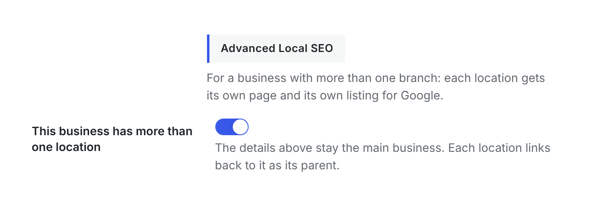
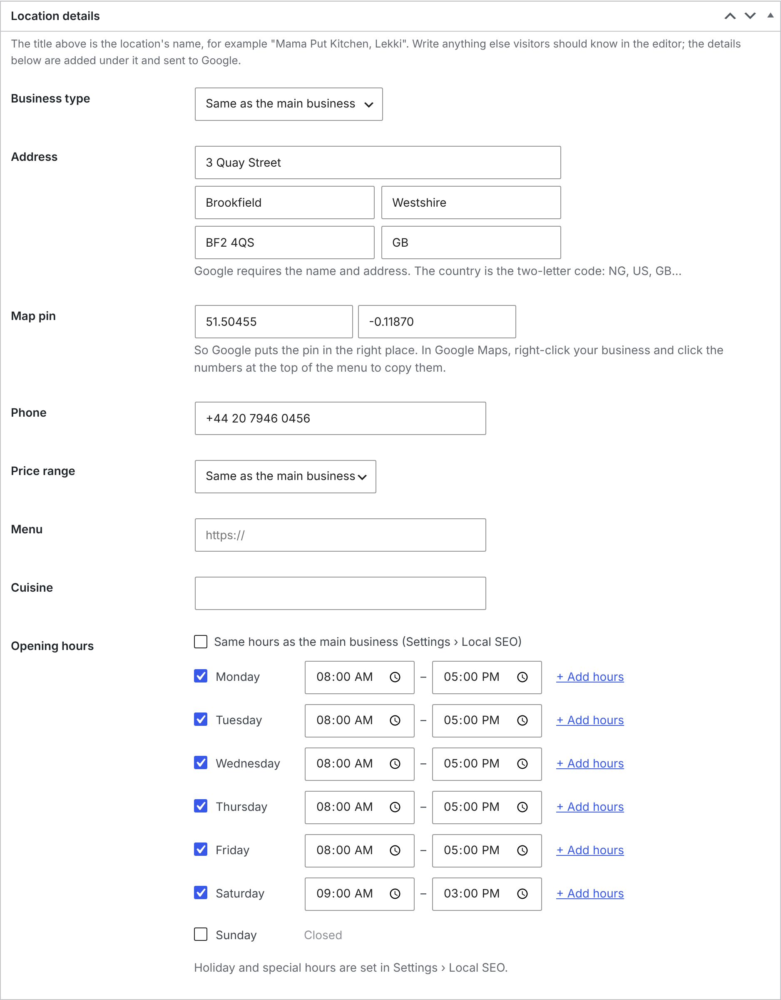
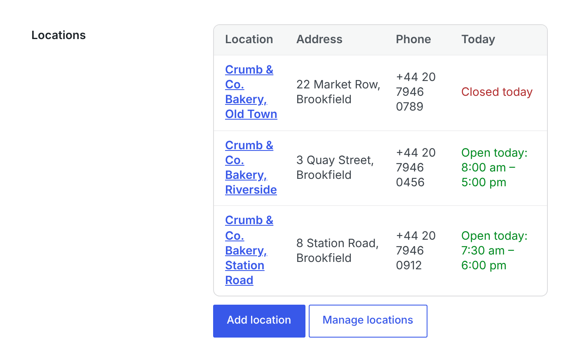
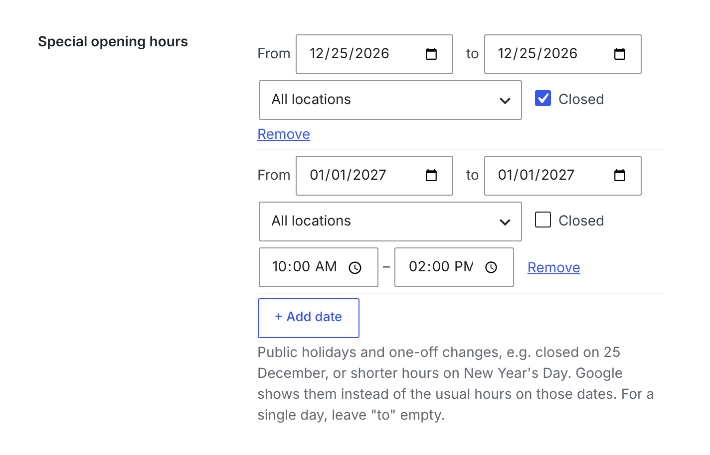

# Managing multiple business locations

When your business has more than one branch, each branch needs its own address, phone number and opening hours in Google. With Advanced Local SEO, every location gets its own page on your site and its own listing for Google, linked back to your main business.

You can also set special opening hours for public holidays and one-off changes, so Google shows the right hours on those dates.

**Note:** This feature needs CrawlWP Premium.

**Before you start:** Set up your main business first. Its details stay the main business, and every location links back to it. See [Setting up Local SEO](https://crawlwp.com/article/setting-up-local-seo/).

In this article:

- [How to turn on multiple locations](#how-to-turn-on-multiple-locations)
- [How to add a location](#how-to-add-a-location)
- [Seeing all your locations](#seeing-all-your-locations)
- [Changing the location page address](#changing-the-location-page-address)
- [How to add holiday and special opening hours](#how-to-add-holiday-and-special-opening-hours)
- [How "Open today" and "Closed today" are decided](#how-open-today-and-closed-today-are-decided)
- [What each location sends to Google](#what-each-location-sends-to-google)
- [Frequently asked questions](#frequently-asked-questions)
- [Related articles](#related-articles)

## How to turn on multiple locations

1. Go to **CrawlWP » Settings** and click **Local SEO** in the list of sections on the left.
2. Find **Advanced Local SEO**, below **Show it on your site**.
3. Turn on **This business has more than one location**.
4. Click **Save Changes**.

After you save, a **Locations** list appears in the same section, and **Locations** is added to the **CrawlWP** menu. CrawlWP updates your site's permalinks by itself, so the new location pages work straight away.

## How to add a location

1. Go to **CrawlWP » Settings**, click **Local SEO** in the list of sections on the left, then click **Add location**. You can also go to **CrawlWP » Locations** and add one there.
2. Type the location's name as the title, for example "Mama Put Kitchen, Lekki".
3. In the editor, write anything else visitors should know about this branch.
4. In the **Location details** box, fill in the **Address**, **Map pin** and **Phone**.
5. Set the **Opening hours**, or tick **Same hours as the main business (Settings › Local SEO)**.
6. Optionally, add a featured image of the branch.
7. Click **Publish**.

The location details are added under the page content, and sent to Google.

### Fields in the Location details box

| Field | What it does |
|---|---|
| **Business type** | Leave on **Same as the main business**, or pick a different type for this branch. |
| **Address** | Street address, city, state or region, postal code, and the two-letter country code. |
| **Map pin** | Latitude and longitude, so Google puts the pin in the right place. |
| **Phone** | The branch's phone number. |
| **Price range** | Leave on **Same as the main business**, or choose another. |
| **Menu** and **Cuisine** | Shown for food business types only. Left empty, they use the main business's values. |
| **Opening hours** | The branch's weekly hours, with up to two time ranges a day. Or tick **Same hours as the main business (Settings › Local SEO)**. |

Opening hours work the same way as for the main business: tick each open day, and use **+ Add hours** for a break.

**Note:** Location pages use the same permissions as WordPress pages. Anyone who can edit pages, such as Editors, can add and edit locations.

## Seeing all your locations

With multiple locations on, the **Locations** list in the **Local SEO** section of **CrawlWP » Settings** shows every location with its **Location**, **Address**, **Phone** and **Today** status. Drafts and other unpublished locations are marked with their status.

- Click a location's name to edit it.
- Click **Add location** to add another.
- Click **Manage locations** to open the full list in **CrawlWP » Locations**.

If you have no locations yet, the list says **No locations yet.**

## Changing the location page address

By default, location pages live under `/locations/`, for example `example.com/locations/lekki/`. The last part comes from each location's slug.

To use a different word:

1. Go to **CrawlWP » Settings**, click **Local SEO** in the list of sections on the left, and find **Location page address**.
2. Type the new word, for example `branches`.
3. Click **Save Changes**.

The description under the field shows where your location pages are now. CrawlWP updates your permalinks for you after the change.

**Note:** Changing this changes the address of every location page. Any links to the old addresses stop working unless you redirect them.

## How to add holiday and special opening hours

Special opening hours replace your usual hours on the dates you choose. Google shows them instead of your weekly hours on those dates.

1. Go to **CrawlWP » Settings**, click **Local SEO** in the list of sections on the left, and find **Special opening hours**.
2. Click **+ Add date**.
3. Choose the **From** date. For a single day, leave **to** empty. For several days, choose the last date in **to**.
4. Choose which locations it applies to: **All locations**, **Main business only**, or one location by name.
5. Leave **Closed** ticked if you are closed. To open with different hours, untick **Closed** and enter the opening and closing times.
6. Repeat for each holiday or change.
7. Click **Save Changes**.

After you save, a single day shows the same date in both **From** and **to**.

To delete a row, click **Remove** next to it, then save.

Each special date has one time range. Once its last date has passed, a row is no longer sent to Google and drops off the list.

## How "Open today" and "Closed today" are decided

The **Today** column in the Locations list, the shortcode and each location page show **Open today: …** or **Closed today**. CrawlWP works this out as follows:

1. It uses today's date in your site's time zone (set in **Settings » General** in WordPress).
2. If a special opening hours row covers today and applies to that location, it wins. A row with **Closed** ticked shows **Closed today**. Otherwise, the row's hours are shown.
3. If no special row covers today, CrawlWP uses the weekly hours for today's day of the week. An unticked day shows **Closed today**.

A location with no opening hours set shows nothing for today.

## What each location sends to Google

Each published location page gets its own LocalBusiness entry in its structured data (code that tells Google about the page). It includes:

- the location's name (its title), business type, address, map pin, phone, price range, and menu and cuisine for food types;
- its weekly opening hours, plus any upcoming special opening hours;
- the location page's address;
- the featured image, if the location has one;
- a link to its parent: your main business, or, if Local SEO is off for the main business, your site's organisation. If Local SEO is off and your site is set up as a person, the location has no parent.

The main business keeps its own entry on the rest of your site, as described in [Setting up Local SEO](https://crawlwp.com/article/setting-up-local-seo/). Special hours set for **All locations** or **Main business only** are added to it too.

To show a location's details anywhere else on your site, use the shortcode with the location's slug or ID:

`[crawlwp_local_business location="lekki"]`

Location pages are public pages, and they are added to your sitemap like your other content. See [Understanding CrawlWP sitemaps](https://crawlwp.com/article/understanding-crawlwp-sitemaps/).

## Frequently asked questions

**The Locations list and menu don't appear.**
Turn on **This business has more than one location** and click **Save Changes**. The list and the **CrawlWP » Locations** menu only appear after you save.

**The shortcode with location="…" shows nothing.**
Check that the slug or ID is right and that the location is published. A location that is a draft or password-protected is not shown. Multiple locations must also be switched on.

**A location page has no address or hours at the bottom.**
The details are not shown on a password-protected location until the visitor enters the password, and they are not sent to Google at all for that location.

**What happens to my locations if I switch multiple locations off?**
The location pages and the Locations menu are no longer available, but your locations are kept. Switch it back on to bring them back.

## Related articles

- [Setting up Local SEO](https://crawlwp.com/article/setting-up-local-seo/)
- [Setting up your site as an Organization or a Person](https://crawlwp.com/article/setting-up-organization-vs-person/)
- [Understanding CrawlWP sitemaps](https://crawlwp.com/article/understanding-crawlwp-sitemaps/)
