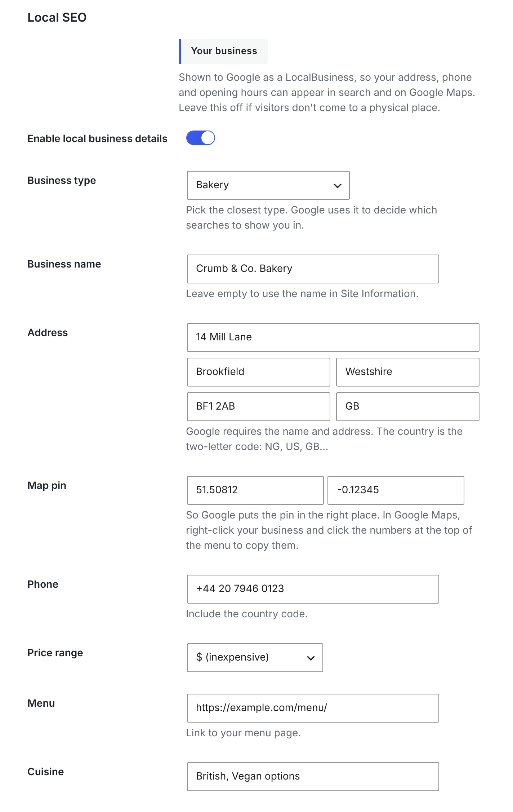
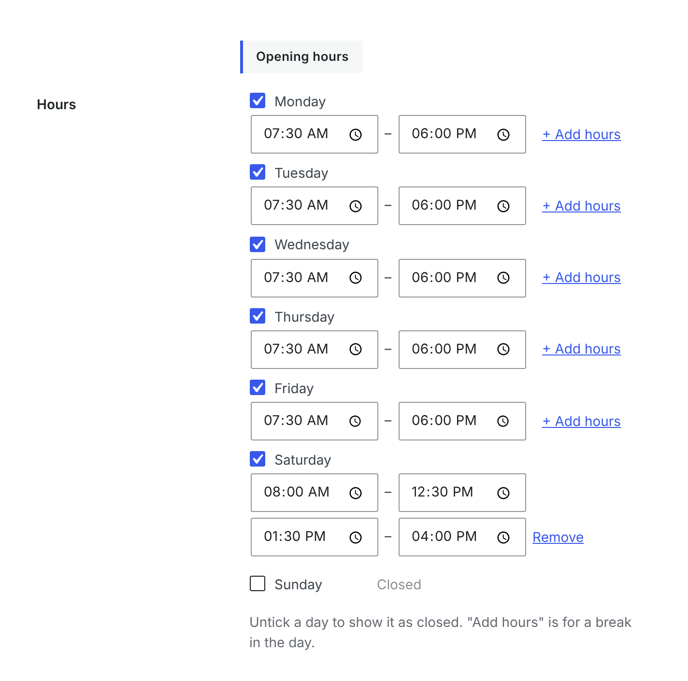
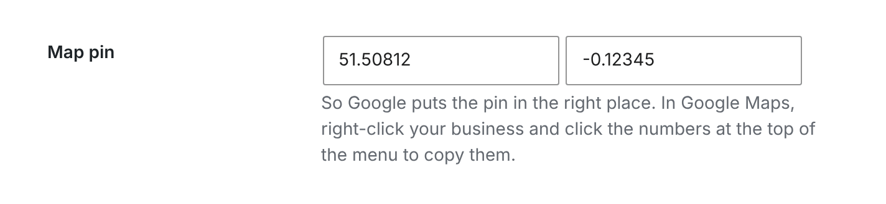
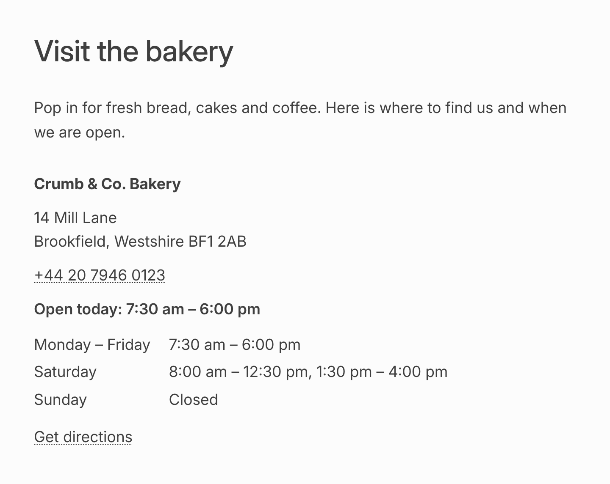

# Setting up Local SEO

If customers visit you at a shop, office or restaurant, you want Google to show your address, phone number and opening hours. CrawlWP's Local SEO settings send those details to Google as LocalBusiness schema (code that tells Google what your business is and where to find it).

You can also show the same details on your site, for example on a contact page or in the footer, with one shortcode. When your hours change, you update them in one place.

**Note:** One business location is free. To add more branches, each with its own page, and holiday opening hours, see [Managing multiple business locations](https://crawlwp.com/article/managing-multiple-locations/), which needs CrawlWP Premium.

In this article:

- [How to add your business details](#how-to-add-your-business-details)
- [How to set your opening hours](#how-to-set-your-opening-hours)
- [How to add a map pin](#how-to-add-a-map-pin)
- [Showing your details on your site](#showing-your-details-on-your-site)
- [What CrawlWP sends to Google](#what-crawlwp-sends-to-google)
- [If you set up local details before this update](#if-you-set-up-local-details-before-this-update)
- [Frequently asked questions](#frequently-asked-questions)
- [Related articles](#related-articles)

## How to add your business details

1. Go to **CrawlWP » Settings** and click **Local SEO** in the list of sections on the left.
2. Under **Your business**, turn on **Enable local business details**.
3. Choose your **Business type**. Pick the closest one; Google uses it to decide which searches to show you in. If nothing fits, choose **Local business (general)**.
4. Type your **Business name**. Leave it empty to use the name in **Site Information**.
5. Fill in the **Address**: **Street address**, **City**, **State / region**, **Postal code** and the country.
6. In the country box, type the two-letter country code, for example `NG`, `US` or `GB`.
7. Type your **Phone** number, including the country code.
8. Choose a **Price range**, or leave it on **Not shown**.
9. Click **Save Changes**.

Google requires the name and the address, so fill in both.

If you choose a food business type, such as **Restaurant**, **Café or coffee shop**, **Bakery** or **Bar or pub**, two more fields appear:

- **Menu**: a link to your menu page.
- **Cuisine**: for example, Nigerian, Italian or Vegan.

These two fields are only sent to Google for food businesses.

### Price range options

| Option | Meaning |
|---|---|
| **Not shown** | No price range is sent to Google. This is the default. |
| **$ (inexpensive)** | Low prices. |
| **$$ (moderate)** | Mid-range prices. |
| **$$$ (expensive)** | High prices. |
| **$$$$ (very expensive)** | Premium prices. |

## How to set your opening hours

Opening hours are set day by day under **Opening hours**. Every day starts unticked, so nothing is sent to Google until you set your hours.

1. In the **Local SEO** section, find **Opening hours**.
2. Tick each day you are open. The day fills in with 9:00 to 17:00.
3. Change the opening and closing times for that day.
4. To add a lunch break, click **+ Add hours** and enter the second time range. For example, 09:00–13:00 and 14:00–17:00.
5. Leave a day unticked to show it as **Closed**.
6. Click **Save Changes**.

Each day can have up to two time ranges. To remove the second one, click **Remove** next to it.

**Tip:** Open all day? Set the opening and closing time to 00:00. CrawlWP saves that as open 24 hours, and visitors see **Open 24 hours**.

## How to add a map pin

A map pin tells Google exactly where your door is, so it shows you in the right place on Google Maps.

1. Open Google Maps and find your business.
2. Right-click your business and click the numbers at the top of the menu. This copies the latitude and longitude.
3. In the **Local SEO** section, find **Map pin**.
4. Paste the first number into **Latitude** and the second into **Longitude**.
5. Click **Save Changes**.

CrawlWP only sends the pin when both numbers are filled in and valid.

## Showing your details on your site

Add the `[crawlwp_local_business]` shortcode anywhere you want your business details to appear, such as a contact page or a footer widget. In the block editor, add it with the Shortcode block.

By default the shortcode shows:

- your business name;
- your address;
- your phone number, as a link visitors can tap to call;
- a line saying **Open today: …** or **Closed today**, then your weekly hours, with days that share the same hours grouped together;
- a **Get directions** link that opens Google Maps.

The **Get directions** link uses your map pin, or your address when there is no pin. "Open today" and "Closed today" follow your site's time zone, set in **Settings » General** in WordPress.

### Shortcode attributes

| Attribute | What it does | Example |
|---|---|---|
| `show` | Choose which parts to show, separated by commas: `name`, `address`, `phone`, `hours`, `directions`. Leave it out to show all five. | `[crawlwp_local_business show="address,phone"]` |
| `location` | Show one of your other locations instead of the main business, by its slug or ID. Needs CrawlWP Premium with multiple locations turned on. | `[crawlwp_local_business location="lekki"]` |

The shortcode shows nothing while **Enable local business details** is off.

## What CrawlWP sends to Google

When **Enable local business details** is on, CrawlWP adds a LocalBusiness entry to the structured data on every public page of your site. Pages set to noindex get no structured data at all.

| Your setting | What Google receives |
|---|---|
| **Business type** | The business type, for example `Bakery` or `Dentist`. |
| **Business name** | The name. If empty, the name from Site Information, or else your site title. |
| **Address** | The postal address. Empty parts are left out. |
| **Map pin** | The coordinates, when both latitude and longitude are set. |
| **Phone** | The phone number. |
| **Price range** | The price range, unless set to **Not shown**. |
| **Menu** and **Cuisine** | Sent for food business types only. |
| **Opening hours** | Your hours for each day, with breaks. |

The business is also linked to the rest of your site's details:

- If your site represents an organisation, the business is marked as part of that organisation.
- If you have a logo in **Site Information**, the business uses it as its image.

To choose whether your site is an organisation or a person, see [Setting up your site as an Organization or a Person](https://crawlwp.com/article/setting-up-organization-vs-person/).

**Tip:** To check what Google reads, test your homepage in Google's [Rich Results Test](https://search.google.com/test/rich-results).

## If you set up local details before this update

Local business details used to be part of **Site Information**. They now have their own **Local SEO** section.

- CrawlWP copies your old business type, address, phone and on/off setting into **Local SEO** for you.
- Hours you typed as text in the old format are turned into the new day-by-day hours where CrawlWP can read them.
- If CrawlWP can't read your old hours, it shows this note under the hours: **Your hours were saved as text before: …. Please enter them again above.** Your old hours are still sent to Google until you enter them in the new editor and save.

## Frequently asked questions

**Should I turn on Local SEO for an online-only business?**
No. Leave it off if visitors don't come to a physical place. LocalBusiness details are for places customers can visit.

**I ticked a day but didn't change the times. What does Google see?**
The day is sent with the times shown, 9:00 to 17:00 by default. Check each ticked day before you save.

**My business has more than one branch. What should I do?**
Enter your main branch here. With CrawlWP Premium you can add the others as separate locations, each with its own page and schema. See [Managing multiple business locations](https://crawlwp.com/article/managing-multiple-locations/).

**The Menu and Cuisine fields have disappeared.**
They only show for food business types. Choose a type such as **Restaurant** or **Café or coffee shop** to see them.

## Related articles

- [Setting up your site as an Organization or a Person](https://crawlwp.com/article/setting-up-organization-vs-person/)
- [Managing multiple business locations](https://crawlwp.com/article/managing-multiple-locations/)
- [Adding rich results to a post](https://crawlwp.com/article/adding-rich-results/)
