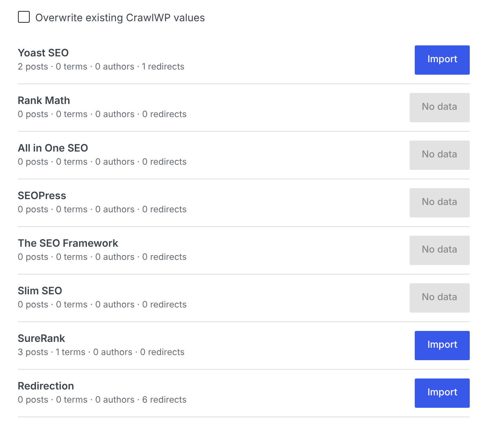
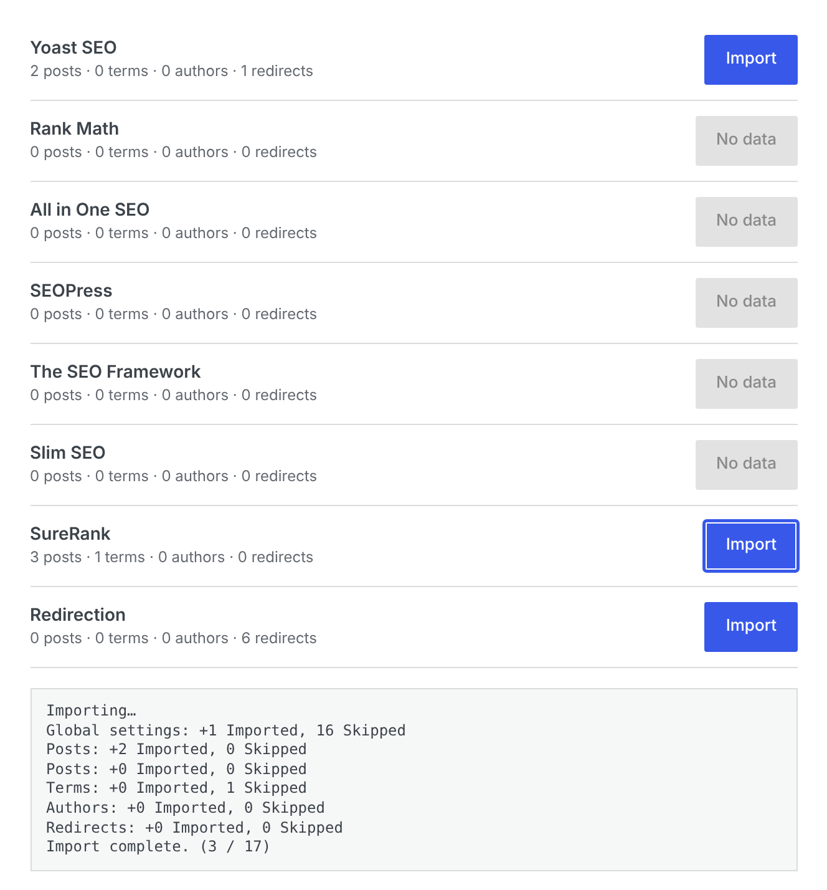
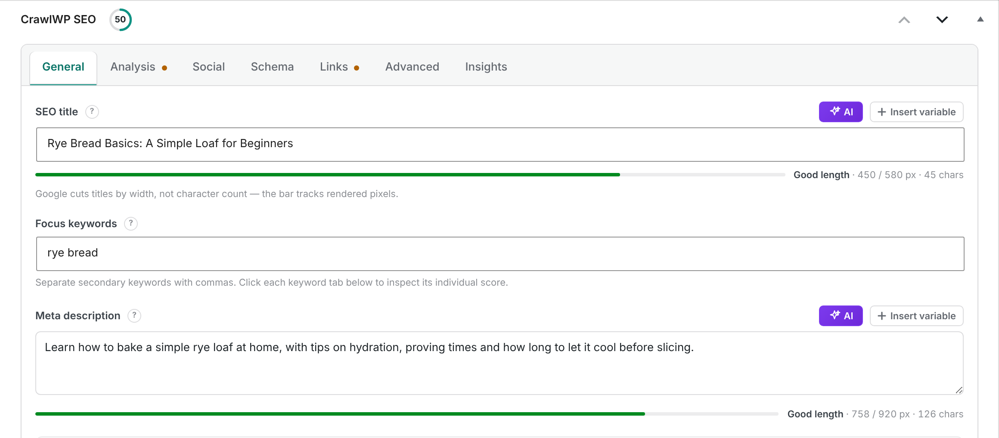

# Importing your SEO data from SureRank

Switching from SureRank to CrawlWP doesn't mean typing your SEO titles and descriptions again. CrawlWP's importer copies your SureRank data across in a few clicks, post by post, and keeps anything you've already set in CrawlWP.

This article shows you how to run the import, what comes across, and what you'll need to check afterwards.

**Before you start:**

- Sign in as an administrator. Only administrators can run imports.
- SureRank doesn't need to be active. CrawlWP finds its data in the database even when the plugin is deactivated.
- Back up your site first. The import writes to your posts, terms and settings, and there's no undo button.

In this article:

- [How to import from SureRank](#how-to-import-from-surerank)
- [What gets imported](#what-gets-imported)
- [What doesn't get imported](#what-doesnt-get-imported)
- [Keeping or overwriting your CrawlWP values](#keeping-or-overwriting-your-crawlwp-values)
- [After the import](#after-the-import)
- [Troubleshooting](#troubleshooting)

## How to import from SureRank

1. In your WordPress dashboard, go to **CrawlWP » Settings** and click **Import SEO Data** in the list of sections on the left.
2. Find the **SureRank** row. It shows how many posts and terms (categories, tags and so on) have SureRank data.

3. To replace values you've already set in CrawlWP, tick **Overwrite existing CrawlWP values**. Leave it unticked to keep them. See [Keeping or overwriting your CrawlWP values](#keeping-or-overwriting-your-crawlwp-values).
4. Click **Import** in the SureRank row.
5. Confirm the "Start importing SEO data from this plugin?" message.

CrawlWP imports in small batches and shows its progress below the list, one line per batch, starting with the name of the stage: **Global settings**, **Posts**, **Terms**, **Authors** and **Redirects**. Each line says how many items were imported and skipped, so a stage can appear more than once. When it's done, you see "Import complete." with the totals imported and skipped in brackets.

Keep the page open until "Import complete." appears. If you close it early, run the import again; values already copied are kept.

**Tip:** Prefer a guided walkthrough? Click **Launch Setup Wizard →** at the top of the section. When SureRank is active, the wizard's **Import SEO Data** step offers **Import from SureRank**, and can deactivate SureRank for you afterwards. In the wizard, **Overwrite any existing CrawlWP values with imported data** is ticked by default, so untick it if you want to keep values you've already set in CrawlWP.

## What gets imported

**For each post, page and term:**

| From SureRank | Into CrawlWP |
|---|---|
| Page title | SEO title |
| Page description | Meta description |
| Canonical URL | Canonical URL |
| Focus keyword | Focus keyword |
| Facebook title, description and image | Social (Open Graph) title, description and image |
| X (Twitter) title, description and image | X title, description and image, only when SureRank's "use the Facebook values for X" option is off for that post |
| X card type | X card type, when it differs from SureRank's site-wide card type |
| Noindex, nofollow and noarchive settings | Index or noindex, follow or nofollow, and noarchive |

Posts with these statuses are included: published, draft, pending, scheduled and private. Terms come from your public taxonomies.

SureRank fills empty title and description fields with its templates when you save a post. CrawlWP spots those copies and doesn't import them, so your posts keep using CrawlWP's templates unless you'd written your own text.

When a post or term has any of its own robots settings in SureRank, both its index and follow settings are copied. A page you kept indexable inside a noindexed post type stays indexable in CrawlWP.

**Site-wide settings:**

| From SureRank | Into CrawlWP |
|---|---|
| Title separator | **Title separator** |
| Home page title and description | Homepage title and meta description |
| Home page noindex and nofollow | Homepage noindex and nofollow |
| Page title and description templates | The title and description template of every post type, unless you'd left SureRank's defaults |
| Noindex and nofollow lists | Noindex and nofollow for the post types, taxonomies and author, date and search archives SureRank switched them on for |
| Fallback image | **Social Image Fallback** (in the **Social Networks** section) |
| X username | **Author Fallback X Profile** (with an @ added) |
| X card type | **Default Twitter Card Type** |
| Site type, name, logo and social profiles from SureRank's setup | **Site Information**: **This website represents a…** (Person or Organization), site name, logo, Facebook and X profiles, and **Additional Profile URLs** for the rest |

A SureRank site type of blog or personal becomes a Person in CrawlWP. Any other type becomes an Organization. See [setting up Organization vs Person](https://crawlwp.com/article/setting-up-organization-vs-person/).

SureRank's variables, such as `%title%`, `%site_name%` and `%term_title%`, are changed into CrawlWP's matching variables. See [title and meta description template variables](https://crawlwp.com/article/title-and-meta-description-template-variables/).

## What doesn't get imported

- **Redirects.** SureRank has no redirects to import. If you used the Redirection plugin, see [importing redirects from Redirection](https://crawlwp.com/article/importing-redirects-from-redirection/).
- **Author SEO settings.** The **Authors** stage always shows 0 for SureRank.
- **Title and description templates for taxonomies.** Only the noindex and nofollow choices for taxonomies come across.
- **Robots settings SureRank didn't switch on.** For post types, taxonomies and archives, the import only turns noindex or nofollow on. It never turns them off, so CrawlWP's own defaults stay in place (for example, search result pages stay noindex). The homepage is the exception: when SureRank has any homepage robots setting, both the homepage noindex and nofollow are copied, on or off.
- **Social images that aren't in your Media Library.** CrawlWP stores a post's social image as a Media Library item. An image address it can't match to one is left out.
- **Variables CrawlWP doesn't know.** They're left exactly as typed, so you can spot and replace them.

For every plugin CrawlWP can import from, see [what gets imported and what doesn't](https://crawlwp.com/article/what-gets-imported-and-what-doesnt/).

## Keeping or overwriting your CrawlWP values

The **Overwrite existing CrawlWP values** box decides what happens when CrawlWP already has a value.

- **Unticked (the default):** CrawlWP keeps its own values and fills only empty fields. This works field by field, so a post with a CrawlWP title can still get its description from SureRank.
- **Ticked:** SureRank's values replace CrawlWP's.

A post counts as **Skipped** when it had SureRank data but nothing was written, because CrawlWP already had every value.

**Note:** Even with overwrite ticked, a noindex you set in CrawlWP for a post type, taxonomy or archive isn't switched off. SureRank's lists can only switch noindex on. The homepage robots settings are the exception (see above).

## After the import

1. Open a few posts and check the SEO box: the title, description and robots settings should match what you had in SureRank.
2. Check your site-wide settings under **CrawlWP » Settings**, especially the separator, homepage title and site information.
3. Deactivate SureRank. Running two SEO plugins at once outputs duplicate meta tags and confuses search engines.

## Troubleshooting

**The SureRank button says "No data".**
CrawlWP found no SureRank settings or post data in your database. If you deleted SureRank with its data, there's nothing left to import.

**I see "Import failed. Please try again."**
A batch didn't finish, often because the server timed out. Click **Import** again. Values already imported are kept, and with overwrite unticked nothing is copied twice.

**Some posts kept CrawlWP's default title instead of the SureRank one.**
That post's SureRank title was a copy of a SureRank template, not text you wrote. CrawlWP skips those on purpose, and its own title template does the same job.

**My titles show text like `%some_variable%`.**
That SureRank variable has no CrawlWP equivalent, so it was left as typed. Replace it with a CrawlWP variable or plain text.

## Related articles

- [What gets imported and what doesn't](https://crawlwp.com/article/what-gets-imported-and-what-doesnt/)
- [Title and meta description template variables](https://crawlwp.com/article/title-and-meta-description-template-variables/)
- [Setting up Organization vs Person](https://crawlwp.com/article/setting-up-organization-vs-person/)
- [Importing redirects from the Redirection plugin](https://crawlwp.com/article/importing-redirects-from-redirection/)
