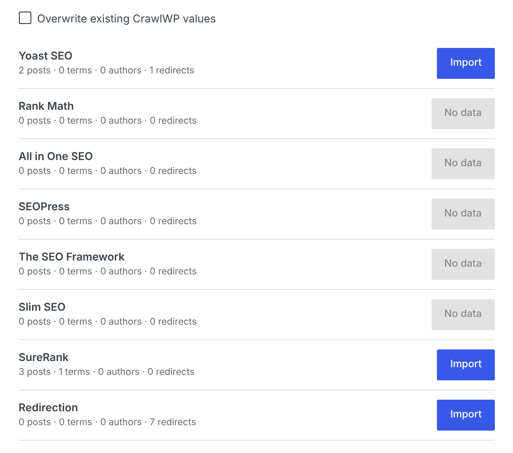
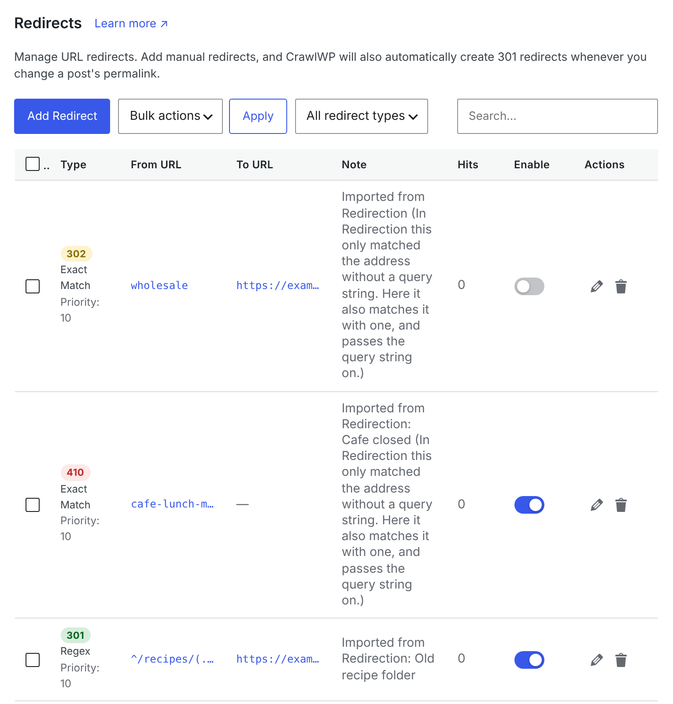

# Importing redirects from the Redirection plugin

If you've built up redirects in the Redirection plugin, you can move them into CrawlWP and manage everything in one place. The importer copies each rule across with its status code, regex setting and on/off state, and labels it so you can tell where it came from.

Not every Redirection rule has a CrawlWP equivalent. This article shows you what comes across, what changes, and what to check before you switch Redirection off.

**Before you start:**

- Sign in as an administrator. Only administrators can run imports.
- Redirection doesn't need to be active. CrawlWP reads its rules from the database even when the plugin is deactivated.
- Back up your site first. There's no undo for an import.

In this article:

- [How to import your redirects](#how-to-import-your-redirects)
- [Which rules are imported](#which-rules-are-imported)
- [How status codes carry over](#how-status-codes-carry-over)
- [How query strings are handled](#how-query-strings-are-handled)
- [Groups and disabled rules](#groups-and-disabled-rules)
- [The note added to each rule](#the-note-added-to-each-rule)
- [Regex rules with accented letters or spaces](#regex-rules-with-accented-letters-or-spaces)
- [After the import](#after-the-import)
- [Troubleshooting](#troubleshooting)

## How to import your redirects

1. In your WordPress dashboard, go to **CrawlWP » Settings** and click **Import SEO Data** in the list of sections on the left.
2. Find the **Redirection** row, at the end of the list. It shows how many redirects Redirection holds.

3. Click **Import** in the Redirection row.
4. Confirm the "Start importing SEO data from this plugin?" message.

CrawlWP copies the rules in small batches. The progress log under the list ends with a **Redirects** line showing how many rules were imported and skipped, then "Import complete." with the totals.

Your imported rules appear in the **Redirects** section of **CrawlWP » Settings** (click **Redirects** in the list of sections on the left), alongside any rules you created in CrawlWP. See [creating a redirect rule](https://crawlwp.com/article/creating-redirect-rule-wordpress/).

**Note:** The **Overwrite existing CrawlWP values** box has no effect on redirects. A Redirection rule whose source address already has a rule in CrawlWP is always skipped, so your CrawlWP rule stays as it is.

## Which rules are imported

CrawlWP imports plain address redirects: when someone visits address A, send them to address B (or tell them the page is gone).

| Redirection rule | What happens |
|---|---|
| Matched on the URL alone | Imported. A normal rule becomes an **Exact Match** rule, and a regex rule becomes a **Regex** rule. |
| Matched on something besides the URL, such as login status, referrer, browser or cookies | Skipped. CrawlWP has no equivalent. |
| Action: redirect to a URL | Imported. |
| Action: error page with code 410 or 451 | Imported as a **410 Content Deleted** or **451 Content Unavailable for Legal Reasons** rule with no destination. |
| Any other action (random post, pass-through, do nothing, other error codes) | Skipped. |
| Source or destination left empty | Skipped. |
| Source address already used by a CrawlWP rule | Skipped. |
| A rule CrawlWP can't accept, such as a regex that is invalid or too complex | Skipped. |

A rule that points to another website keeps working after the import: it gets **Allow redirecting to an external site** switched on. This only happens when the destination names a fixed website. If the website part is built from the visitor's address (for example with `$1`), the rule stays limited to your own site.

Hit counts and Redirection's logs stay in Redirection. The **Hits** column starts again from zero.

## How status codes carry over

CrawlWP's **Type** list has 301, 302, 307, 410 and 451, so a few of Redirection's codes are changed to the nearest match.

| Redirection code | CrawlWP **Type** |
|---|---|
| 301 | **301 Moved Permanently** |
| 302 | **302 Found (Temporary)** |
| 303 | **302 Found (Temporary)** |
| 304 | **302 Found (Temporary)** |
| 307 | **307 Temporary Redirect** |
| 308 | **301 Moved Permanently** (browsers and Google treat both as permanent) |
| 410 (error) | **410 Content Deleted** |
| 451 (error) | **451 Content Unavailable for Legal Reasons** |

## How query strings are handled

A query string is the part of an address after a `?`, for example `?utm_source=newsletter`. Redirection decides what to do with it using each rule's query parameter setting, or the site-wide default when a rule doesn't have its own. CrawlWP uses the rule's **Ignore query string parameters** setting.

| In Redirection | In CrawlWP |
|---|---|
| Exact (Redirection's default): the rule only matched the address with no query string | **Ignore query string parameters** off. The rule now also matches the address with a query string, and passes the query string on to the destination. A note on the rule says so. |
| Ignore: matched with any query string, and dropped it | **Ignore query string parameters** on. Same behaviour. |
| Ignore and pass: matched with any query string, and passed it on to the destination | **Ignore query string parameters** off. Same behaviour. |
| A source address with its own query string, such as `/old/?ref=a` | Compared in full. With Redirection's ignore or pass setting, extra parameters (`/old/?ref=a&utm=1`) no longer match. A note on the rule says so. |
| Regex rules | Matched against the whole address, query string included, as in Redirection. The query setting doesn't apply. |

## Groups and disabled rules

Redirection keeps rules in groups. CrawlWP doesn't have groups, so it looks at each rule's group while importing:

- **Disabled rules** are imported switched off. Their **Enable** toggle is off, so they don't run until you turn them on.
- **Rules in a disabled group** are imported switched off too.
- **Rules in Apache or Nginx groups** are skipped. Redirection writes those to your server's configuration files, so WordPress never ran them.
- **Rules left in a deleted group** are skipped. Redirection never ran them either.

Imported rules get CrawlWP's default **Priority**. They're added in the order they were created in Redirection.

## The note added to each rule

Every imported rule gets a **Note**, so you can find it later:

- "Imported from Redirection" when the rule had no title in Redirection.
- "Imported from Redirection: " followed by the rule's title when it had one.

When the rule now matches differently, one of these is added to the note:

- "(In Redirection this only matched the address without a query string. Here it also matches it with one, and passes the query string on.)"
- "(In Redirection this also matched the address with extra query parameters. Here the query string must be exactly the one in the rule.)"

**Tip:** Search the **Redirects** list for "In Redirection" to find every rule that behaves differently, and check each one.

## Regex rules with accented letters or spaces

**Note:** A regex rule written with real accented letters or spaces doesn't match after the import. For example, `^/café/(.*)` or `^/my page/(.*)` won't redirect anything.

That's because CrawlWP compares regex rules with the address exactly as the browser sends it. Browsers send `é` as `%C3%A9` and a space as `%20`.

To fix a rule like this, edit it and write those characters in their encoded form: `^/caf%C3%A9/(.*)` instead of `^/café/(.*)`, or `^/my%20page/(.*)` instead of `^/my page/(.*)`. Rules with plain letters, numbers and symbols aren't affected.

## After the import

1. Go to **CrawlWP » Settings** and click **Redirects** in the list of sections on the left.
2. Check rules whose note mentions "In Redirection", and any regex rules with accented letters or spaces.
3. Test a few old addresses in your browser to make sure they redirect.
4. Compare the number imported and skipped with your Redirection rules, so you know which ones need recreating by hand.
5. Deactivate Redirection once you're happy. If you rely on rules CrawlWP skipped (for example, login-based rules), keep Redirection active or recreate them another way.

## Troubleshooting

**The Redirection button says "No data".**
CrawlWP found no Redirection table in your database. If you deleted Redirection with its data, there's nothing to import.

**Fewer rules were imported than Redirection shows.**
The count in the row includes every Redirection rule. Rules with no CrawlWP equivalent, rules in Apache, Nginx or deleted groups, and rules whose source already exists in CrawlWP are skipped. See [Which rules are imported](#which-rules-are-imported).

**I see "Import failed. Please try again."**
A batch didn't finish, often because the server timed out. Click **Import** again. Rules already imported are skipped, so nothing is added twice.

**Running the import a second time added nothing.**
That's expected. Every rule whose source address is already in CrawlWP is skipped.

## Related articles

- [Creating a redirect rule in WordPress](https://crawlwp.com/article/creating-redirect-rule-wordpress/)
- [What gets imported and what doesn't](https://crawlwp.com/article/what-gets-imported-and-what-doesnt/)
- [Using the 404 Monitor](https://crawlwp.com/article/using-the-404-monitor/)
- [Importing your SEO data from SureRank](https://crawlwp.com/article/importing-from-surerank/)
