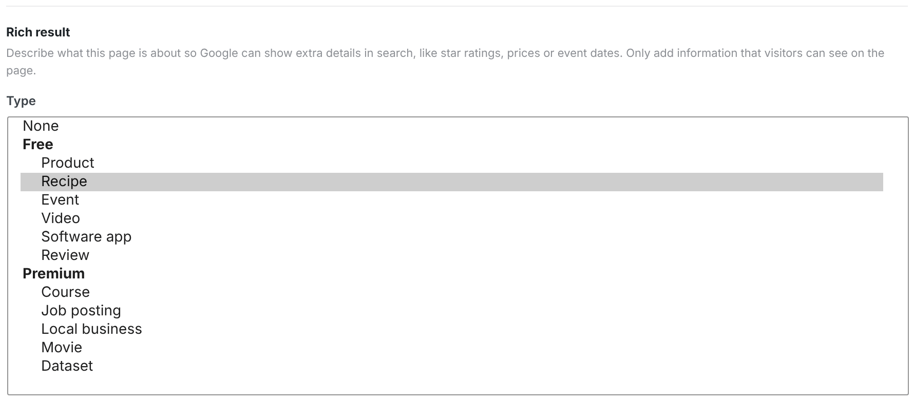
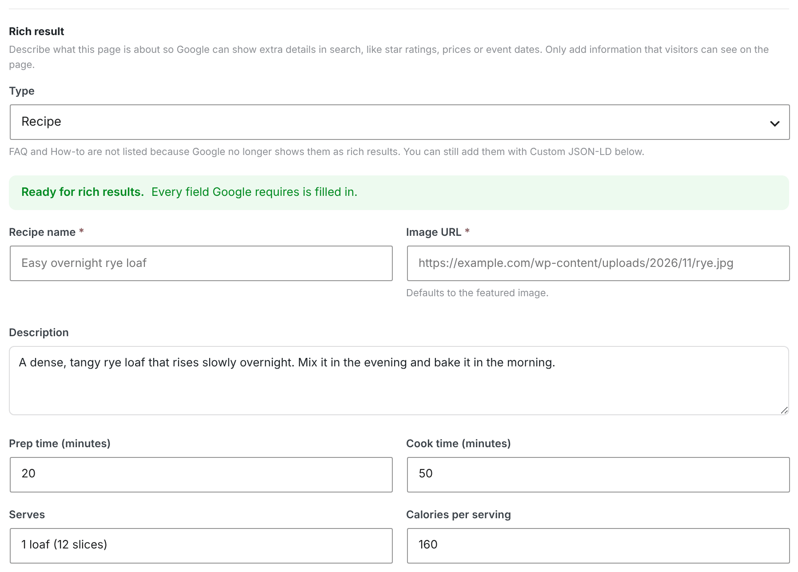
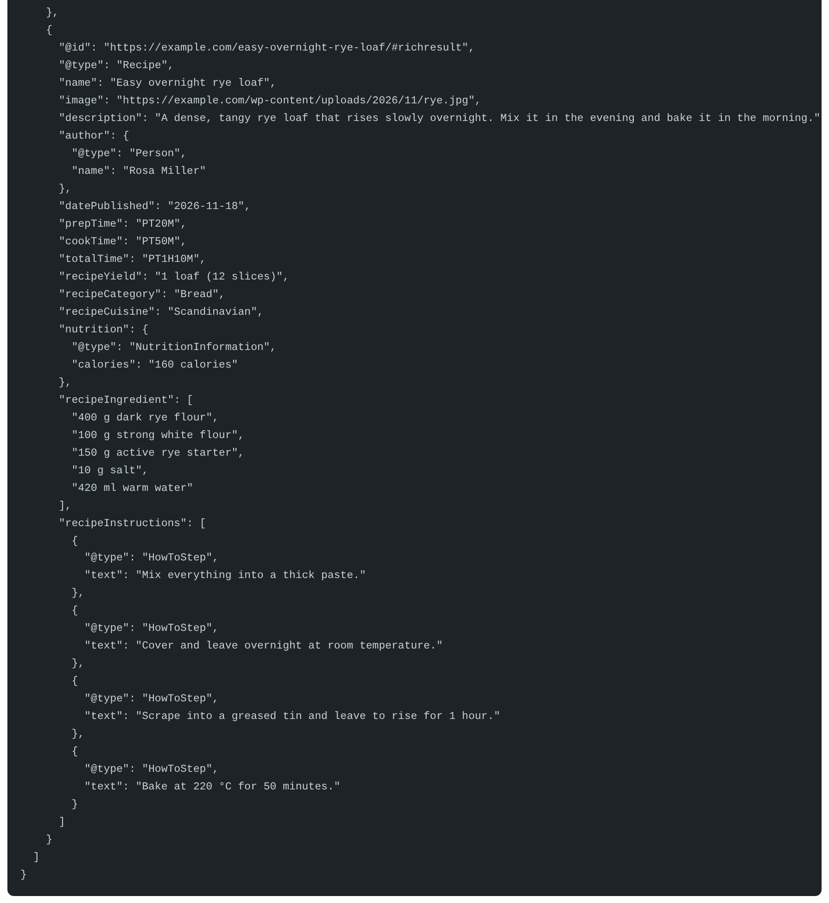

# Adding rich results to a post

Rich results are the extras Google can show under a search result, such as star ratings, prices, cooking times or event dates. They make your result stand out and tell searchers more before they click.

To be eligible, a page needs schema (code that tells Google what the page is about). In the **Schema** tab of the CrawlWP SEO box, you pick what the page describes and fill in a short form. CrawlWP writes the code for you and shows which fields Google requires.

**Note:** Product, Recipe, Event, Video, Software app and Review are free. Course, Job posting, Local business, Movie and Dataset need CrawlWP Premium.

In this article:

- [How to add a rich result](#how-to-add-a-rich-result)
- [Free and Premium types](#free-and-premium-types)
- [Fields for each type](#fields-for-each-type)
- [Checking the preview](#checking-the-preview)
- [Testing with Google's Rich Results Test](#testing-with-googles-rich-results-test)
- [Values that aren't saved](#values-that-arent-saved)
- [When no rich result is output](#when-no-rich-result-is-output)
- [Frequently asked questions](#frequently-asked-questions)
- [Related articles](#related-articles)

## How to add a rich result

1. Open the post or page in the WordPress editor.
2. In the **CrawlWP SEO** box, click the **Schema** tab.
3. Scroll to the **Rich result** section.
4. Choose what the page is about in the **Type** list. Types are grouped under **Free** and **Premium**.

5. Fill in the fields. Fields marked with a red **\*** are **Required by Google**.
6. Check the status box above the fields. When it says **Ready for rich results.**, every field Google requires is filled in.

7. Save or update the post.

CrawlWP adds the rich result to the page's structured data as soon as the post is saved. Google picks it up the next time it crawls the page.

Some fields are filled in for you when you leave them empty. Their default shows inside the empty field. For example, the name fields use the post title, and image fields use the featured image.

**Note:** Google only shows rich results for information visitors can see on the page. If you add a price or rating here, make sure it's on the page too.

You can choose one rich result type per post. If you switch type, what you typed for the first type is kept until you leave the page, but only the type selected when you save is stored.

## Free and Premium types

| Type | Plan | Use it for |
|---|---|---|
| Product | Free | A product you sell without WooCommerce. WooCommerce products get Product data automatically, so this type isn't offered on them. |
| Recipe | Free | A page with one recipe. |
| Event | Free | An event in person, online or both. |
| Video | Free | A page whose main content is a video. |
| Software app | Free | An app, plugin or other software. |
| Review | Free | A page reviewing one thing. Google ignores reviews a business writes about itself. |
| Course | Premium | Courses for Google's course carousel. Google needs at least three courses marked up, and a page that lists them. |
| Job posting | Premium | A job opening, for Google's job search. |
| Local business | Premium | A page about one branch or location. Your main business details are set in **Site Information**. |
| Movie | Premium | A film, for Google's movie carousel. Google builds it from a page that lists several movies, each with its own page. |
| Dataset | Premium | Data you publish. It's shown in Google Dataset Search, not in regular search results. |

Without Premium, choosing a Premium type shows "[Type] is a Premium type", a short description and an **Upgrade to Premium** button. If Premium is active but too old for rich results, the button reads **Update CrawlWP Premium to use it**.

**Note:** FAQ and How-to aren't listed, because Google no longer shows them as rich results. You can still add them with **Custom JSON-LD** in the same tab.

## Fields for each type

A field marked "Yes, if…" becomes required only in that situation. The red **\*** appears next to it when it does.

### Product

| Field | Required | Notes |
|---|---|---|
| **Product name** | Yes | Defaults to the post title. |
| **Description** | — | Defaults to the meta description. |
| **Image URL** | — | Defaults to the featured image. |
| **Brand** | — | |
| **SKU** | — | |
| **Price** | See below | 0 or more. |
| **Currency** | Yes, if the price isn't 0 | Three-letter code, e.g. USD, EUR, NGN. |
| **Availability** | — | **In stock**, **Out of stock**, **Pre-order**, **Back order** or **Discontinued**. |
| **Average rating** | See below | Out of 5. Only use real ratings shown on this page. |
| **Number of ratings** | See below | 1 or more. |

Google needs a price or a rating: either **Price**, or both **Average rating** and **Number of ratings**. Until then, the status box lists "A price or a rating".

### Recipe

| Field | Required | Notes |
|---|---|---|
| **Recipe name** | Yes | Defaults to the post title. |
| **Image URL** | Yes | Defaults to the featured image. |
| **Description** | — | Defaults to the meta description. |
| **Prep time (minutes)** | — | Whole minutes. |
| **Cook time (minutes)** | — | Whole minutes. CrawlWP adds both together for the total time. |
| **Serves** | — | For example, "4 servings". |
| **Calories per serving** | — | 0 or more. |
| **Category** | — | For example, Dinner or Dessert. |
| **Cuisine** | — | For example, Nigerian or Italian. |
| **Ingredients** | — | One per line. |
| **Steps** | — | One step per line. |
| **Average rating** | — | Out of 5. |
| **Number of ratings** | — | 1 or more. |

The post author and publish date are added automatically.

### Event

| Field | Required | Notes |
|---|---|---|
| **Event name** | Yes | Defaults to the post title. |
| **Status** | — | **Scheduled** (default), **Cancelled**, **Postponed**, **Rescheduled** or **Moved online**. |
| **Starts** | Yes | Date and time, in your site's time zone. |
| **Ends** | — | Date and time. |
| **Attendance** | — | **In person** (default), **Online**, or **In person and online**. |
| **Venue name** | Yes, if in person or both | |
| **Venue address** | Yes, if in person or both | Street, city, postcode, country. |
| **Online event link** | Yes, if online or both | |
| **Description** | — | Defaults to the meta description. |
| **Image URL** | — | Defaults to the featured image. |
| **Organiser** | — | Defaults to your organisation in Site Information. |
| **Performer or speaker** | — | |
| **Price** (Tickets) | — | 0 for a free event. |
| **Currency** (Tickets) | Yes, if the price isn't 0 | Three-letter code. |
| **Ticket link** (Tickets) | — | If empty, the post's address is used. |
| **Tickets on sale from** (Tickets) | — | Date and time. |

### Video

| Field | Required | Notes |
|---|---|---|
| **Video title** | Yes | Defaults to the post title. |
| **Description** | — | Defaults to the meta description. |
| **Thumbnail URL** | Yes | Defaults to the featured image. |
| **Upload date** | Yes | Defaults to the post date. |
| **Length** | — | Minutes and seconds (12:30), or hours:minutes:seconds. |
| **Video file link** | See below | The URL of the video file itself, e.g. .mp4. |
| **Embed link** | See below | The player URL, e.g. a YouTube embed link. |

Google needs a video file link or an embed link. Until you add one, the status box lists "A video file link or an embed link".

### Software app

| Field | Required | Notes |
|---|---|---|
| **App name** | Yes | Defaults to the post title. |
| **Category** | — | **Business**, **Developer tools**, **Design**, **Education**, **Finance**, **Game**, **Health**, **Lifestyle**, **Multimedia**, **Security**, **Utilities** or **Web app**. |
| **Operating system** | — | For example, Windows, macOS, Android, WordPress. |
| **Price** | Yes | 0 if it is free. |
| **Currency** | Yes, if the price isn't 0 | Three-letter code. |
| **Average rating** | Yes | Out of 5. Google needs a rating for app results. |
| **Number of ratings** | Yes | 1 or more. |

### Review

| Field | Required | Notes |
|---|---|---|
| **What is reviewed** | Yes | **Product**, **Book**, **Course**, **Event**, **Game**, **Local business**, **Movie**, **Recipe**, **Software app**, **TV season** or **Music recording**. |
| **Name of what is reviewed** | Yes | |
| **Your rating** | Yes | Out of 5. |
| **Reviewer** | Yes | Defaults to the post author. |
| **Summary** | — | Defaults to the meta description. |

### Course (Premium)

| Field | Required | Notes |
|---|---|---|
| **Course name** | Yes | Defaults to the post title. |
| **Description** | Yes | Defaults to the meta description. Google shows about the first 60 characters. |
| **Provider** | — | Defaults to your organisation in Site Information. |
| **Format** | — | **Online**, **In person**, or **Online and in person**. |
| **Image URL** | — | Defaults to the featured image. |
| **Price** | — | 0 for a free course. |
| **Currency** | Yes, if the price isn't 0 | Three-letter code. |
| **Average rating** | — | Out of 5. |
| **Number of ratings** | — | 1 or more. |

### Job posting (Premium)

| Field | Required | Notes |
|---|---|---|
| **Job title** | Yes | Defaults to the post title. |
| **Job description** | Yes | Defaults to the meta description. Google expects the full description, including responsibilities and qualifications. |
| **Date posted** | Yes | Defaults to the post date. |
| **Closing date** | — | |
| **Employment type** | — | **Full time**, **Part time**, **Contractor**, **Temporary**, **Internship**, **Volunteer**, **Per day** or **Other**. |
| **Company** | Yes | Defaults to your organisation in Site Information. |
| **Company website** | — | Defaults to your home page. |
| **Company logo URL** | — | |
| **Where the work happens** (Location) | — | **At a workplace** (default), **At a workplace, partly remote**, or **Fully remote**. |
| **Street address** (Location) | — | |
| **City** (Location) | Yes, unless fully remote | |
| **State or region** (Location) | — | |
| **Postcode** (Location) | — | |
| **Country** (Location) | Yes | Two-letter country code, e.g. NG, US, GB. For fully remote jobs, this is where applicants must live. |
| **Minimum** (Salary) | — | The salary, or the bottom of the range. |
| **Maximum** (Salary) | — | Leave empty for a fixed salary. |
| **Currency** (Salary) | Yes, if the minimum isn't 0 | Three-letter code. |
| **Per** (Salary) | — | **Year** (default), **Hour**, **Day**, **Week** or **Month**. |

**Tip:** Remove the job posting when the job is filled, or set a **Closing date**.

### Local business (Premium)

| Field | Required | Notes |
|---|---|---|
| **Business type** | — | **Local business (general)** (default), or a more specific type such as **Restaurant**, **Café**, **Shop** or **Dentist**. |
| **Business name** | Yes | Defaults to the post title. |
| **Phone** | — | |
| **Price range** | — | For example, $$. |
| **Image URL** | — | Defaults to the featured image. |
| **Opening hours** | — | One line per set of days, e.g. Mo-Fr 09:00-17:00. |
| **Street address** (Address) | Yes | |
| **City** (Address) | Yes | |
| **State or region** (Address) | — | |
| **Postcode** (Address) | — | |
| **Country** (Address) | Yes | Two-letter country code. |
| **Latitude** (Address) | — | From -90 to 90. |
| **Longitude** (Address) | — | From -180 to 180. |

### Movie (Premium)

| Field | Required | Notes |
|---|---|---|
| **Movie title** | Yes | Defaults to the post title. |
| **Poster URL** | Yes | Defaults to the featured image. |
| **Release date** | — | |
| **Director** | — | |
| **Average rating** | — | Out of 5. |
| **Number of ratings** | — | 1 or more. |

### Dataset (Premium)

| Field | Required | Notes |
|---|---|---|
| **Dataset name** | Yes | Defaults to the post title. |
| **Description** | Yes | Defaults to the meta description. Between 50 and 5,000 characters. |
| **Creator** | — | Defaults to your organisation in Site Information. |
| **Licence URL** | — | For example, a Creative Commons licence link. |
| **Keywords** | — | Separate with commas. |
| **Download link** (Download) | — | |
| **File format** (Download) | — | For example, text/csv. |

## Checking the preview

The status box at the top of the form tells you whether the rich result will be output:

- **Ready for rich results.** Every field Google requires is filled in.
- **Not output yet. Google needs:** followed by the fields still missing.

CrawlWP doesn't output a rich result with required fields missing, because Google would reject it.

To see the code itself:

1. Scroll to the **Output** section at the bottom of the **Schema** tab.
2. Click **Show JSON-LD**.

The preview includes your rich result, built from the values you typed, even before you save. If a required field is missing, a line under the preview says, for example, "The Recipe rich result isn't output until this is filled in: Image URL."

**Note:** The preview is approximate. Site-wide parts of your structured data, such as the website and publisher, aren't shown.

## Testing with Google's Rich Results Test

Google's own [Rich Results Test](https://search.google.com/test/rich-results) tells you whether a page can show rich results.

1. Update the post, so the live page has your changes.
2. In the **Rich result** section, click **Test this page in Google's Rich Results Test ↗** under the fields.
3. Google's tool opens in a new tab with the post's address filled in. Run the test.
<!-- SCREENSHOT (needs live site): Google Rich Results Test showing a valid Recipe item for the post's address -->

The test fetches the published page, so drafts, private posts and password-protected posts can't be tested this way.

**Tip:** Passing the test means the page is eligible. Google still decides whether to show a rich result.

## Values that aren't saved

To keep your structured data valid, CrawlWP doesn't save values Google can't use. A note appears under the field as you type:

| Note under the field | When it appears |
|---|---|
| Not a number, so it won't be saved. | A number field holds text, such as "about 20". |
| Use a number from 1 to 5. This won't be saved. | A rating is outside 1 to 5. Other fields with a range show their own limits, such as -90 to 90 for **Latitude**. |
| Use 0 or more. This won't be saved. | A price or calorie count is below 0. **Number of ratings** asks for 1 or more. |
| Use a whole number of minutes. This won't be saved. | **Prep time (minutes)** or **Cook time (minutes)** isn't a whole number, such as "1.5" or "1 hour". |
| Not a web address (it should start with https://), so it won't be saved. | A link field contains spaces, or starts with a scheme other than http:// or https://, such as ftp:// or mailto:. |
| The date was incomplete, so it was cleared. | You left a date field with only part of a date typed, such as a day and month with no year. The field is emptied. |

A value that isn't saved counts as empty, so a required field with one of these notes still shows under **Not output yet. Google needs:**.

**Note:** **Currency** must be a three-letter code, and **Length** must look like 12:30 or 1:02:30. Anything else shows a note under the field (**Use a three-letter currency code such as USD, so it is saved.** or **Use minutes:seconds or hours:minutes:seconds, such as 12:30, so it is saved.**) and isn't saved. While the currency is invalid and the price is above 0, the status box lists **Currency** as missing.

## When no rich result is output

Even with every required field filled in, CrawlWP prints no rich result data when:

- the post is password-protected. Visitors only see a password form, so prices, dates, addresses and salaries stay out of the page source too;
- the post is set to noindex, or its **Page type** is **None — no structured data**. These pages get no structured data at all;
- the type is a Premium type and CrawlWP Premium isn't active. Your values are kept, and are output again once Premium is active.

## Frequently asked questions

**I don't see the Schema tab.**
Your role may not be allowed to use the advanced SEO fields. An administrator can change this, see [Choosing which roles can use CrawlWP](https://crawlwp.com/article/roles-and-permissions/).

**Why isn't Product in the Type list on my WooCommerce product?**
WooCommerce products already get Product data from CrawlWP, so the type isn't offered there.

**Can I add two rich result types to one post?**
No, you can choose one type per post. For anything else, use **Custom JSON-LD** in the same tab.

**The status says ready, but Google shows no stars.**
Google decides when to show rich results, and it can take time after it recrawls the page. Check the page with the Rich Results Test, and make sure the rating is visible on the page.

## Related articles

- [Author profiles, Person schema and the author box](https://crawlwp.com/article/author-profiles-and-author-box/)
- [Setting up Local SEO](https://crawlwp.com/article/setting-up-local-seo/)
- [Setting up Organization vs Person](https://crawlwp.com/article/setting-up-organization-vs-person/)
- [Choosing which roles can use CrawlWP](https://crawlwp.com/article/roles-and-permissions/)
