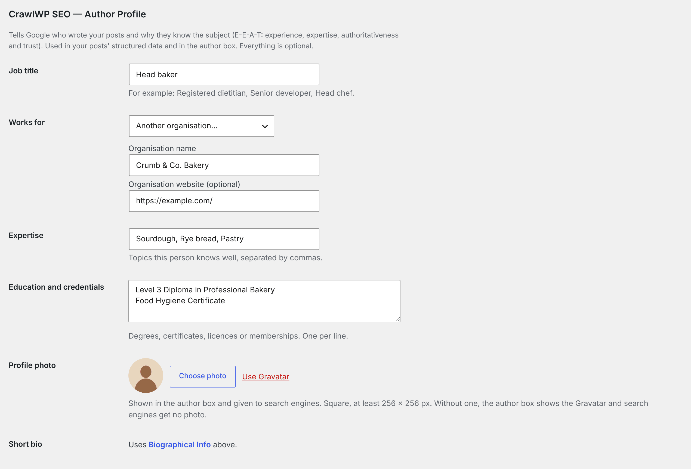
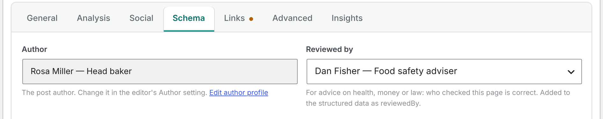
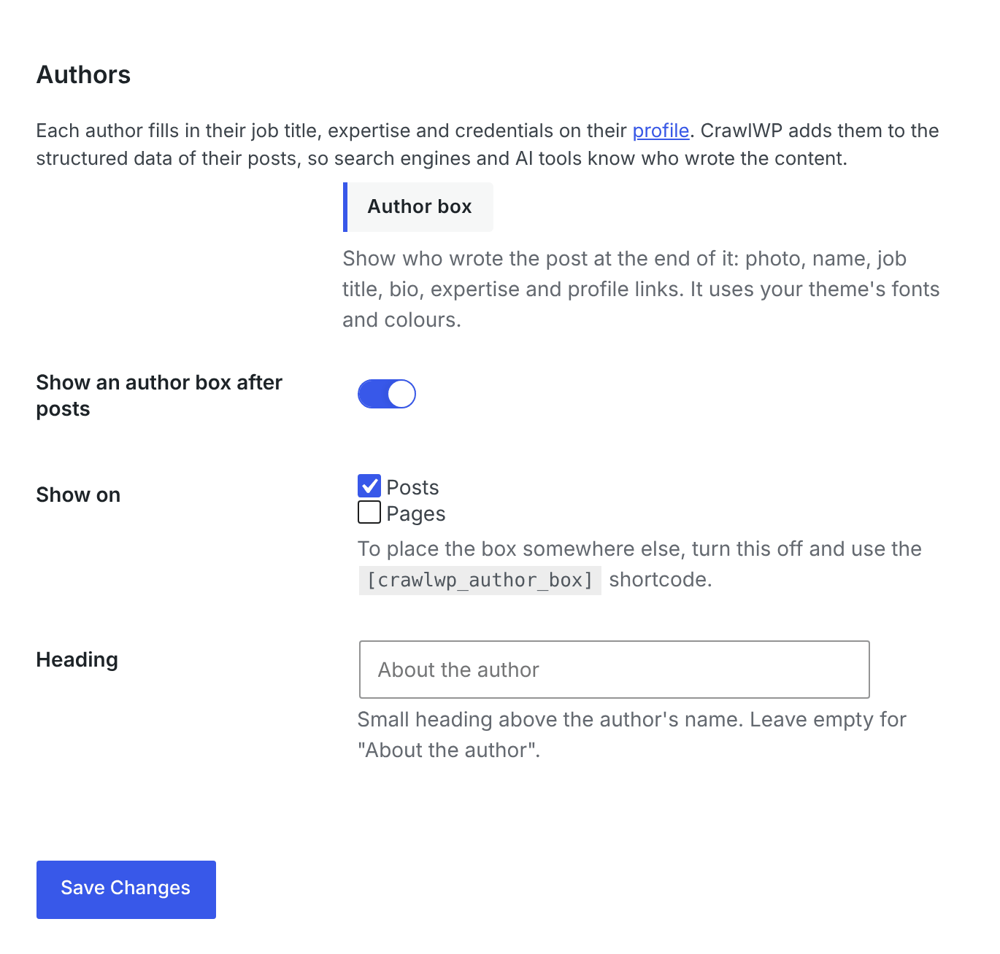
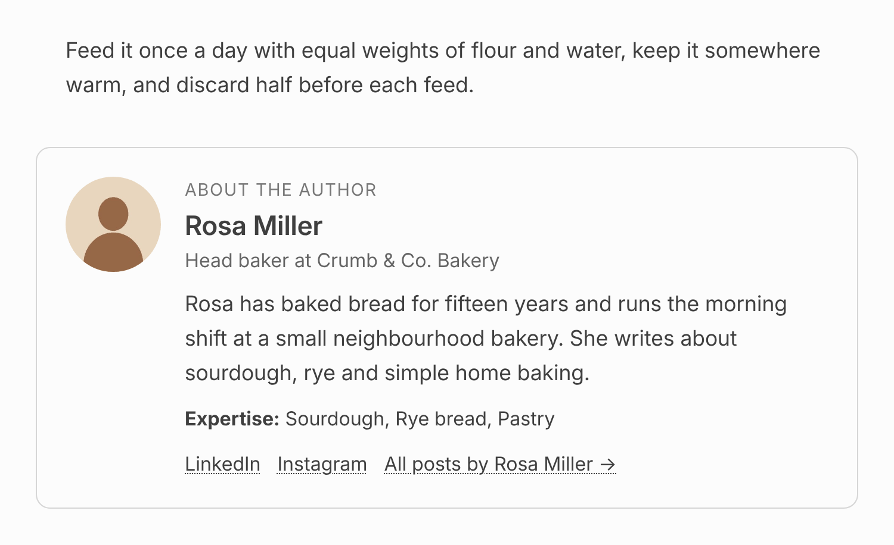

# Author profiles, Person schema and the author box

Google wants to know who wrote a page and why they know the subject. It calls this E-E-A-T: experience, expertise, authoritativeness and trust. It matters most for advice on health, money or the law.

CrawlWP lets each author describe themselves on their WordPress profile: job title, employer, expertise, credentials and photo. CrawlWP adds those details to the structured data (code that tells search engines what a page is about) of every post they write. You can also name who reviewed a post, and show an author box at the end of your posts.

**Before you start:** If your site represents a company, set it up as an organisation first, so authors can say they work for it. See [Setting up Organization vs Person](https://crawlwp.com/article/setting-up-organization-vs-person/).

In this article:

- [How to fill in an author profile](#how-to-fill-in-an-author-profile)
- [What goes into the Person schema](#what-goes-into-the-person-schema)
- [How to add a reviewer to a post](#how-to-add-a-reviewer-to-a-post)
- [How to show the author box](#how-to-show-the-author-box)
- [Placing the author box with a shortcode](#placing-the-author-box-with-a-shortcode)
- [Frequently asked questions](#frequently-asked-questions)
- [Related articles](#related-articles)

## How to fill in an author profile

Each author can fill in their own profile. Administrators can fill in anyone's.

1. Go to **Users » Profile** for your own profile, or **Users » All Users** and click a user's name.
2. Scroll to the **CrawlWP SEO — Author Profile** section.

3. Fill in the fields you want. Everything is optional.
4. Click **Update Profile** (or **Update User** when you edit someone else).

| Field | What to enter |
|---|---|
| **Job title** | For example: Registered dietitian, Senior developer, Head chef. |
| **Works for** | Your site's organisation, shown as "[name] (from Site Information)"; **Another organisation…**; or **Nobody (freelance or not relevant)**. |
| **Organisation name** and **Organisation website (optional)** | Appear when you choose **Another organisation…**. |
| **Expertise** | Topics this person knows well, separated by commas. |
| **Education and credentials** | Degrees, certificates, licences or memberships. One per line. |
| **Profile photo** | Click **Choose photo** and pick an image from the Media Library. Square, at least 256 × 256 px. **Use Gravatar** removes it. |
| **Short bio** | Uses WordPress's own **Biographical Info** field, higher up on the same screen. |

**Works for** is set to **Nobody (freelance or not relevant)** until the author changes it. The site's organisation is only offered when **Site Information** says the site represents an **Organization / Company**.

**Note:** The section only appears for users who can write posts, so Subscribers and shop customers don't see it. The **Choose photo** button only appears for users who can upload files. WordPress Contributors can't, so an administrator needs to choose their photo for them.

**Tip:** Add links to the author's other profiles (LinkedIn, a university page and so on) in **Additional Profile URLs**, in the **CrawlWP SEO — Social Profiles** section just below. They're used in the schema and the author box too.

## What goes into the Person schema

On each post, CrawlWP describes the author as a Person, with everything from their profile. This happens automatically, also on sites that updated from an earlier version. There's nothing to switch on.

| Where it comes from | Shared with search engines | Shown in the author box |
|---|---|---|
| The user's display name | Name | Yes |
| Their author page | Link to their author page, once they have a published post | Yes, as a link on the name and "All posts by [name] →" |
| **Profile photo** | Photo | Yes. Without one, the box shows the Gravatar. |
| **Biographical Info** | Description | Yes |
| **Job title** | Job title | Yes |
| **Works for** | Employer | Yes, as "[job title] at [organisation]", when a job title is filled in too |
| **Expertise** | Topics they know about | Yes, after "Expertise:" |
| **Education and credentials** | Credentials | No |
| **Facebook Page URL**, **X (Twitter) @handle** and **Additional Profile URLs** | Profile links | Yes, labelled with the site name, such as LinkedIn or GitHub |

A few things to know:

- Search engines only get a photo you chose with **Choose photo**. A Gravatar isn't shared, because its address is based on the person's email address.
- Only users who can write posts get a Person entry. Subscribers and customers don't.
- On an author's own archive page, the same Person details are added as the subject of the page, unless the archive is set to noindex.
- Pages without structured data get none of this: posts set to noindex, and posts whose **Page type** is **None — no structured data**.

## How to add a reviewer to a post

For advice on health, money or the law, you can say who checked the page is correct. CrawlWP adds that person to the page's structured data as its reviewer, with their full profile.

1. Open the post in the WordPress editor.
2. In the **CrawlWP SEO** box, click the **Schema** tab.
3. At the top, the **Author** field shows the post author. To change the author, use the editor's own Author setting. **Edit author profile** opens their profile in a new tab.
4. Choose a person in **Reviewed by**. Each name shows the job title from their profile.

5. Update the post.

To remove the reviewer, choose **Nobody** and update the post.

Who can choose a reviewer:

| Who | What they can do |
|---|---|
| Users who can edit other people's posts (in WordPress, Editors and Administrators) | Choose anyone who can write posts, or **Nobody**. |
| Other writers, such as Authors and Contributors | Name only themselves, or **Nobody**. If someone else is already set as the reviewer, the field is greyed out and they can't change it. |

The **Schema** tab also needs the advanced SEO fields permission. See [Choosing which roles can use CrawlWP](https://crawlwp.com/article/roles-and-permissions/).

## How to show the author box

The author box shows who wrote the post at the end of it: photo, name, job title, bio, expertise and profile links. It uses your theme's fonts and colours. It's off by default.

1. Go to **CrawlWP » Settings** and click **Authors** in the list of sections on the left.
2. Turn on **Show an author box after posts**.
3. Under **Show on**, tick the types of content that should get the box. **Posts** is ticked by default. Only content types that have an author are listed.
4. Optional: type a **Heading**. This is the small heading above the author's name. Leave it empty for "About the author".

5. Click **Save Changes**.

Open one of your posts. The box appears after the post content.

The box isn't shown on password-protected posts until the visitor enters the password. It also isn't added to excerpts.

## Placing the author box with a shortcode

To put the box somewhere else in your content, such as near the top of the post, use the `[crawlwp_author_box]` shortcode.

1. Go to **CrawlWP » Settings**, click **Authors** in the list of sections on the left, and turn off **Show an author box after posts**, so the box doesn't also appear at the end.
2. Add `[crawlwp_author_box]` where you want the box, for example in a Shortcode block. It shows the current post's author.

If a post already contains the shortcode, the automatic box isn't added to it, so the box never appears twice.

To show a particular person's box, add their user ID: `[crawlwp_author_box user="12"]`. You'll find the ID in the address bar when you edit that user. This only works in posts written by Editors or Administrators, and only for people who can write posts.

## Frequently asked questions

**I don't see the CrawlWP SEO — Author Profile section on a profile.**
That user can't write posts, for example a Subscriber. If no profile shows it, CrawlWP's on-page SEO features may be off. Go to **CrawlWP » Settings » SEO Features** and tick **Enable all on-page SEO features on this website**, and check that **Disable SEO Features** is off in the **Advanced** section of **CrawlWP » Settings**.

**Why isn't the author's name linked in the author box?**
The name links to the author's archive page once they have at least one published post.

**The Reviewed by field is greyed out.**
Someone else is set as the reviewer, and only users who can edit other people's posts can change that. Ask an Editor or Administrator.

**Can I use a different photo in the author box and for Google?**
No. The **Profile photo** is used for both. Without one, the author box shows the Gravatar, and search engines get no photo.

## Related articles

- [Setting up Organization vs Person](https://crawlwp.com/article/setting-up-organization-vs-person/)
- [Adding rich results to a post](https://crawlwp.com/article/adding-rich-results/)
- [Choosing which roles can use CrawlWP](https://crawlwp.com/article/roles-and-permissions/)
- [Search appearance settings for post types](https://crawlwp.com/article/search-appearance-settings-for-post-types/)
