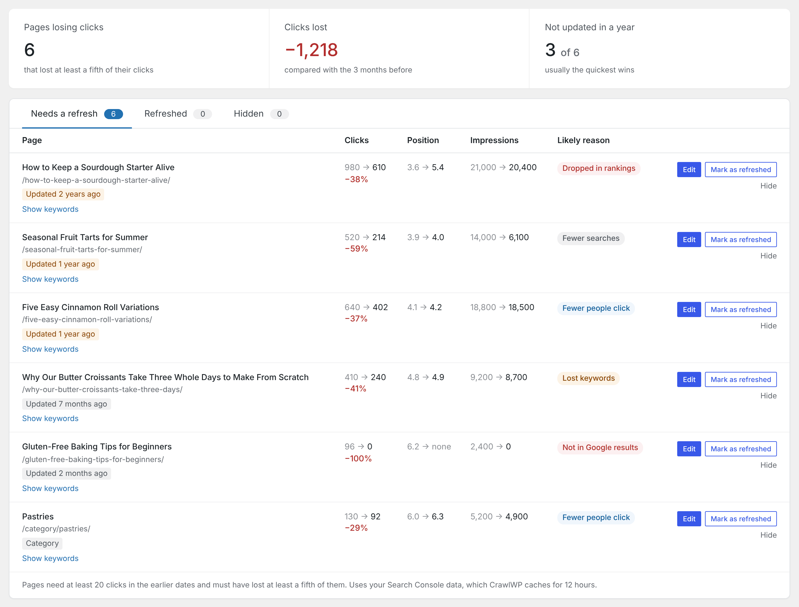
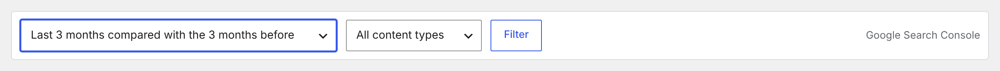
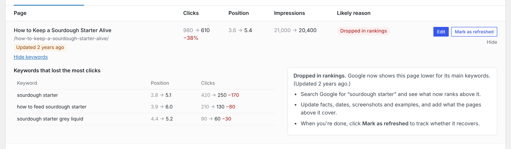
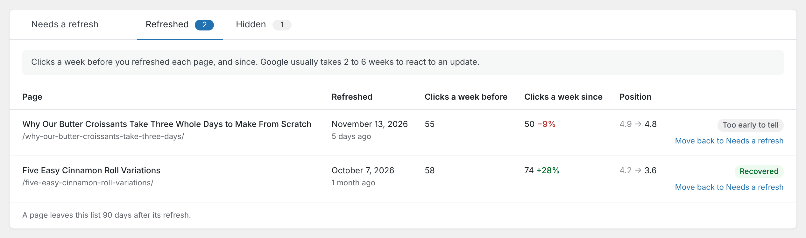
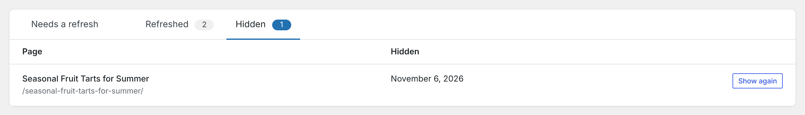

# Finding and fixing pages that are losing clicks

Pages that once brought steady visitors from Google can slowly lose them. A competitor publishes something newer, the facts go out of date, or people stop searching for the topic.

**Content Refresh** lists your pages that are getting fewer clicks from Google than before, biggest loss first. For each page it shows the likely reason and what to do about it. After you update a page, it tracks whether the clicks come back.

**Note:** This feature needs CrawlWP Premium.

**Before you start:** Connect CrawlWP to Google Search Console. See [Connecting CrawlWP to Google Search Console and Bing](https://crawlwp.com/article/connect-google-search-console-and-bing/).

In this article:

- [How to open Content Refresh](#how-to-open-content-refresh)
- [Choosing the dates to compare](#choosing-the-dates-to-compare)
- [Reading the Needs a refresh list](#reading-the-needs-a-refresh-list)
- [What each likely reason means](#what-each-likely-reason-means)
- [Marking a page as refreshed and tracking recovery](#marking-a-page-as-refreshed-and-tracking-recovery)
- [Hiding pages you don't want to see](#hiding-pages-you-dont-want-to-see)
- [How often the report updates](#how-often-the-report-updates)
- [Troubleshooting](#troubleshooting)

## How to open Content Refresh

1. In your WordPress dashboard, go to **CrawlWP » Content Refresh**.
2. The **Needs a refresh** tab opens first.

At the top, three cards sum up the list:

| Card | What it shows |
|---|---|
| **Pages losing clicks** | How many pages lost at least a fifth of their clicks. |
| **Clicks lost** | The total clicks those pages lost, compared with the earlier dates. |
| **Not updated in a year** | How many of the listed pages were last updated more than a year ago. These are usually the quickest wins. |

**Note:** Who can open Content Refresh depends on the **SEO Stats and Analytics** permission. See [Choosing which roles can use CrawlWP](https://crawlwp.com/article/roles-and-permissions/).

## Choosing the dates to compare

Content Refresh compares a recent period with an earlier one. You can choose which.

1. Open the first drop-down and pick one:
   - **Last 3 months compared with the 3 months before** (the default);
   - **Last 28 days compared with the 28 days before**;
   - **Last 3 months compared with the same months last year**.
2. To see only one kind of content, open the second drop-down. Pick a post type, such as Posts or Pages, or **Categories and tags**. The default is **All content types**.
3. Click **Filter**.

The recent period ends two days ago. Google's last two days are still incomplete, and comparing them would make losses look bigger than they are.

**Tip:** Use **Last 3 months compared with the same months last year** for seasonal topics. It shows whether a dip is just the time of year.

## Reading the Needs a refresh list

A page appears on **Needs a refresh** when both of these are true:

- it had at least 20 clicks in the earlier dates;
- it lost at least a fifth (20%) of those clicks in the recent dates.

Pages you marked as refreshed or hid are left out. The list shows up to 200 pages, 20 at a time. Click **Show more** to see more.

Each row shows:

| Column | What it shows |
|---|---|
| **Page** | The page title and address, and when it was last updated (for example "Updated 16 months ago"). Pages not updated in over a year are highlighted. |
| **Clicks** | Clicks in the earlier dates → clicks in the recent dates, and the percentage lost. |
| **Position** | Average position in Google before → now. **none** means Google didn't show the page in the recent dates. |
| **Impressions** | How often Google showed the page, before → now. |
| **Likely reason** | Why the page probably lost clicks. See the next section. |

To see more about a page:

1. Click **Show keywords** under the page title.
2. Read **Keywords that lost the most clicks**. It lists up to five searches, with their position and clicks before and now. **not shown** means Google no longer shows the page for that search.
3. Read the advice next to it. It explains the reason and lists what to do.

When you're ready to update the page, click **Edit**. If the reason is **Fewer people click**, the editor opens at the CrawlWP SEO box, so you can rewrite the title and description straight away.

## What each likely reason means

CrawlWP checks the reasons in this order and shows the first one that fits.

| Likely reason | When it is shown | What to do |
|---|---|---|
| **Not in Google results** | Google didn't show the page at all in the recent dates. | Check that it's still indexed in **SEO Indexing**, and that it isn't set to noindex or redirected. If it moved to a new address, add a redirect from the old one. |
| **Dropped in rankings** | Google now shows the page at least one place lower. | Search Google for its main keyword and see what now ranks above it. Update facts, dates, screenshots and examples, and add what the pages above it cover. |
| **Lost keywords** | Searches that no longer show the page at all account for at least half of the lost clicks. | Check that the page still covers those topics, with the words people search for. See whether another of your pages now shows for them instead (the **Competing pages** tab in SEO Stats). |
| **Fewer searches** | Google shows the page about as high as before, but at least a quarter less often. | It may be seasonal: compare with the same months last year. If interest is fading for good, cover the newer questions people search for. |
| **Fewer people click** | Google shows the page about as often and as high as before, but fewer people click it. | Rewrite the SEO title and description so they match what people search for now. Search for its main keyword and see what's new above it, like videos, product boxes or AI answers. |

If you see "Google didn't report keywords for this page. It hides rare searches to protect people's privacy.", Google didn't share the searches behind this page. The reason is then worked out from the page's own numbers.

For more on competing pages, see [Finding quick wins with the Opportunities report](https://crawlwp.com/article/seo-opportunities-report/). For pages that left Google's index, see [Finding out why Google hasn't indexed a page](https://crawlwp.com/article/why-google-has-not-indexed-a-page/).

## Marking a page as refreshed and tracking recovery

After you update a page, tell CrawlWP so it can track the result.

1. On the **Needs a refresh** tab, find the page.
2. Click **Mark as refreshed**.
3. The screen reloads, and the page moves to the **Refreshed** tab.

The **Refreshed** tab compares the page's clicks before and after the date you marked it:

| Column | What it shows |
|---|---|
| **Refreshed** | The date you marked the page, and how long ago that was. |
| **Clicks a week before** | Average clicks a week in the 28 days before that date. |
| **Clicks a week since** | Average clicks a week since that date, and the change in percent. |
| **Position** | Average position before → since. |

Each page also gets a result:

| Result | Meaning |
|---|---|
| **Too early to tell** | There are fewer than 3 weeks of data since the refresh. |
| **Recovered** | Clicks a week are up by 10% or more. |
| **Still dropping** | Clicks a week are down by 10% or more. |
| **No change yet** | Clicks a week changed by less than 10%. |

Google usually takes 2 to 6 weeks to react to an update. Search Console data is also a few days behind, so give each page time before you judge it.

The tab shows up to 50 pages, most recently refreshed first. A page leaves the **Refreshed** tab 90 days after its refresh. To put a page back on the main list sooner, click **Move back to Needs a refresh**.

**Note:** The **Refreshed** and **Hidden** lists are shared by everyone who can open Content Refresh on your site.

## Hiding pages you don't want to see

Some pages lose clicks for reasons you can't or won't fix, such as an old event or a product you no longer sell. You can hide them.

1. On the **Needs a refresh** tab, find the page.
2. Click **Hide** under its buttons.
3. The screen reloads, and the page moves to the **Hidden** tab.

To bring a page back:

1. Open the **Hidden** tab.
2. Click **Show again** next to the page.

The **Hidden** tab shows the date you hid each page.

## How often the report updates

Content Refresh uses your Search Console data, which CrawlWP caches for 12 hours. New clicks from Google appear in the report after the cache expires.

On the **Refreshed** tab, CrawlWP asks Google for each page's numbers in turn. With many pages, some may say "Still loading. Reload the page to see it." Reload the page and they appear.

## Troubleshooting

**The page says "Connect CrawlWP to Google Search Console to see which pages are losing clicks."**
CrawlWP isn't connected to Google yet. Click **Connect with Google** and follow [Connecting CrawlWP to Google Search Console and Bing](https://crawlwp.com/article/connect-google-search-console-and-bing/).

**The page says "Google Search Console didn't answer, so the report can't be shown right now. Please try again in a few minutes."**
Google didn't respond. Wait a few minutes and reload. Your **Refreshed** and **Hidden** lists are kept; they show again once Google answers.

**The list says "No pages lost a noticeable number of clicks. Nice."**
No page with at least 20 clicks in the earlier dates lost a fifth or more of them. Try another comparison, such as **Last 28 days compared with the 28 days before**.

**I clicked a button and saw "Something went wrong. Please reload the page and try again."**
The change wasn't saved. Reload the page and click the button again.

## For developers

- `crawlwp_content_refresh_min_clicks` (default 20): the fewest clicks a page needs in the earlier dates to be listed.
- `crawlwp_content_refresh_min_drop` (default 0.2): the share of its clicks a page must lose to be listed.

## Related articles

- [Finding quick wins with the Opportunities report](https://crawlwp.com/article/seo-opportunities-report/)
- [Getting email alerts when pages drop](https://crawlwp.com/article/index-and-ranking-alerts/)
- [Finding out why Google hasn't indexed a page](https://crawlwp.com/article/why-google-has-not-indexed-a-page/)
- [Choosing which roles can use CrawlWP](https://crawlwp.com/article/roles-and-permissions/)
