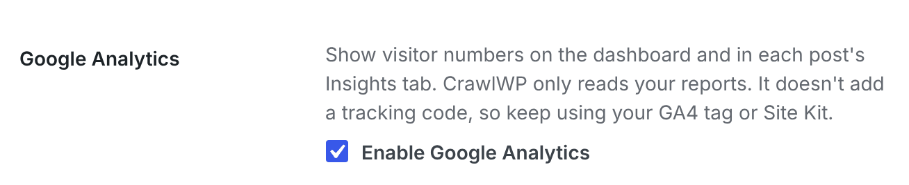
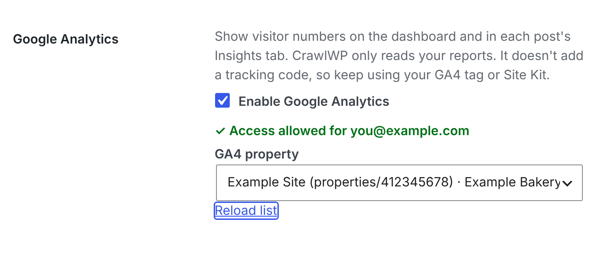
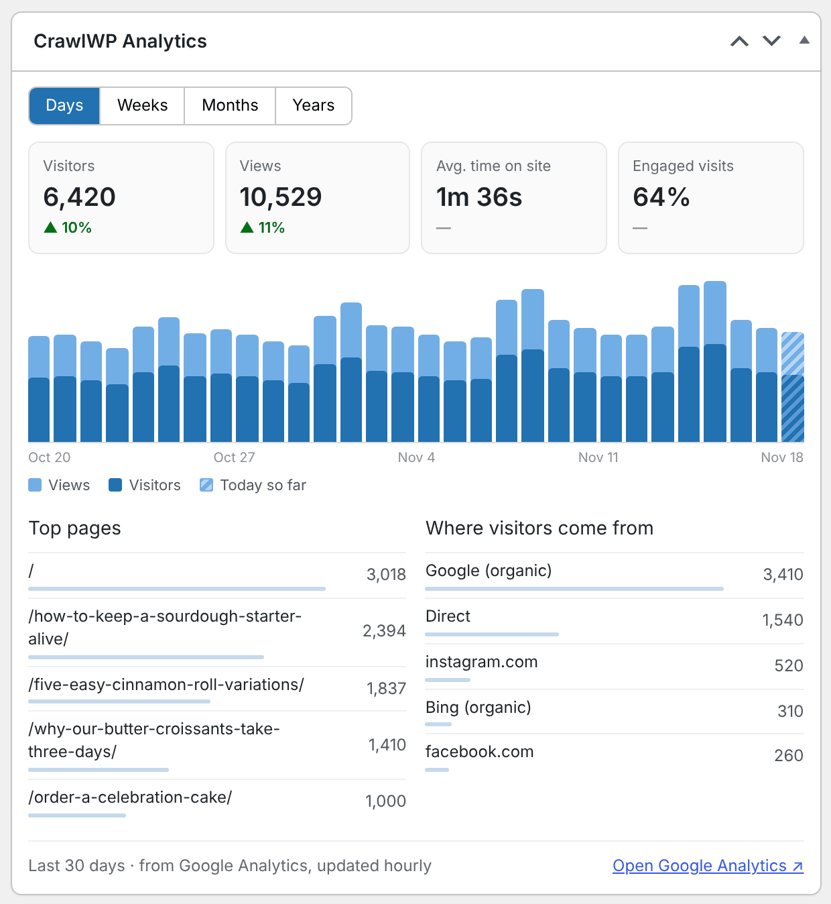
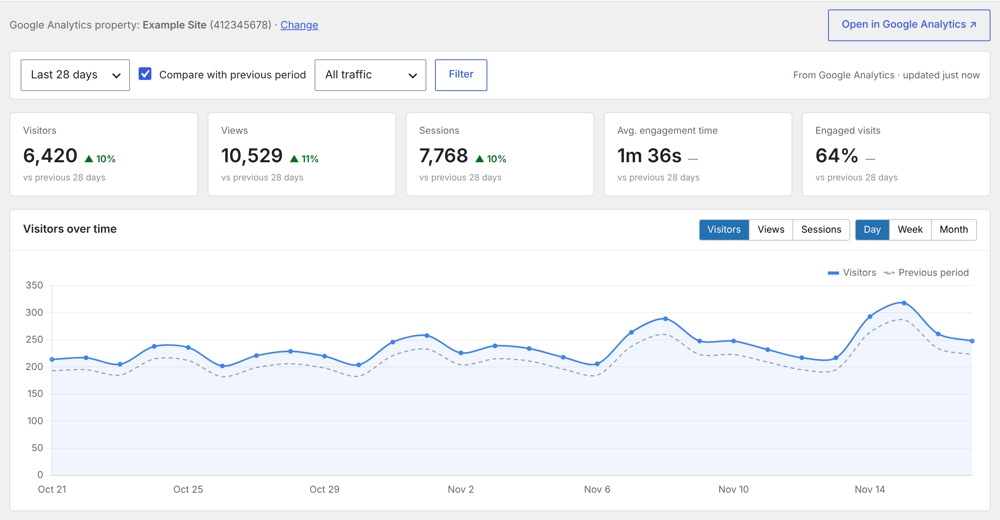
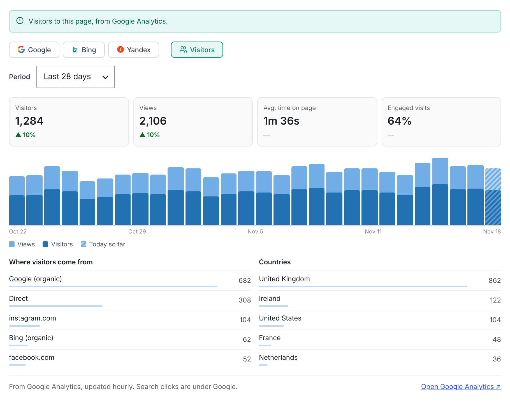

# Viewing Google Analytics in WordPress

Search Console tells you how people find your site in Google. Google Analytics tells you what they do once they arrive: how many visit, which pages they read and where they come from.

CrawlWP shows your Google Analytics 4 (GA4) numbers inside WordPress. You get a dashboard widget, a full **Analytics** page, and a **Visitors** view in each post's Insights tab. CrawlWP only reads your reports. It doesn't add a tracking code, so keep using your GA4 tag or Site Kit.

**Note:** This feature needs CrawlWP Premium.

**Before you start:**

- Your site needs a Google Analytics 4 property that already collects data.
- Connect CrawlWP to Google, either with **Connect with Google** or with a service account JSON key. See [Connecting CrawlWP to Google Search Console and Bing](https://crawlwp.com/article/connect-google-search-console-and-bing/).
- Only administrators can set up Google Analytics, because the settings are on the **API Settings** tab.

In this article:

- [How to turn on Google Analytics](#how-to-turn-on-google-analytics)
- [Choosing your GA4 property](#choosing-your-ga4-property)
- [Using the dashboard widget](#using-the-dashboard-widget)
- [Using the Analytics page](#using-the-analytics-page)
- [Seeing visitors for a single post](#seeing-visitors-for-a-single-post)
- [Choosing who can see visitor stats](#choosing-who-can-see-visitor-stats)
- [Troubleshooting](#troubleshooting)

## How to turn on Google Analytics

1. In your WordPress dashboard, go to **CrawlWP » Settings » API Settings**.
2. In the **Google API** section, find **Google Analytics**.
3. Tick **Enable Google Analytics**. The setting saves straight away and shows "Saved."

What you do next depends on how CrawlWP is connected to Google.

### If you used Connect with Google

Your Google connection needs permission to read Google Analytics. If it doesn't have it yet, the block says "Your Google connection needs permission to read Google Analytics."

1. Under **Enable Google Analytics**, click **Allow access to Google Analytics**. Google's permission screen opens.
2. Make sure the Google Analytics permission is ticked, then continue.
3. You return to the **API Settings** tab.

You'll see "Access allowed for" followed by your Google account's email address.

### If you use a service account JSON key

When a service account JSON key is saved, CrawlWP uses it for all Google requests, including Google Analytics. The settings show the service account's email address.

1. Copy the service account email address shown in the **Google Analytics** block.
2. In Google Analytics, go to **Admin » Property access management**.
3. Add that email address as a **Viewer**.
4. In the Google Cloud project the key belongs to, enable the Google Analytics Data API and Admin API.

For more on service accounts, see [Integrating WordPress with Google Search](https://crawlwp.com/article/integrating-wordpress-with-google-search/).

## Choosing your GA4 property

Once CrawlWP has access, a **GA4 property** drop-down appears in the **Google Analytics** block.

1. Open the **GA4 property** drop-down. Each property shows its name, its ID and the account it belongs to.
2. Choose the property for this site. It saves straight away and shows "Saved."

If you just created a property and it isn't listed, click **Reload list**.

If the drop-down says "No GA4 properties found for this Google account.", the connected account can't see any GA4 property. Connect with the right account, or add the service account as a Viewer.

## Using the dashboard widget

With Google Analytics turned on, a **CrawlWP Analytics** widget appears on your WordPress dashboard (**Dashboard » Home**).

1. Click **Days**, **Weeks**, **Months** or **Years** at the top of the widget.
2. The widget shows the last 30 days, 12 weeks, 12 months or 3 years.

The widget shows:

- **Visitors**, **Views**, **Avg. time on site** and **Engaged visits**, each with the change from the period before (▲ up, ▼ down, — no change or no earlier data);
- a bar chart of views and visitors, where the last bar is the period still in progress ("Today so far", "This week so far" and so on);
- **Top pages** and **Where visitors come from**, five rows each.

The figures come from Google Analytics and update hourly. Click **Open Google Analytics** to see the property in Google Analytics.

## Using the Analytics page

For the full report, go to **CrawlWP » Analytics**.

The top of the page shows the **Google Analytics property** in use, with a **Change** link to the settings and an **Open in Google Analytics** button.

### Choosing dates and traffic

1. Choose a date range: **Last 7 days**, **Last 28 days**, **Last 3 months**, **Last 6 months**, **Last 12 months**, **Last 16 months** or **Custom range**. For **Custom range**, pick the start and end dates.
2. Tick or untick **Compare with previous period**. It is ticked by default.
3. Choose which traffic to include: **All traffic**, **Search engines**, **Social**, **Other websites**, **Email** or **Direct**.
4. Click **Filter**.

To go back to the defaults (**Last 28 days**, compared, all traffic), click **Clear filters**.

The preset ranges end yesterday, because today's data is still coming in. A **Custom range** can end today. The previous period is the same number of days just before.

**Note:** Google Analytics has no data before 14 August 2015. If the previous period would start before then, comparison is switched off for that range and the page says "Google Analytics has no earlier period of the same length to compare this range with." This only happens with very long custom ranges.

### Reading the totals and chart

Five totals sit at the top: **Visitors**, **Views**, **Sessions**, **Avg. engagement time** and **Engaged visits**. With comparison on, each shows the change, such as "vs previous 28 days".

The **Visitors over time** chart can show **Visitors**, **Views** or **Sessions**. Group it by **Day**, **Week** or **Month**. With comparison on, a dashed line shows the previous period.

### Reading the tables

| Table | Columns | What it shows |
|---|---|---|
| **Top pages** | **Page**, **Views**, **Visitors**, **Avg. time** | Your most-viewed pages. |
| **Landing pages** | **Page**, **Sessions**, **Engaged**, **From search** | The pages where visits start. **From search** is the share of sessions that came from search engines. |
| **Where visitors come from** | **Source**, **Visitors**, **Engaged** | The sites and channels that send visitors. |
| **Countries** | **Country**, **Visitors** | Where your visitors are. |
| **Devices** | (chart) | Visitors by device, such as desktop, mobile and tablet, with percentages. |

Each table shows 10 rows at first. Click **Show all** to see the rest. Tables show up to 250 rows. When there are more, the button says "Show top 250 (export CSV for more)".

Tables with more than 10 rows have a **Search** box. Type to show only matching rows.

### Seeing one page's numbers

1. In **Top pages** or **Landing pages**, click a page title.
2. The whole page now shows numbers for that page only. A **Page:** label shows which page.
3. Click **View page** to open it on your site.
4. Click the **×** on the **Page:** label to go back to the whole site.

When a page is selected, the totals show **Avg. time on page**, and the **Top pages** and **Landing pages** tables are hidden.

**Tip:** The filters are part of the page address, so you can bookmark a filtered view.

### Exporting a table as CSV

1. Click **Export CSV** on a table.
2. Your browser downloads a CSV file (a spreadsheet file) with the same dates and filters.

An export holds up to 5,000 rows, more than the page shows.

**Note:** A very large export can take too long. After 45 seconds, CrawlWP stops and shows "This export is too large to finish in one go. Choose a shorter date range or a single traffic type and try again."

## Seeing visitors for a single post

You can see a post's Google Analytics numbers while you edit it.

1. Open a published post or page in the editor.
2. In the CrawlWP SEO box, open the **Insights** tab.
3. Click **Visitors**, next to **Google**, **Bing** and **Yandex**.
4. Use the **Period** drop-down to choose **Last 7 days**, **Last 28 days** or **Last 3 months**.

The view shows **Visitors**, **Views**, **Avg. time on page** and **Engaged visits**, a chart, **Where visitors come from** and **Countries**. Search clicks stay under **Google**.

**Note:** Visitor stats for a single post need pretty permalinks (web addresses with the post name in them). If your site uses Plain permalinks, you'll see "Visitor stats for a single post need pretty permalinks. Choose any structure other than Plain in Settings > Permalinks." The page set as your homepage is the exception.

The **Visitors** button only appears when Google Analytics is turned on. For drafts, it says "Visitor stats appear once this post is published."

## Choosing who can see visitor stats

Administrators can always see everything. For other roles, use **Role Manager** in CrawlWP Premium:

| Permission | What it controls |
|---|---|
| **SEO Stats and Analytics** | The **CrawlWP Analytics** dashboard widget and the **Analytics** page (and SEO Stats). |
| **Insights tab** | The **Visitors** view in the SEO box, on posts the user can edit. |

See [Choosing which roles can use CrawlWP](https://crawlwp.com/article/roles-and-permissions/).

**Note:** Only administrators see Google's detailed error messages. Other users see "Visitor stats couldn't be loaded from Google Analytics. Ask a site administrator to check the connection in CrawlWP settings."

## Troubleshooting

**The widget or page says "Allow CrawlWP to read Google Analytics to see visitor stats."**
Your Google connection doesn't have the Google Analytics permission. Click **Open settings**, then **Allow access to Google Analytics**.

**After allowing access, I saw "Google was connected, but without access to Google Analytics."**
The Google Analytics permission wasn't ticked on Google's screen. Click **Allow access to Google Analytics** again and tick the Google Analytics permission.

**It says "Choose your Google Analytics property to see visitor stats."**
Google Analytics is on but no property is chosen. Click **Open settings** and pick one in the **GA4 property** drop-down.

**It says "Google Analytics refused access. Add … as a Viewer on your GA4 property".**
You use a service account that hasn't been added to the property. Add the email address shown as a Viewer in Google Analytics, under **Admin » Property access management**.

**It says "The Google Analytics API isn't enabled for this Google Cloud project."**
Your service account's Google Cloud project doesn't allow Google Analytics yet. Enable the Google Analytics Data API and Admin API in that project, then try again.

**The numbers don't match Google Analytics exactly.**
CrawlWP keeps Google's answers for an hour, so recent visits can take up to an hour to appear. The Analytics page shows when the data was last updated, such as "From Google Analytics · updated 12 mins ago".

## For developers

- `crawlwp_analytics_csv_rows` (default 5000, at most 25000): the most rows in a CSV export.
- `crawlwp_analytics_csv_seconds` (default 45, between 10 and 240): how long an export may run before it stops.

## Related articles

- [Connecting CrawlWP to Google Search Console and Bing](https://crawlwp.com/article/connect-google-search-console-and-bing/)
- [Choosing which roles can use CrawlWP](https://crawlwp.com/article/roles-and-permissions/)
- [Integrating WordPress with Google Search](https://crawlwp.com/article/integrating-wordpress-with-google-search/)
- [Finding quick wins with the Opportunities report](https://crawlwp.com/article/seo-opportunities-report/)
