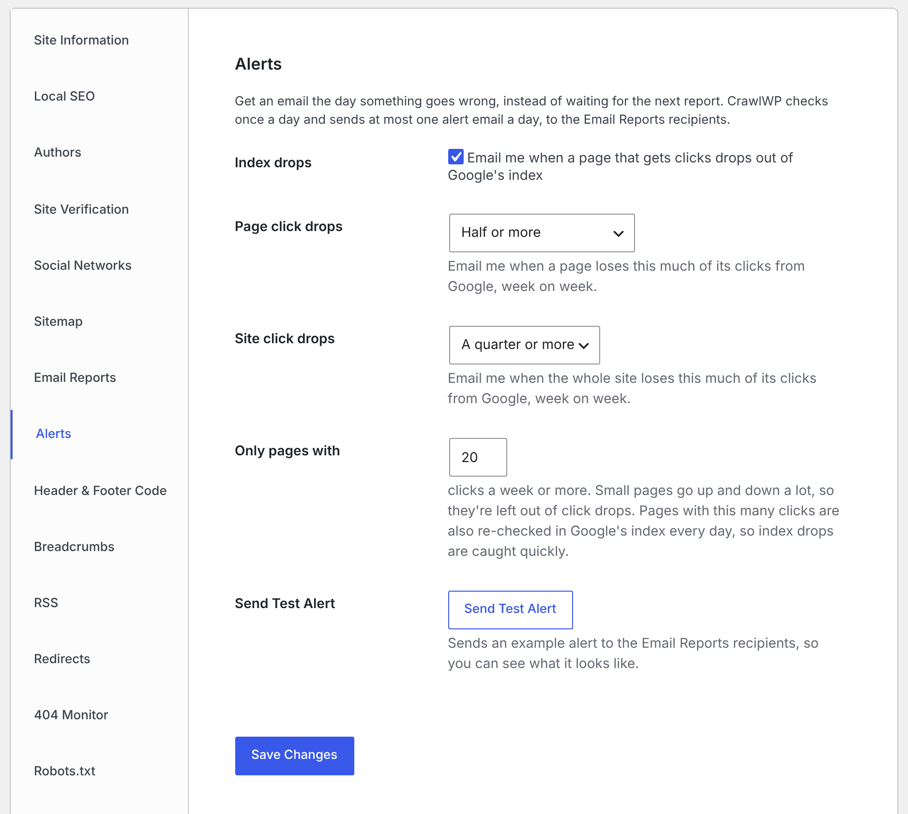
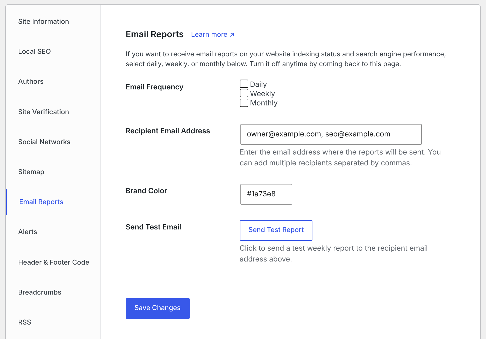

# Getting email alerts when pages drop

Email reports tell you how your site is doing every day, week or month. But when an important page drops out of Google, you want to know straight away.

CrawlWP alerts send you an email the day something goes wrong: a page that gets clicks drops out of Google's index, a page loses a big share of its clicks, or your whole site does. CrawlWP checks once a day and sends at most one alert email a day.

**Note:** This feature needs CrawlWP Premium.

**Before you start:**

- Connect CrawlWP to Google Search Console. See [Connecting CrawlWP to Google Search Console and Bing](https://crawlwp.com/article/connect-google-search-console-and-bing/).
- Alerts go to the people set as recipients in **Email Reports**. See [SEO performance email reports](https://crawlwp.com/article/seo-performance-email-reports/).

In this article:

- [How to turn on alerts](#how-to-turn-on-alerts)
- [Sending a test alert](#sending-a-test-alert)
- [What triggers an alert](#what-triggers-an-alert)
- [When CrawlWP checks](#when-crawlwp-checks)
- [What the alert email contains](#what-the-alert-email-contains)
- [Changing who gets alerts](#changing-who-gets-alerts)
- [Turning alerts off](#turning-alerts-off)
- [Troubleshooting](#troubleshooting)

## How to turn on alerts

All alerts are off until you turn them on.

1. In your WordPress dashboard, go to **CrawlWP » Settings** and click **Alerts** in the list of sections on the left.
2. Choose which alerts you want:
   - Tick **Index drops** to get an email when a page that gets clicks drops out of Google's index.
   - Under **Page click drops**, choose how much of its clicks a page must lose, week on week: **A quarter or more**, **Half or more** or **Three quarters or more**.
   - Under **Site click drops**, choose how much of its clicks the whole site must lose, week on week: **A quarter or more** or **Half or more**.
3. In **Only pages with**, enter the fewest clicks a week a page needs to be included. The default is 20.
4. Click **Save Changes**.

From the next daily check, CrawlWP emails you when one of your chosen alerts is triggered.

**Tip:** Small pages go up and down a lot from week to week. If you get alerts for pages that don't matter much, raise the **Only pages with** number.

## Sending a test alert

To see what an alert looks like before a real one arrives:

1. Go to **CrawlWP » Settings** and click **Alerts** in the list of sections on the left.
2. Click **Send Test Alert**.

CrawlWP sends an example alert to your **Email Reports** recipients and shows "Test alert sent." The test email is marked as a test and uses made-up example pages, not your site's data.

**Note:** Only administrators see the **Send Test Alert** button. Other roles that can open CrawlWP settings can still change the alert options.

## What triggers an alert

CrawlWP compares the last 7 days with the 7 days before. Because Search Console data runs about 2 days behind, the last 7 days end two days ago.

| Alert | You get an email when | Not repeated for |
|---|---|---|
| **Index drops** | A page dropped out of Google's index in the last 8 days and got at least one click from Google in the last two weeks. | The same drop isn't reported again. |
| **Page click drops** | A page had at least your **Only pages with** number of clicks in the earlier week and lost at least the share you chose. A page that no longer shows in Google at all counts as zero clicks. | 14 days per page |
| **Site click drops** | Your whole site had at least your **Only pages with** number of clicks in the earlier week and lost at least the share you chose. | 7 days |

Each email lists up to 20 pages that dropped out of the index and up to 20 pages that lost clicks. Pages with the biggest losses come first.

A page that dropped out of the index is listed only under the index drops. It isn't also listed as losing clicks in that email or for the next 14 days.

### How CrawlWP spots index drops

CrawlWP learns whether a page is indexed from its **SEO Indexing** checks. Indexed pages are normally re-checked only once a month.

With **Index drops** ticked, CrawlWP also re-checks your most-clicked pages every day, so a drop is caught quickly. It re-checks up to 50 posts and pages a day that have at least your **Only pages with** number of clicks a week. Each check uses one of Google's 2,000 daily URL inspections (checks of a single address).

## When CrawlWP checks

CrawlWP checks once a day, from 8 AM in your site's time zone. It uses WordPress's scheduled tasks (WP-Cron), which run when someone visits your site. On a quiet site, the check may happen later in the day.

The check only runs when at least one alert is on, CrawlWP is connected to Google, and there is a valid recipient email address.

If an email fails to send, CrawlWP tries again at the next hourly run, up to 3 times that day.

## What the alert email contains

The subject line reads like "[CrawlWP] 2 pages need your attention - example.com". The email has these parts, depending on what was found:

| Part | What it shows |
|---|---|
| **Your site is getting fewer clicks from Google** | Your site's clicks in the 7 days before and in the last 7 days, and the drop in percent. |
| **Dropped out of Google's index** | Each page's title, address and clicks in the last 2 weeks. If CrawlWP knows Google's reason, it shows it after **Google's reason:**. The **See why and fix** button opens the page in **SEO Indexing**. |
| **Lost most of their clicks** | Each page's clicks before → now, the drop in percent, and its position before → now. **Not in results** means Google no longer shows the page at all. A short note below suggests what may have caused the drop. |

At the bottom, the **Open SEO Stats** button takes you to your full Search Console figures. The footer link **Change alert settings** opens the **Alerts** section.

The email uses the **Brand Color** set in **Email Reports**.

To find out why a page lost clicks and how to fix it, see [Finding and fixing pages that are losing clicks](https://crawlwp.com/article/content-refresh/). For pages that left the index, see [Finding out why Google hasn't indexed a page](https://crawlwp.com/article/why-google-has-not-indexed-a-page/).

## Changing who gets alerts

Alerts go to the same people as your email reports.

1. Go to **CrawlWP » Settings** and click **Email Reports** in the list of sections on the left.
2. In **Recipient Email Address**, enter one or more addresses, separated by commas.
3. Click **Save Changes**.

By default, this is your site's admin email address.

## Turning alerts off

1. Go to **CrawlWP » Settings** and click **Alerts** in the list of sections on the left.
2. Untick **Index drops**.
3. Set **Page click drops** and **Site click drops** to **Off**.
4. Click **Save Changes**.

You can also turn off just one alert and keep the others. When all three are off, CrawlWP stops the daily check.

## Troubleshooting

**I clicked Send Test Alert and saw "Please set a recipient email address in Email Reports first."**
There is no valid address in **Recipient Email Address**. Add one in the **Email Reports** section, click **Save Changes**, and try again.

**I saw "Failed to send the test alert. Please check your email settings."**
WordPress couldn't send the email. This is usually a problem with how your site sends email. An SMTP plugin (a plugin that sends email through a proper mail service) often fixes it.

**I turned alerts on but never get one.**
That may simply mean nothing dropped. Send a test alert to check that email works. Also check that CrawlWP is still connected to Google. If your scheduled tasks don't run, see [fixing cron events with missing schedules](https://crawlwp.com/article/fix-cron-events-missing-schedules/).

**Why didn't I get an alert for a small page?**
Pages with fewer clicks a week than your **Only pages with** number are left out of click drops. Lower the number to include them.

## For developers

- `crawlwp_alerts`: change the alerts before they are emailed, or return an empty array to cancel the email.
- `crawlwp_alert_email_subject`: change the email's subject line.
- `crawlwp_alerts_daily_index_checks` (default 50): how many pages are re-checked in Google's index each day.

## Related articles

- [SEO performance email reports](https://crawlwp.com/article/seo-performance-email-reports/)
- [Finding and fixing pages that are losing clicks](https://crawlwp.com/article/content-refresh/)
- [Finding out why Google hasn't indexed a page](https://crawlwp.com/article/why-google-has-not-indexed-a-page/)
- [Finding quick wins with the Opportunities report](https://crawlwp.com/article/seo-opportunities-report/)
