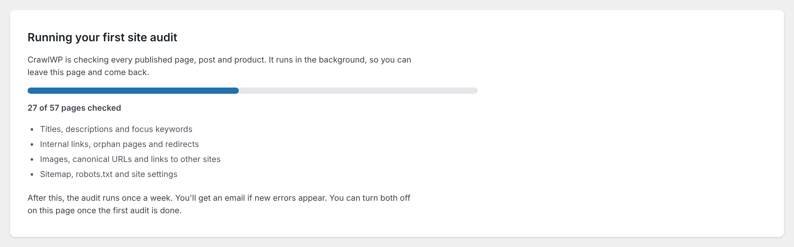
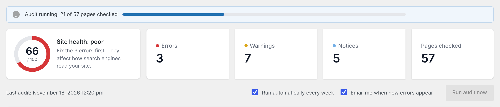
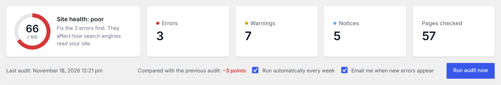
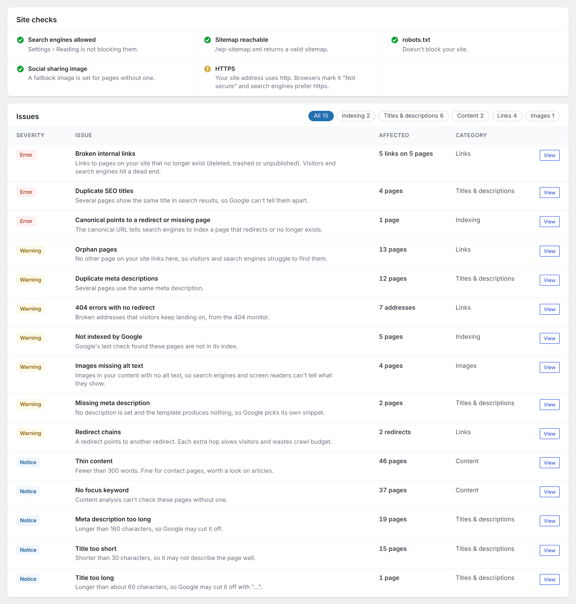
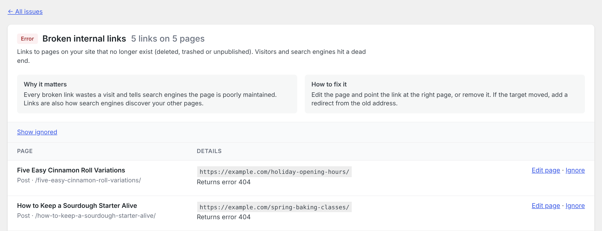
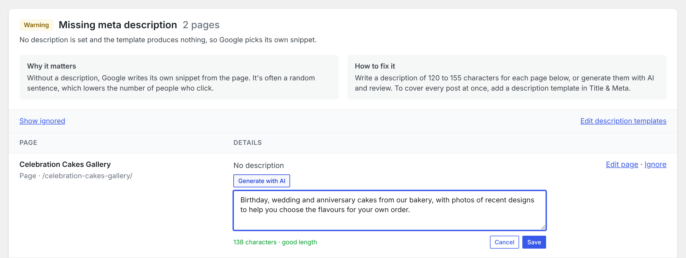
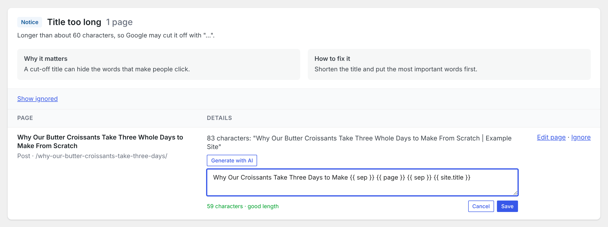
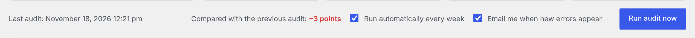

# Running a Site Audit

Small SEO problems pile up as a site grows: a deleted page that other posts still link to, two posts with the same title, a page nothing links to. Site Audit checks every published page for problems like these and lists them, most serious first, with how to fix each one.

It gives your site a health score out of 100, runs again by itself every week, and emails you when new errors appear. You can fix titles and descriptions straight from the list, with or without AI.

**Note:** This feature needs CrawlWP Premium.

In this article:

- [Where to find Site Audit](#where-to-find-site-audit)
- [Running an audit](#running-an-audit)
- [How long an audit takes and what it covers](#how-long-an-audit-takes-and-what-it-covers)
- [Reading the results](#reading-the-results)
- [How the health score is worked out](#how-the-health-score-is-worked-out)
- [Filtering issues by category](#filtering-issues-by-category)
- [Fixing titles and descriptions from the audit](#fixing-titles-and-descriptions-from-the-audit)
- [Ignoring an issue](#ignoring-an-issue)
- [Turning off the weekly audit](#turning-off-the-weekly-audit)
- [Turning off the email summary](#turning-off-the-email-summary)
- [Troubleshooting](#troubleshooting)

## Where to find Site Audit

Site Audit is at **CrawlWP » Site Audit** in your WordPress dashboard. Only administrators can open it.

Without Premium, the same menu item shows a preview of the feature with an **Upgrade to CrawlWP Premium** button.

## Running an audit

The first audit starts by itself the first time an administrator opens **CrawlWP » Site Audit**. You see **Running your first site audit** and a progress bar.

The audit runs in the background, so you can leave the page and come back. When it finishes, the page reloads and shows the results.

To run a new audit at any time:

1. Go to **CrawlWP » Site Audit**.
2. Click **Run audit now**.

The page shows **Audit running:** with the number of pages checked so far. The results of the last audit stay on screen until the new one finishes. **Run audit now** is greyed out while an audit is running.

## How long an audit takes and what it covers

How long an audit takes depends on how many pages and links your site has. While it runs, the progress line moves through three stages:

1. **… of … pages checked**: CrawlWP reads each page.
2. **Checking links: … of …**: CrawlWP visits the links that need checking over the internet, such as links to other websites. It waits up to 5 seconds for each one.
3. **Finishing up…**: the site-wide checks and the score.

The audit checks every published post, page and product, and every other public content type except media attachments. Password-protected posts are left out.

To keep a link-heavy site from running for hours, each audit has these limits:

| What | Limit per audit |
|---|---|
| Pages | No limit: every published page is checked |
| Links to other websites | 400 different addresses |
| Links to your own site that need a visit to check (archives, files and other addresses that aren't a post) | 300 different addresses |
| Canonical URLs that point somewhere else | 300 different addresses |
| Links to any one outside website | 20 different addresses |

Links beyond these limits aren't checked in that audit. Links to your own posts and pages don't count towards the limits: CrawlWP checks those directly in your database.

**Note:** Site Audit runs through WP-Cron, WordPress's built-in task scheduler. If WP-Cron doesn't run on your site, the audit only moves forward while the Site Audit page is open in your browser. See [fixing cron events with missing schedules](https://crawlwp.com/article/fix-cron-events-missing-schedules/).

## Reading the results

When an audit is done, the top of **CrawlWP » Site Audit** shows:

- your health score out of 100, with **Site health: good**, **fair** or **poor**, and a short hint on what to do next;
- **Errors**, **Warnings** and **Notices**: how many types of issue of each severity were found;
- **Pages checked**;
- **Last audit:** with the date and time, and, from the second audit on, **Compared with the previous audit:** with the points gained or lost.

Below that are two panels.

**Site checks** lists site-wide settings, such as whether search engines are allowed, whether your sitemap and robots.txt work, and whether your site uses HTTPS. Each one has a tick, a warning or a cross.

**Issues** lists each type of problem found, with its **Severity**, the **Issue** name and a one-line summary, how many items are **Affected**, and its **Category**. Errors come first, then warnings, then notices. Click an issue's name or **View** to see the affected pages.

The page for one issue shows:

- what the issue is, **Why it matters** and **How to fix it**;
- each affected page (or address, or redirect) with the details, for example the broken link and why it's broken;
- **Edit page** and **Ignore** links on each row;
- for some issues, a shortcut such as **Open the 404 monitor**, **Open redirects**, **Open SEO Indexing** or **Edit description templates**.

The list shows 20 rows at a time; use **Previous** and **Next** to see more. Click **← All issues** to go back.

For what every issue means and how to fix it, see [What each Site Audit issue means](https://crawlwp.com/article/site-audit-issues/).

If nothing is found, the Issues panel says **No issues found. Nice work.**

## How the health score is worked out

Your score starts at 100. Each type of issue takes points off, depending on its severity and how many of your pages it affects.

| Severity | Most points it can take off |
|---|---|
| Error | 15 |
| Warning | 7 |
| Notice | 2 |

An issue only costs the full amount when every checked page has it. A problem on a few pages costs much less: on 1% of your pages it costs a tenth of the maximum, and on a quarter of your pages it costs half. So a large site with a few stray issues still scores well, and the score falls as problems spread.

Site checks count too. A failed site check marked as an error takes off 10 points, and one marked as a warning takes off 2. A site check that couldn't run takes off nothing.

The score is rounded to a whole number between 0 and 100:

- 90 and above: **good**;
- 70 to 89: **fair**;
- below 70: **poor**.

Ignored issues don't count. When you ignore an issue, or fix a title or description from the audit, the score goes up straight away, without waiting for the next audit. Fixes you make elsewhere, such as in the post editor, show in the score after the next audit.

## Filtering issues by category

Above the Issues table are filter buttons for each category that has issues: **All**, **Indexing**, **Titles & descriptions**, **Content**, **Links** and **Images**. Each shows how many types of issue it holds.

1. Go to **CrawlWP » Site Audit**.
2. Click a category button, for example **Links**.

The table now shows only that category's issues. Click **All** to see everything again.

## Fixing titles and descriptions from the audit

For title and description issues you can write the fix right in the list, without opening each post. This works for **Duplicate SEO titles**, **Title too long**, **Title too short**, **Missing meta description**, **Duplicate meta descriptions** and **Meta description too long**.

1. Go to **CrawlWP » Site Audit** and click one of those issues.
2. On a page's row, click **Edit SEO title** or **Edit meta description**.
3. Type the new text. Below the box, a counter shows the length and whether it's a **good length**, **too long** or **too short**.
4. Click **Save**.

If the new text fixes the issue, you see **Saved. Fixed.** and the row is marked done. If it still breaks a length rule, you see **Saved, but this is still listed:** followed by the issue, for example **Title too long**.

The counter calls a title a good length between 30 and 60 characters, and a description between 50 and 160 characters. The audit itself only flags a description that is missing or longer than 160 characters, so a shorter one still counts as fixed.

**Note:** A changed title or description no longer shows as a duplicate straight away. The next audit checks again whether it matches another page.

### Generating a title or description with AI

If AI is set up in CrawlWP, each row also has a **Generate with AI** button. See [generating SEO titles and descriptions with AI](https://crawlwp.com/article/generating-seo-titles-and-descriptions-with-ai/) to set it up.

1. On a page's row, click **Generate with AI**.
2. Wait while the button says **Generating…**. The suggestion appears in the box.
3. Read it and change it if you like. Click **Generate with AI** again for another suggestion.
4. Click **Save**.

Nothing is saved until you click **Save**.

For a title, AI writes only the part that describes the page. The rest of your title template, such as the separator and site name, stays around it. In the box, that part shows as template variables, such as `{{ sep }}` and `{{ site.title }}`.

## Ignoring an issue

Some issues are fine on purpose: a short contact page flagged as **Thin content**, or a decorative image with no alt text. Ignore those so they stop counting against your score.

1. Open the issue from **CrawlWP » Site Audit**.
2. On the page's row, click **Ignore**.

The row disappears and the score goes up. Ignored issues stay ignored in future audits.

To see or bring back ignored issues:

1. At the bottom of the overview, next to **Ignored issues:**, click **Show ignored**, then click **View** next to the issue. You can also click **Show ignored** on one issue's page.
2. On the issue's ignored list, click **Restore** on the row.

The row goes back to the open issues and counts in the score again.

## Turning off the weekly audit

After the first audit, Site Audit runs by itself once a week. The first weekly run starts a day after you install or update CrawlWP Premium.

To stop it:

1. Go to **CrawlWP » Site Audit**.
2. Untick **Run automatically every week**.

The change saves straight away. From then on, an audit only runs when you click **Run audit now**. Tick the box again to switch the weekly run back on.

**Note:** The two checkboxes appear once the first audit is done. Unticking **Run automatically every week** doesn't stop an audit that is already running.

## Turning off the email summary

When an audit finds a type of error that the previous audit didn't, CrawlWP emails your site's administration email address (set in WordPress under **Settings » General**). The email:

- has the subject **[your site name] Site Audit found new SEO errors**;
- lists each new error with how many pages or links it affects;
- gives your site health score and a link to the Site Audit page.

No email is sent after the very first audit, or when the only new problems are warnings or notices.

To stop these emails:

1. Go to **CrawlWP » Site Audit**.
2. Untick **Email me when new errors appear**.

The change saves straight away.

## Troubleshooting

**The page says "The audit stopped making progress."**
The audit hasn't moved for 30 minutes, usually because WP-Cron isn't running. Click **Run audit now** to start again, and check that WP-Cron works on your site. See [fixing cron events with missing schedules](https://crawlwp.com/article/fix-cron-events-missing-schedules/).

**The progress says "This page can no longer reach the audit".**
Your browser lost touch with the site, but the audit may still be running in the background. Reload the page to see where it is.

**I see "The audit could not start. Please reload the page and try again."**
Reload the page and click **Run audit now** again.

**A ticked or unticked box jumped back, with "That change could not be saved."**
The setting wasn't saved. Reload the page and try again.

**Some of my posts aren't in the audit.**
The audit skips password-protected posts and anything not yet published. Pages set to noindex are still checked for links and images, but not for titles, descriptions, focus keywords or word count, because they don't appear in search results.

## Related articles

- [What each Site Audit issue means](https://crawlwp.com/article/site-audit-issues/)
- [Generating SEO titles and descriptions with AI](https://crawlwp.com/article/generating-seo-titles-and-descriptions-with-ai/)
- [Fixing cron events with missing schedules](https://crawlwp.com/article/fix-cron-events-missing-schedules/)
- [Finding out why Google hasn't indexed a page](https://crawlwp.com/article/why-google-has-not-indexed-a-page/)
- [Using the 404 Monitor](https://crawlwp.com/article/using-the-404-monitor/)

## For developers

These filters change how Site Audit works:

- `crawlwp_site_audit_post_types`: the post types the audit checks.
- `crawlwp_site_audit_checks`: the checks' labels, explanations and severity.
- `crawlwp_site_audit_site_checks`: the results in the Site checks panel.
- `crawlwp_site_audit_weekly_enabled`: whether the weekly audit runs.
- `crawlwp_site_audit_email_to`: who gets the new-errors email.

The `crawlwp_site_audit_finished` action runs when an audit finishes.
