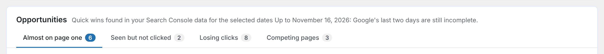
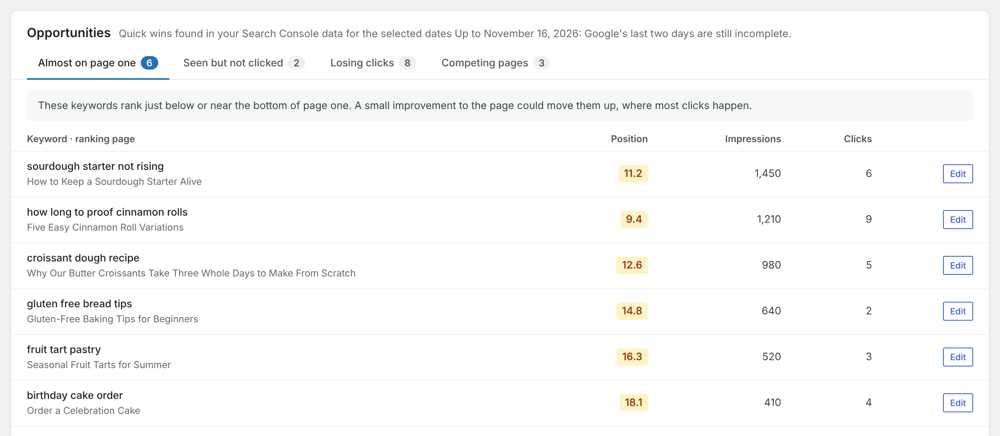
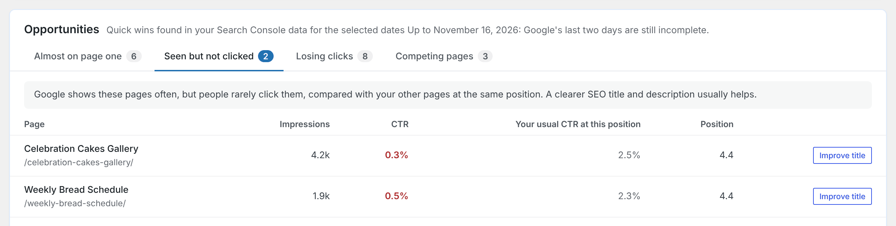
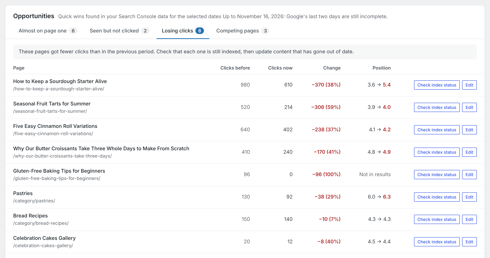
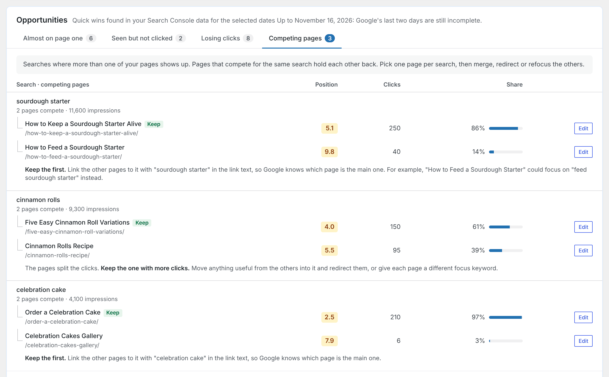

# Finding quick wins with the Opportunities report

Your Google Search Console data already shows where small changes could bring more visitors. The trouble is finding them among thousands of rows.

The **Opportunities** card in SEO Stats does that for you. It sorts your data into four short lists: keywords almost on page one, pages people see but don't click, pages losing clicks, and pages competing for the same search. Each list says what to do next.

**Note:** This feature needs CrawlWP Premium.

**Before you start:** Connect CrawlWP to Google Search Console. See [Connecting CrawlWP to Google Search Console and Bing](https://crawlwp.com/article/connect-google-search-console-and-bing/).

In this article:

- [How to open the Opportunities report](#how-to-open-the-opportunities-report)
- [Choosing the dates the report uses](#choosing-the-dates-the-report-uses)
- [Improving keywords that are almost on page one](#improving-keywords-that-are-almost-on-page-one)
- [Fixing pages that are seen but not clicked](#fixing-pages-that-are-seen-but-not-clicked)
- [Checking pages that are losing clicks](#checking-pages-that-are-losing-clicks)
- [Fixing pages that compete for the same search](#fixing-pages-that-compete-for-the-same-search)
- [What each list includes](#what-each-list-includes)
- [Troubleshooting](#troubleshooting)

## How to open the Opportunities report

1. In your WordPress dashboard, go to **CrawlWP » SEO Stats**.
2. Make sure the **Google Stats** tab is open.
3. Scroll down past the chart to the **Opportunities** card.

The card has four tabs: **Almost on page one**, **Seen but not clicked**, **Losing clicks** and **Competing pages**. Each tab shows how many items it found. A count of **100+** means there are more than 100.

Each list shows 10 items at first. Click **Show more** to see the next 10, up to 100 per list.

**Note:** Who can see SEO Stats depends on the **SEO Stats and Analytics** permission. See [Choosing which roles can use CrawlWP](https://crawlwp.com/article/roles-and-permissions/). The **Edit** and **Improve title** buttons only show for pages the user is allowed to edit.

## Choosing the dates the report uses

The Opportunities card uses the same dates and filters as the rest of the SEO Stats page.

1. At the top of the page, choose a date range: **Last 7 Days**, **Last 28 Days**, **Last 3 Months**, **Last 6 Months**, **Last 12 Months**, **Last 16 Months** or **Custom**.
2. Click **Filter**.

The default is **Last 28 Days**. To go back to it, click **Clear Filter**.

Google's figures for the last two days are still incomplete. If your dates include them, the card moves the whole range back so it ends two days ago. It then shows a note such as "Up to [date]: Google's last two days are still incomplete."

**Note:** If you filtered the page by a keyword, page, country or device (by clicking a row in one of the tables below the card), the Opportunities lists are filtered the same way. Remove the filter to see the whole site again.

## Improving keywords that are almost on page one

The **Almost on page one** tab lists keywords where your site ranks at positions 8 to 20. That is the bottom of Google's first page or the top of page two. A small improvement can move them up to where most clicks happen.

Each row shows the keyword, the page that gets the most impressions for it, its average position, impressions (how often it was shown) and clicks.

To work on one:

1. Click **Edit** next to the keyword to open the page.
2. Make sure the page answers that search well. Add missing details, examples or a section that covers it.
3. Use the keyword in the page's SEO title, a subheading and the opening paragraph, where it reads naturally.
4. Link to the page from your other related posts.

**Tip:** Start with the keywords at the top of the list. They are sorted by impressions, so they are the searches people make most often.

## Fixing pages that are seen but not clicked

The **Seen but not clicked** tab lists pages that Google shows often but people rarely click. CrawlWP compares each page with your other pages at the same position, so it isn't fooled by a low ranking.

Each row shows the page, its impressions, its **CTR** (click-through rate: clicks divided by impressions), **Your usual CTR at this position**, and its position.

To fix one:

1. Click **Improve title**. The page opens in the editor, at the CrawlWP SEO box.
2. Rewrite the SEO title so it matches what people search for and gives them a reason to click.
3. Rewrite the meta description to sum up what the page offers.
4. Update the post.

The list is sorted by the clicks each page is missing, so the biggest gains come first.

## Checking pages that are losing clicks

The **Losing clicks** tab lists pages that got fewer clicks than in the previous period. The previous period is the same number of days, just before your chosen dates.

Each row shows **Clicks before**, **Clicks now**, the **Change** in clicks and percent, and the position before and now. **Not in results** means Google didn't show the page at all in the chosen dates.

To check one:

1. Click **Check index status**. This opens the page in **SEO Indexing**, so you can see whether Google still has it in its index.
2. If the page is no longer indexed, see [Finding out why Google hasn't indexed a page](https://crawlwp.com/article/why-google-has-not-indexed-a-page/).
3. If it is still indexed, click **Edit** and update anything that has gone out of date.

**Tip:** For a fuller view of pages losing clicks, with the likely reason for each one, use [Content Refresh](https://crawlwp.com/article/content-refresh/). To hear about big drops by email, turn on [index and ranking alerts](https://crawlwp.com/article/index-and-ranking-alerts/).

## Fixing pages that compete for the same search

The **Competing pages** tab lists searches where more than one of your pages shows up in Google. This is often called keyword cannibalisation. Pages that compete for the same search hold each other back.

Each search shows its competing pages, with each page's position, clicks and **Share**. Share is the page's share of the clicks. When the pages have too few clicks to compare, it is their share of impressions instead. Hover over the share to see which one it is.

The page with the most clicks is labelled **Keep**. Below the pages, CrawlWP suggests what to do:

| What you see | What it means |
|---|---|
| **Keep the first.** Link the other pages to it with "[search]" in the link text… | The **Keep** page already gets most of the clicks (70% or more). Add links from the other pages to it, using the search words as the link text. |
| The pages split the clicks. **Keep the one with more clicks.** Move anything useful from the others into it and redirect them, or give each page a different focus keyword. | No page clearly wins. Merge the weaker pages into the **Keep** page and redirect them, or give each page its own topic. |
| For example, "[page]" could focus on "[another search]" instead. | CrawlWP found another search where only the weakest page shows up. That page could focus on that search instead. |

To act on a search:

1. Decide which page should rank. Usually it is the **Keep** page.
2. Click **Edit** next to the other pages.
3. Either move their useful content into the main page, or change their focus keyword and title to a different search.
4. If you merged a page, redirect its address to the main page. See [Creating a redirect rule in WordPress](https://crawlwp.com/article/creating-redirect-rule-wordpress/).

## What each list includes

CrawlWP uses fixed rules to decide what goes into each list.

| Tab | A row is listed when | Sorted by |
|---|---|---|
| **Almost on page one** | The keyword's average position across your pages is between 8 and 20, and it had at least 10 impressions. | Impressions, most first |
| **Seen but not clicked** | The page had at least 100 impressions, ranks in the top 20, and its CTR is less than half the CTR of your other pages at the same position. At least 3 other pages must share that position to compare with. | Clicks missed, most first |
| **Losing clicks** | The page lost at least 5 clicks compared with the previous period. | Clicks lost, most first |
| **Competing pages** | The search had at least 50 impressions, and two or more of your pages each got at least 10% of them while ranking in the top 30. Searches where every page is in the top 3 are left out, because that is usually sitelinks (extra links Google shows under one result), not a problem. | Impressions, most first |

In **Competing pages**, links to a section of a page (such as `/post/#heading`) count as the same page.

**Note:** CrawlWP caches your Search Console data for 12 hours. Changes you make take time to show in Google anyway, so check back after a few weeks.

## Troubleshooting

**The SEO Stats page says "You need to connect with the Google API to view reports."**
CrawlWP isn't connected to Google Search Console yet. Click **Connect with Google API** and follow [Connecting CrawlWP to Google Search Console and Bing](https://crawlwp.com/article/connect-google-search-console-and-bing/).

**A tab says "Google didn't answer just now, so this list couldn't be worked out. Reload the page to try again."**
Google Search Console didn't respond when CrawlWP asked for the data. Reload the page after a minute or two.

**A tab says there is nothing to show, such as "No keywords at positions 8 to 20 for these dates."**
Nothing in your data meets that list's rules for the chosen dates. Try a longer date range, such as **Last 3 Months**. Small or new sites may not have enough searches yet.

**A page shows its address instead of its title, with no Edit button.**
CrawlWP couldn't match the address to a post, page, category or tag on your site. If you see the title but no **Edit** or **Improve title** button, you don't have permission to edit that page.

## For developers

You can change the thresholds with these filters. Each returns a number.

- `crawlwp_opportunities_near_min_impressions` (default 10): fewest impressions for **Almost on page one**.
- `crawlwp_opportunities_ctr_min_impressions` (default 100), `crawlwp_opportunities_ctr_min_peers` (default 3) and `crawlwp_opportunities_ctr_ratio` (default 0.5): rules for **Seen but not clicked**.
- `crawlwp_opportunities_min_click_drop` (default 5): fewest clicks lost for **Losing clicks**.
- `crawlwp_opportunities_competing_min_impressions` (default 50), `crawlwp_opportunities_competing_min_share` (default 0.1) and `crawlwp_opportunities_competing_max_position` (default 30): rules for **Competing pages**.
- `crawlwp_opportunities_row_limit` (default 5000): rows requested from Search Console.

## Related articles

- [Finding and fixing pages that are losing clicks](https://crawlwp.com/article/content-refresh/)
- [Getting email alerts when pages drop](https://crawlwp.com/article/index-and-ranking-alerts/)
- [Finding out why Google hasn't indexed a page](https://crawlwp.com/article/why-google-has-not-indexed-a-page/)
- [Connecting CrawlWP to Google Search Console and Bing](https://crawlwp.com/article/connect-google-search-console-and-bing/)
- [Choosing which roles can use CrawlWP](https://crawlwp.com/article/roles-and-permissions/)
