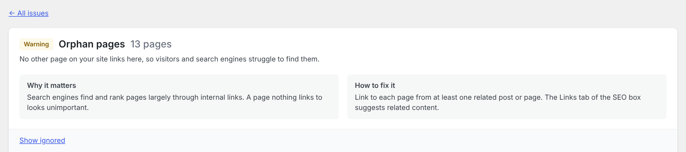
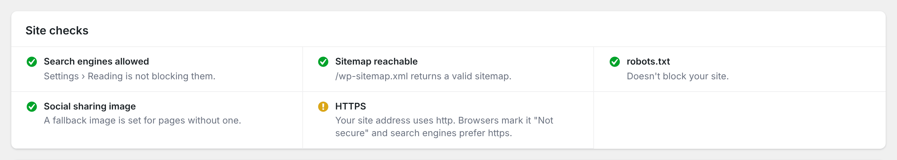

# What each Site Audit issue means

Site Audit lists problems by name, such as **Orphan pages** or **Redirect chains**. This page explains each one: what it means, why it matters, and what to do about it.

Use it alongside [Running a Site Audit](https://crawlwp.com/article/running-a-site-audit/), which covers running the audit, the health score and fixing issues from the list.

**Note:** Site Audit needs CrawlWP Premium.

In this article:

- [Severity levels](#severity-levels)
- [Indexing issues](#indexing-issues)
- [Title and description issues](#title-and-description-issues)
- [Content issues](#content-issues)
- [Link issues](#link-issues)
- [Image issues](#image-issues)
- [How links are checked](#how-links-are-checked)
- [Site checks](#site-checks)

## Severity levels

Each issue has one of three severities. The severity decides where it appears in the list and how much it lowers your health score.

| Severity | What it means |
|---|---|
| **Error** | Fix these first. They affect how search engines read your site. |
| **Warning** | The next things to improve. |
| **Notice** | Worth a look, but often fine on purpose. |

The issue page for each problem also shows **Why it matters** and **How to fix it**, so you don't need this article open while you work.

**Note:** Pages set to noindex (hidden from search results) are only checked for links and images. Title, description, focus keyword, thin content and canonical checks skip them, because they don't appear in search results.

## Indexing issues

### Canonical points to a redirect or missing page

**Severity:** Error

**What it means:** A page's canonical URL (the address you tell search engines to index instead of this one) redirects somewhere else or no longer exists. The details show **Redirects to** and the address, or **Returns error** with the error number, such as 404.

**Why it matters:** Search engines may drop the page from results, because the version you told them to index is broken.

**How to fix it:** Open the page, go to the SEO box, **Advanced** tab, and set the canonical URL to the final working address, or clear it.

### Not indexed by Google

**Severity:** Warning

**What it means:** Google's last check found these pages are not in its index. The audit takes this from the **SEO Indexing** screen: published pages with the status **Not Indexed** or **Likely Not Indexed**. This check only runs when CrawlWP is connected to Google Search Console (see [connecting CrawlWP to Google Search Console and Bing](https://crawlwp.com/article/connect-google-search-console-and-bing/)).

**Why it matters:** A page that isn't indexed can't appear in Google search results at all.

**How to fix it:** Click **Open SEO Indexing** on the issue page to see the details and submit the pages again. Thin or duplicate pages are often left out until they are improved. [Finding out why Google hasn't indexed a page](https://crawlwp.com/article/why-google-has-not-indexed-a-page/) explains each reason Google gives.

## Title and description issues

These checks look at the title and description as they appear in search results: your own text from the SEO box, or, if there is none, the text your **Title & Meta** template produces. Upper and lower case and extra spaces don't make two texts different.

You can fix all six of these from the issue page with **Edit SEO title** or **Edit meta description**, or **Generate with AI**. See [fixing titles and descriptions from the audit](https://crawlwp.com/article/running-a-site-audit/#fixing-titles-and-descriptions-from-the-audit).

### Duplicate SEO titles

**Severity:** Error

**What it means:** Several pages show the same title in search results, so Google can't tell them apart. The details show **Same as:** and the other pages. Pages whose canonical URL points to another address aren't counted.

**Why it matters:** Pages with the same title compete with each other, and searchers can't tell which result they want.

**How to fix it:** Give each page a title that describes what is different about it.

### Missing meta description

**Severity:** Warning

**What it means:** No description is set and the template produces nothing, so Google picks its own snippet.

**Why it matters:** Without a description, Google writes its own snippet from the page. It's often a random sentence, which lowers the number of people who click.

**How to fix it:** Write a description of 120 to 155 characters for each page, or generate them with AI and review. To cover every post at once, add a description template in **Title & Meta**: the issue page has an **Edit description templates** link. See [title and meta description template variables](https://crawlwp.com/article/title-and-meta-description-template-variables/).

### Duplicate meta descriptions

**Severity:** Warning

**What it means:** Several pages use the same meta description. The details show **Same as:** and the other pages.

**Why it matters:** Identical snippets make your pages look the same in search results.

**How to fix it:** Write a description for each page that summarises what it covers.

### Title too long

**Severity:** Notice

**What it means:** The title is longer than 60 characters, so Google may cut it off with "...". The details show the length and the title.

**Why it matters:** A cut-off title can hide the words that make people click.

**How to fix it:** Shorten the title and put the most important words first.

### Title too short

**Severity:** Notice

**What it means:** The title is shorter than 30 characters, so it may not describe the page well.

**Why it matters:** A very short title wastes space you could use to tell searchers what the page offers.

**How to fix it:** Add a few words that describe the page more specifically.

### Meta description too long

**Severity:** Notice

**What it means:** The description is longer than 160 characters, so Google may cut it off.

**Why it matters:** The end of the description, often the call to action, may not be shown.

**How to fix it:** Shorten the description to 120 to 155 characters.

## Content issues

### Thin content

**Severity:** Notice

**What it means:** The page has fewer than 300 words. That's fine for contact pages, but worth a look on articles. The details show the word count. Your home page and blog page are never flagged.

**Why it matters:** Short pages rarely answer a search fully, so they tend to rank below more complete pages.

**How to fix it:** Expand the page with useful detail, merge it into a related page, or ignore it if it is short on purpose.

### No focus keyword

**Severity:** Notice

**What it means:** The page has no focus keyword, so content analysis can't check it.

**Why it matters:** A focus keyword lets CrawlWP check that the page is optimised for the search you want it to rank for.

**How to fix it:** Open the page and add a focus keyword in the **Analysis** tab of the SEO box.

## Link issues

### Broken internal links

**Severity:** Error

**What it means:** Links to pages on your site that no longer exist (deleted, trashed or unpublished). Visitors and search engines hit a dead end. Each row shows the link and why it's broken:

- **The target is a draft**
- **The target is pending review**
- **The target is scheduled, not published yet**
- **The target is in the trash**
- **The target was deleted**
- **Returns error** and the error number, for addresses on your site that aren't a post, such as an archive or a file

**Why it matters:** Every broken link wastes a visit and tells search engines the page is poorly maintained. Links are also how search engines discover your other pages.

**How to fix it:** Edit the page and point the link at the right page, or remove it. If the target moved, [add a redirect](https://crawlwp.com/article/creating-redirect-rule-wordpress/) from the old address.

### Broken outbound links

**Severity:** Error

**What it means:** Links to other websites that return an error or no longer exist. Each row shows the link and **Returns error** with the error number, or **The site could not be reached**.

**Why it matters:** Readers who follow them reach an error page, which makes your content look out of date.

**How to fix it:** Replace each link with a working address, or remove it. Some sites block automated checks, so open the link yourself before removing it.

### Orphan pages

**Severity:** Warning

**What it means:** No other page on your site links here, so visitors and search engines struggle to find it. The details say **No other checked page links here.**

Some pages are never reported as orphans, because visitors can reach them another way:

- pages linked from one of your navigation menus;
- your home page and blog page;
- blog posts, and posts of any type that has an archive page;
- posts filed under a category, tag or other public taxonomy, which are listed on that term's page.

**Why it matters:** Search engines find and rank pages largely through internal links. A page nothing links to looks unimportant.

**How to fix it:** Link to each page from at least one related post or page. The **Links** tab of the SEO box suggests related content.

### 404 errors with no redirect

**Severity:** Warning

**What it means:** Broken addresses that visitors keep landing on, from the 404 monitor. The audit lists addresses that were visited at least twice and were last visited in the past 30 days, and that no active redirect covers (up to 200, most visited first). Each row shows the number of hits and the date of the last one.

**Why it matters:** Each one is a visitor who arrived from a link or search result and found nothing.

**How to fix it:** Click **Open the 404 monitor** on the issue page and redirect each address to the most relevant page. See [using the 404 Monitor](https://crawlwp.com/article/using-the-404-monitor/).

**Note:** This check reads the 404 Monitor's log, so it only finds addresses the monitor has recorded.

### Redirect chains

**Severity:** Warning

**What it means:** A redirect points to another redirect. Each extra hop slows visitors and wastes crawl budget (the time search engines spend on your site). The audit checks your active CrawlWP redirects that match an exact address. Each row shows **Goes to** the first destination, **which redirects again to** the final one.

**Why it matters:** Search engines may stop following after a few hops, and every hop adds loading time.

**How to fix it:** Click **Open redirects** on the issue page and edit the first redirect so it points straight at the final address.

## Image issues

### Images missing alt text

**Severity:** Warning

**What it means:** Images in your content with no alt text, so search engines and screen readers can't tell what they show. The details show how many images on the page have none. Images marked as decorative in the page code are not counted.

**Why it matters:** Alt text helps your images appear in image search and makes the page usable for people who can't see the images.

**How to fix it:** Edit the page and describe each image in its alt text field. Purely decorative images can keep an empty alt text; ignore those in the audit. See [image SEO and automatic alt text](https://crawlwp.com/article/image-seo-and-automatic-alt-text/).

## How links are checked

Links to your own posts and pages are checked in your database, so the audit knows straight away whether the target is published. Other links are visited over the internet:

- A link to your own site counts as broken when the address returns "not found" (404 or 410).
- A link to another website counts as broken when it returns "not found", a server error (500 and above), or the site can't be reached at all, including when its domain no longer exists.
- A link that is just slow, or that redirects too many times, is not reported, because it may still work in a browser.

Some links are **not checked**, and so never appear as broken:

- links to websites your server can't look up, for example a site that only has a newer-style (IPv6) address, a server that reaches the internet through a proxy, or a lookup that fails for a moment;
- links to private or local addresses, such as a company network;
- links to your own home page, WordPress admin and login pages and feeds, and addresses on your site with extra query text (except `?p=` and `?page_id=`);
- links beyond the per-audit limits. See [how long an audit takes and what it covers](https://crawlwp.com/article/running-a-site-audit/#how-long-an-audit-takes-and-what-it-covers).

## Site checks

The **Site checks** panel, below the health score on the Site Audit overview, tests site-wide settings. Each one shows a tick (fine), a warning, a cross (error) or a dash (couldn't check).

A failed check marked as an error lowers your health score by 10 points, and one marked as a warning by 2. A check that couldn't run doesn't change the score.

| Check | Result | What you see | What to do |
|---|---|---|---|
| Search engines | Fine | **Search engines allowed**: Settings › Reading is not blocking them. | Nothing. |
| Search engines | Error | **Search engines blocked**: "Discourage search engines from indexing this site" is on in Settings › Reading. | In WordPress, go to **Settings » Reading** and untick **Discourage search engines from indexing this site**. |
| Sitemap | Fine | **Sitemap reachable**: [sitemap path] returns a valid sitemap. | Nothing. |
| Sitemap | Warning | **Sitemap turned off**: Your XML sitemap is disabled, so search engines must find pages through links alone. | Switch your sitemap back on. See [understanding CrawlWP sitemaps](https://crawlwp.com/article/understanding-crawlwp-sitemaps/). |
| Sitemap | Error | **Sitemap not reachable**: [sitemap path] returned status [code] instead of a sitemap. | Open the sitemap address in your browser. A security, caching or redirect plugin may be blocking it. |
| robots.txt | Fine | There is no robots.txt file, so nothing is blocked. Or: Doesn't block your site. | Nothing. |
| robots.txt | Error | Blocks every search engine from the whole site ("Disallow: /"). | Remove that rule. See [editing robots.txt](https://crawlwp.com/article/editing-robots-txt/). |
| Social sharing image | Warning | No fallback image set. Pages without a featured image share with none. | Go to **CrawlWP » Settings**, click **Social Networks** in the list of sections on the left, and set **Social Image Fallback**. |
| HTTPS | Warning | Your site address uses http. Browsers mark it "Not secure" and search engines prefer https. | Ask your host for an SSL certificate, then change your site address to https. |
| Organization logo | Warning | Set it in CrawlWP » Settings » Site Information so Google can show it in results. | Go to **CrawlWP » Settings**, click **Site Information** in the list of sections on the left, and add a **Logo**. |

The **Organization logo** check only appears when your site is set up as an organization, not a person. See [setting up Organization vs Person](https://crawlwp.com/article/setting-up-organization-vs-person/).

**Couldn't check: this server doesn't allow requests to itself.** The sitemap and robots.txt checks work by visiting your own site. Some hosts block that. The result doesn't affect your score; open the sitemap and robots.txt in your browser to check them yourself.

**Couldn't check: robots.txt returned status …** Your robots.txt address returned an error other than "not found", so the audit couldn't read it.

**Note:** Search engines only read robots.txt at the top of your domain (for example `https://example.com/robots.txt`), so that's where the audit looks, even if WordPress is installed in a sub-folder.

## Related articles

- [Running a Site Audit](https://crawlwp.com/article/running-a-site-audit/)
- [Creating a redirect rule in WordPress](https://crawlwp.com/article/creating-redirect-rule-wordpress/)
- [Using the 404 Monitor](https://crawlwp.com/article/using-the-404-monitor/)
- [Editing robots.txt](https://crawlwp.com/article/editing-robots-txt/)
- [Finding out why Google hasn't indexed a page](https://crawlwp.com/article/why-google-has-not-indexed-a-page/)
