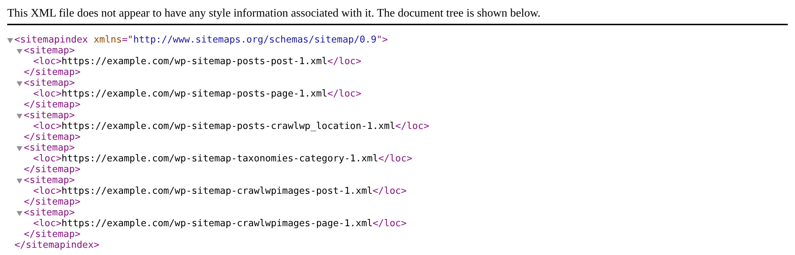
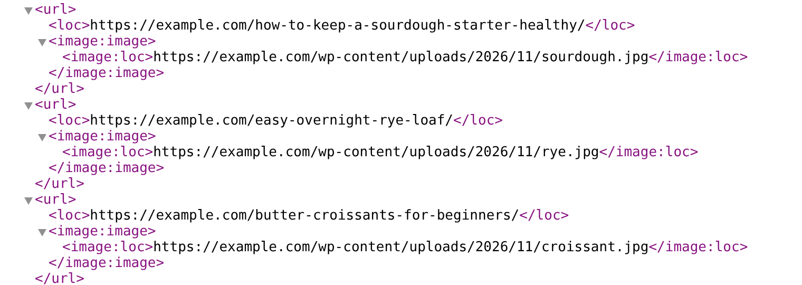
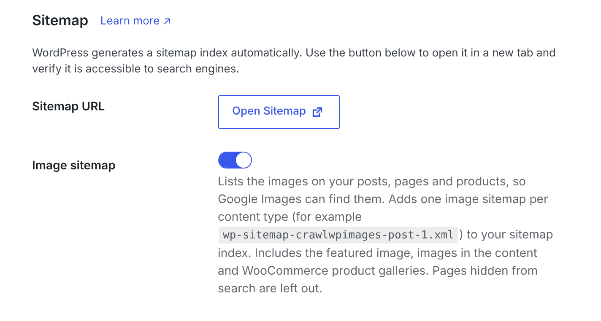

# Using the image sitemap

Google Images can bring visitors to your site, but only if Google finds your images. CrawlWP's image sitemap lists the images on your posts, pages and products, so Google can find them even when they are deep in your content.

It is switched on by default and needs no setup. This article explains what it lists, where to find it and how to turn it off.

In this article:

- [What the image sitemap lists](#what-the-image-sitemap-lists)
- [Where to find it](#where-to-find-it)
- [How to submit it to Google](#how-to-submit-it-to-google)
- [How soon changes appear](#how-soon-changes-appear)
- [How to turn it off](#how-to-turn-it-off)
- [Frequently asked questions](#frequently-asked-questions)
- [Related articles](#related-articles)

## What the image sitemap lists

For each published post, page or product, the image sitemap lists the page's address and the images on it:

- the featured image;
- images in the content (every image tag saved in the post);
- WooCommerce product gallery images, for products.

A page without any images is left out.

CrawlWP leaves out the same pages your normal sitemap leaves out:

- drafts and other unpublished posts;
- password-protected posts;
- posts set to noindex (hidden from search);
- content types you have hidden from search results.

**Note:** Each content type gets its own image sitemap. A content type with no images at all gets none, because an empty sitemap is not valid.

### Limits

| Limit | Value |
|---|---|
| Pages per image sitemap file | 1,000. Larger sites get more files, numbered 1, 2, 3 and so on. |
| Images listed per page | 1,000, Google's limit. |

## Where to find it

The image sitemaps are added to your WordPress sitemap index, next to your normal sitemaps.

1. Go to **CrawlWP » Settings** and click **Sitemap** in the list of sections on the left.
2. Next to **Sitemap URL**, click **Open Sitemap**.
3. In the sitemap index, look for files named like `wp-sitemap-crawlwpimages-post-1.xml`. There is one for each content type with images, for example `post`, `page` or `product`.

Open one to see each page with its images listed under it.

## How to submit it to Google

You don't need to submit the image sitemaps one by one. They are part of your sitemap index, so submitting the index covers them.

1. Copy the address of your sitemap index. Click **Open Sitemap** in the **Sitemap** section of **CrawlWP » Settings** and copy the address from your browser.
2. Open [Google Search Console](https://search.google.com/search-console) and choose your site.
3. Open the **Sitemaps** report.
4. Paste the sitemap index address and submit it.

If you already submitted your sitemap index, there is nothing more to do. Google finds the new image sitemaps in it the next time it reads the index.

**Tip:** If your site isn't in Search Console yet, see [Verifying your website in Google Search Console](https://crawlwp.com/article/verify-website-google-search-console/).

## How soon changes appear

CrawlWP keeps a saved copy of each image sitemap for up to a day, so it loads quickly for search engines. It clears that copy as soon as something changes, so your changes appear the next time the sitemap is opened.

The saved copy is cleared when you:

- publish, update, unpublish or delete a post;
- add, change or remove a featured image or product gallery;
- set a post to noindex, or back to index;
- edit an image's details, crop or rotate it, or delete it;
- save the **Sitemap** settings;
- change your permalink settings.

Search engines then read the updated sitemap on their next visit, which can take a few days.

## How to turn it off

1. Go to **CrawlWP » Settings** and click **Sitemap** in the list of sections on the left.
2. Turn off **Image sitemap**.
3. Click **Save Changes**.

The image sitemaps are removed from your sitemap index, and their addresses stop working. Your normal sitemaps are not affected.

## Frequently asked questions

**Why is there no image sitemap for my pages?**
CrawlWP only creates an image sitemap for a content type when at least one of its published, indexable items has an image. Add an image to a page, or a featured image, and the page image sitemap appears.

**Why is a post with images missing from the image sitemap?**
Check that it is published, not password-protected and not set to noindex. If the post isn't in your normal sitemap either, the SEO box tells you why. See [Why the SEO box says a post isn't in your sitemap](https://crawlwp.com/article/post-not-in-sitemap-warning/).

**Does the image sitemap include alt text?**
No. It lists the address of each image. Alt text still matters for Google Images, so see [Image SEO and automatic alt text](https://crawlwp.com/article/image-seo-and-automatic-alt-text/).

**Was the image sitemap switched on when I updated?**
Yes. On sites where CrawlWP's SEO features are on, the image sitemap is on by default after the update. Turn it off in the **Sitemap** section of **CrawlWP » Settings** if you don't want it.

## Related articles

- [Understanding CrawlWP sitemaps](https://crawlwp.com/article/understanding-crawlwp-sitemaps/)
- [Image SEO and automatic alt text](https://crawlwp.com/article/image-seo-and-automatic-alt-text/)
- [Why the SEO box says a post isn't in your sitemap](https://crawlwp.com/article/post-not-in-sitemap-warning/)
