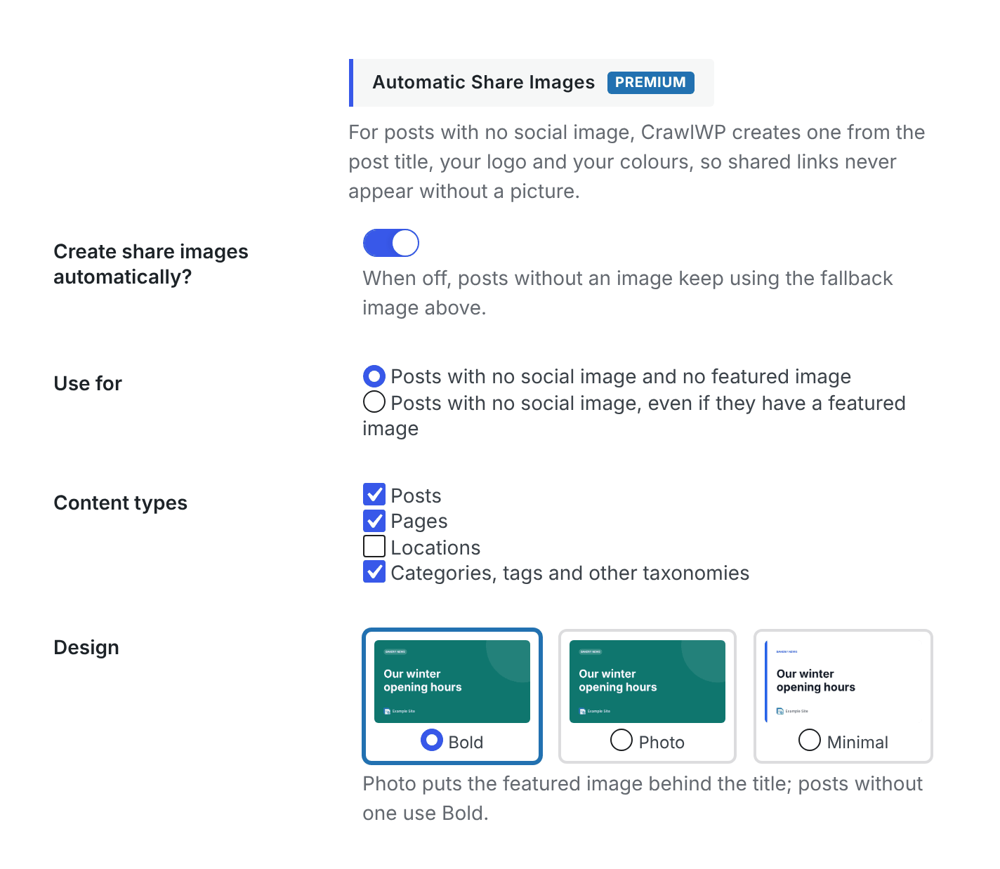
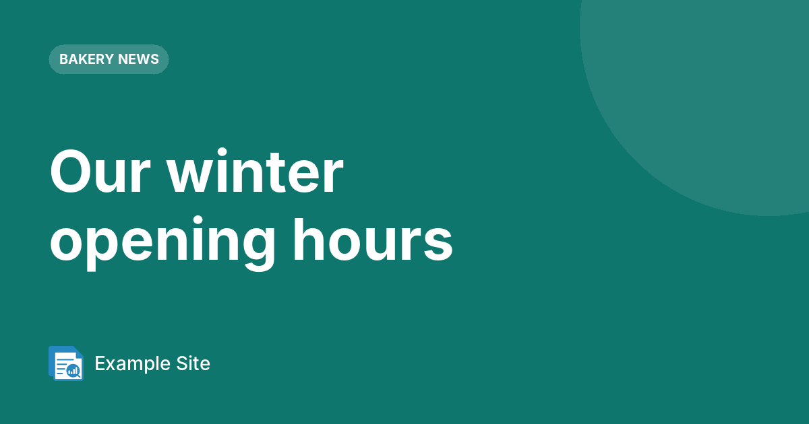
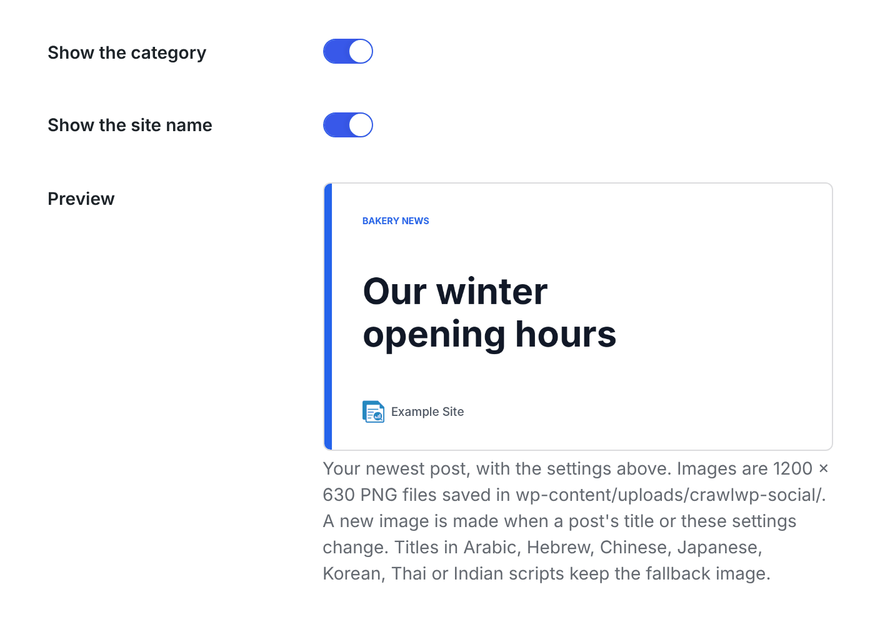
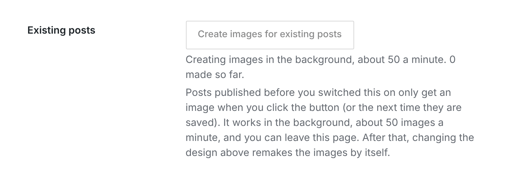
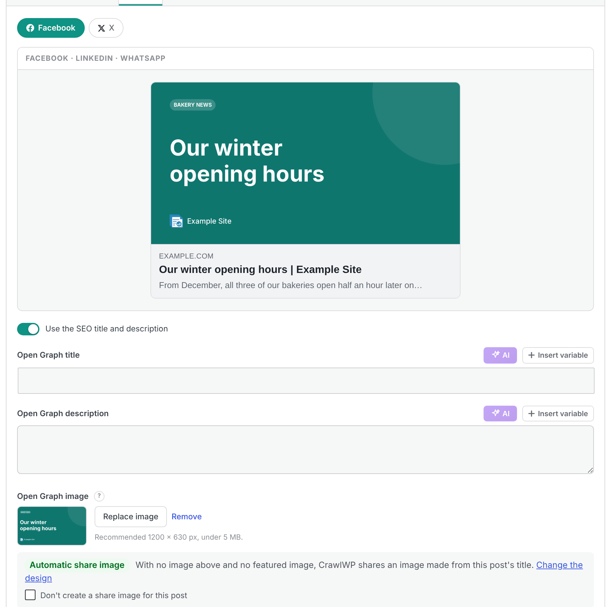

# Creating share images automatically

A link shared without a picture is easy to scroll past. CrawlWP Premium can make a share image for each post that doesn't have one, using the post title, your logo and your colours.

Each image is 1200 × 630 pixels, the size social networks recommend for link previews. You choose the design once, and CrawlWP makes the images for you.

**Note:** This feature needs CrawlWP Premium.

**Before you start:** Make sure Open Graph tags are switched on, so social networks can see your share images. See [Setting up Open Graph for Facebook](https://crawlwp.com/article/setting-up-open-graph-for-facebook/).

In this article:

- [How to turn on automatic share images](#how-to-turn-on-automatic-share-images)
- [Choosing when an image is used](#choosing-when-an-image-is-used)
- [Choosing a design](#choosing-a-design)
- [Creating images for existing posts](#creating-images-for-existing-posts)
- [Turning off the share image for one post](#turning-off-the-share-image-for-one-post)
- [Where the images are stored](#where-the-images-are-stored)
- [Troubleshooting](#troubleshooting)
- [Related articles](#related-articles)

## How to turn on automatic share images

1. Go to **CrawlWP » Settings** and click **Social Networks** in the list of sections on the left.
2. Find **Automatic Share Images**, below **Social Image Fallback**.
3. Turn on **Create share images automatically?**.
4. Under **Use for**, choose which posts get an image. See [Choosing when an image is used](#choosing-when-an-image-is-used).
5. Under **Content types**, tick the content types that should get images. Posts and pages are ticked by default.
6. Choose a **Design** and your colours. See [Choosing a design](#choosing-a-design).
7. Check the **Preview**, then click **Save Changes**.

From now on, new posts get their image when you publish them, and edited posts get theirs when you save them.

**Note:** Switching the feature on does not make images for posts you published before. Use **Create images for existing posts** for those. See [Creating images for existing posts](#creating-images-for-existing-posts).

To include categories, tags and other taxonomy pages, tick **Categories, tags and other taxonomies** under **Content types**.

## Choosing when an image is used

A post's own social image always wins. CrawlWP only fills in when there is nothing better. The **Use for** setting decides what counts as "nothing better".

| Option | Which posts get a made image |
|---|---|
| **Posts with no social image and no featured image** (default) | Posts with no social image in the SEO box and no featured image. Posts with a featured image keep sharing it. |
| **Posts with no social image, even if they have a featured image** | Every post with no social image in the SEO box, including posts with a featured image. |

A default social image set for a content type in **Title & Meta** counts like a featured image: it is kept, unless you choose the second option.

When the feature is off, posts without an image keep using the **Social Image Fallback** image set above it in the same section.

Only published posts that are not password-protected get an image. Scheduled posts get theirs when they go live.

## Choosing a design

There are three designs. Each one shows a preview of your newest post as you change the settings.

| Design | What it looks like |
|---|---|
| **Bold** (default) | White text on a solid background colour. |
| **Photo** | The post's featured image behind the title, darkened so the text is easy to read. Posts without a featured image use **Bold**. |
| **Minimal** | A white background with a coloured bar on the side. |

**Note:** **Photo** needs **Posts with no social image, even if they have a featured image** under **Use for**. With the default option, only posts without a featured image get an image, so they all use **Bold**.

Then set the details:

| Setting | Default | What it does |
|---|---|---|
| **Background colour** | #1e40af | The background of the Bold design. |
| **Accent colour** | #2563eb | The label on the Photo design and the bar on the Minimal design. |
| **Logo** | Empty | A PNG, JPEG or WebP image. Leave empty to use the logo from Site Information, your theme's logo or the site icon. |
| **Show the category** | On | Shows a label with the post's primary category, or else its first category, on the image. |
| **Show the site name** | On | Shows your site name on the image. |

Titles longer than 150 characters are shortened with "…". Emoji are left out, because the font can't draw them.

## Creating images for existing posts

Once the feature is on and saved, an **Existing posts** row appears with the **Create images for existing posts** button.

1. Go to **CrawlWP » Settings** and click **Social Networks** in the list of sections on the left.
2. Under **Existing posts**, click **Create images for existing posts**.
3. You can leave the page. CrawlWP makes the images in the background, about 50 a minute.

While it runs, the message under the button says: **Creating images in the background, about 50 a minute. … made so far.** When it has finished, it tells you how many published posts still have no social image.

Without the button, an older post gets its image the next time it is saved, or in the background after someone visits it.

### When CrawlWP remakes images by itself

After the first run, you don't need to click the button again. CrawlWP starts a new background run by itself, and remakes every image that is out of date, when you:

- change the design, colours, logo or other share image settings while the feature is on;
- change your site name or site icon;
- change your theme's logo, or the logo in **Site Information**.

A new run replaces any run that is still going. A post also gets a new image when its title changes.

## Turning off the share image for one post

1. Open the post in the editor.
2. In the **CrawlWP SEO** box, open the **Social** tab.
3. Under **Open Graph image**, tick **Don't create a share image for this post**.
4. Update the post.

CrawlWP deletes that post's made image, and the post goes back to its usual image or the fallback image.

The note above the checkbox tells you when the post will use a made image. Users who can change the share image settings also see a **Change the design** link there.

**Tip:** To use your own picture for one post instead, choose an image under **Open Graph image**. A post's own social image always wins over a made one.

## Where the images are stored

Images are 1200 × 630 PNG files saved in `wp-content/uploads/crawlwp-social/`. They are not added to your Media Library.

- When a post's image is remade, the old file is deleted.
- When a post is deleted, or stops needing an image, its file is deleted.
- When you delete CrawlWP with **Remove Data on Uninstall** turned on, and Premium is no longer installed, the whole folder is deleted. See [Uninstalling CrawlWP and what gets removed](https://crawlwp.com/article/uninstalling-crawlwp-and-what-gets-removed/).

Social networks get the made image through the Open Graph tags. Your structured data keeps the post's featured photo, which is what Google shows as the article thumbnail.

## Troubleshooting

**I see "This server's PHP has no GD image library with FreeType, so share images can't be made. Ask your host to enable it."**
CrawlWP draws the images with GD, an image library built into PHP, and needs its FreeType add-on to draw text. Ask your host to enable GD with FreeType. Until then, no images are made and posts keep the fallback image.

**A post still shares the fallback image.**
Check that its content type is ticked under **Content types**, that it is published and not password-protected, and that **Don't create a share image for this post** is not ticked. Titles in Arabic, Hebrew, Chinese, Japanese, Korean, Thai or Indian scripts also keep the fallback image, because the images can't draw those scripts.

**I saved a post but its image isn't there yet.**
With the **Photo** design (for posts with a featured image), during imports, and when many posts are saved at once, the image is made in the background instead of during the save. It appears after the next background run.

**Clicking the button shows "Something went wrong. Please reload the page and try again."**
Reload the page and click **Create images for existing posts** again. If it keeps happening, ask an administrator: only administrators, and roles given **CrawlWP settings** in Role Manager, can start the run.

**No images are made at all.**
CrawlWP needs to write to your uploads folder. If it can't, it pauses image making for an hour, then tries again. Ask your host to check that `wp-content/uploads/` can be written to.

**My SVG logo doesn't show.**
The images can't draw SVG files. Upload a PNG, JPEG or WebP version under **Logo**.

## Related articles

- [Setting up Open Graph for Facebook](https://crawlwp.com/article/setting-up-open-graph-for-facebook/)
- [Search appearance settings for post types](https://crawlwp.com/article/search-appearance-settings-for-post-types/)
- [Choosing which roles can use CrawlWP](https://crawlwp.com/article/roles-and-permissions/)
- [Uninstalling CrawlWP and what gets removed](https://crawlwp.com/article/uninstalling-crawlwp-and-what-gets-removed/)
