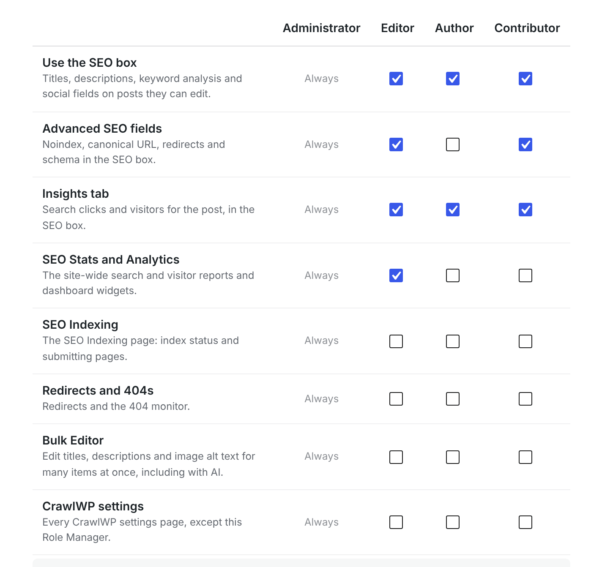
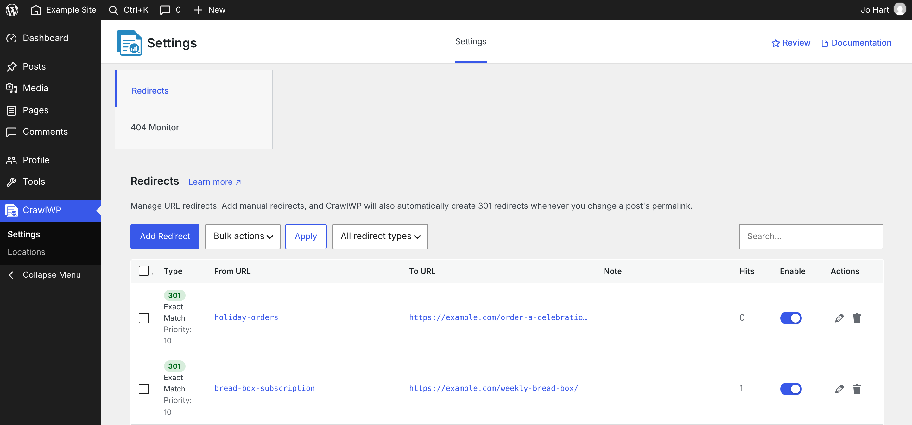

# Choosing which roles can use CrawlWP

On a site with several people, you may want writers to fill in SEO titles but not hide posts from Google, or an editor to manage redirects without touching your settings. CrawlWP decides who can use each of its parts with a set of permissions.

The free plugin uses sensible defaults: anyone who can edit posts gets the SEO box, and everything else is for administrators. With CrawlWP Premium, Role Manager lets you change this role by role.

**Note:** The permissions and their defaults are part of the free plugin. Changing them for each role with Role Manager needs CrawlWP Premium.

In this article:

- [Who can do what by default](#who-can-do-what-by-default)
- [What stays admin-only](#what-stays-admin-only)
- [How to change permissions with Role Manager](#how-to-change-permissions-with-role-manager)
- [Users with more than one role](#users-with-more-than-one-role)
- [What people see with limited access](#what-people-see-with-limited-access)
- [Frequently asked questions](#frequently-asked-questions)
- [For developers](#for-developers)
- [Related articles](#related-articles)

## Who can do what by default

Without Role Manager, CrawlWP works the way it always has. Administrators can do everything.

| Permission | What it covers | Who has it by default |
|---|---|---|
| **Use the SEO box** | Titles, descriptions, keyword analysis and social fields on posts they can edit. Also the SEO fields on category, tag and other term screens. | Anyone who can edit posts, pages, products or other public content. |
| **Advanced SEO fields** | Noindex, canonical URL, redirects and schema in the SEO box (the **Schema** and **Advanced** tabs). | Anyone who can edit posts, pages, products or other public content. |
| **Insights tab** | Search clicks and visitors for the post, in the SEO box. Premium feature. | Anyone who can edit posts, pages, products or other public content. |
| **SEO Stats and Analytics** | The site-wide search and visitor reports and dashboard widgets. Premium feature. | Administrators only. |
| **SEO Indexing** | The SEO Indexing page: index status and submitting pages. Premium feature. | Administrators only. |
| **Redirects and 404s** | Redirects and the 404 monitor. | Administrators only. |
| **Bulk Editor** | Edit titles, descriptions and image alt text for many items at once, including with AI. | Administrators only. |
| **CrawlWP settings** | Every CrawlWP settings page, except Role Manager. | Administrators only. |

"Administrator" here means any user who can manage your site's options, which in WordPress is the Administrator role.

**Note:** Permissions never let anyone edit a post they couldn't edit before. A user needs WordPress's permission to edit a post before they can use its SEO box.

## What stays admin-only

Some parts of CrawlWP hold secrets or affect the whole site. Only administrators can use them, whatever a role is given, even **CrawlWP settings**:

- the **API Settings** tab (API keys and the service-account key);
- the **Log** tab (the indexing submission log);
- the **License** tab;
- the **Submit URLs** tab;
- the **Import SEO Data** section;
- **Role Manager** itself;
- saving redirects that send visitors to another website.

A non-administrator with **Redirects and 404s** can still re-save an existing redirect to another website, as long as they don't change where it matches or where it goes.

## How to change permissions with Role Manager

**Note:** Role Manager needs CrawlWP Premium, and only administrators can see it.

1. Go to **CrawlWP » Settings** and click **Role Manager** in the list of sections on the left.
2. Find the permission in the left column.
3. Tick or untick the box in the column for each role.
4. Click **Save Changes**.


### How the grid is laid out

- **Rows** are the eight permissions from the table above, each with a short description.
- **Columns** are your user roles. The **Administrator** column says **Always** in every row, because administrators can always do everything.
- The other columns are every role that can edit posts, pages or other public content. Roles added by other plugins, such as Shop manager, appear too. Roles that can't edit content, such as Subscriber, are not shown.

The boxes start ticked or unticked to match the defaults, so nothing changes until you save. For example:

- untick **Advanced SEO fields** for Authors, so they can't noindex posts;
- tick **SEO Stats and Analytics** for Editors, so they can see your reports;
- tick **Redirects and 404s** for Editors, so they can manage redirects without your other settings.



### Going back to the defaults

1. In **Role Manager**, tick **Reset to defaults when saving**.
2. Click **Save Changes**.

Every role goes back to the default access in the first table.

## Users with more than one role

Some users have two roles, for example Author and a shop or membership role. CrawlWP allows a user to do something when **any** of their roles allows it.

- Each role is judged on its own: by its column in Role Manager if you saved one, or else by that role's default.
- A role that isn't in the grid, such as Subscriber or Customer, grants nothing. So if you untick a box for Authors, it also holds for an Author who is also a Subscriber.
- If none of a user's roles has a saved choice, the user keeps the free plugin's default. That default also counts permissions given to that one user directly, for example by a user-role plugin.

## What people see with limited access

- **Without Use the SEO box**, the **CrawlWP SEO** box doesn't load on the post screen, and the SEO fields don't show on category and tag screens.
- **Without Advanced SEO fields**, the **Schema** and **Advanced** tabs are hidden in the SEO box.
- **Without Insights tab**, the Insights tab, the **CrawlWP Details** column in the posts list and the **CrawlWP Stats** box are hidden. These are Premium features.
- **With Redirects and 404s or Bulk Editor, but not CrawlWP settings**, the user can open **CrawlWP » Settings**. It opens on the **Settings** tab and shows only the **Redirects**, **404 Monitor** or **Bulk Editor** sections they are allowed. They can only save those sections.



**Note:** When CrawlWP's SEO features are turned off, there are no Redirects or Bulk Editor sections to open. Then only **CrawlWP settings** lets a non-administrator into the settings.

## Frequently asked questions

**I don't have Premium. Can I stop Authors using the Advanced SEO fields?**
Not from a screen. The free plugin uses the defaults in the first table. A developer can change them with a filter (see [For developers](#for-developers)), or you can use Role Manager in CrawlWP Premium.

**I gave Editors CrawlWP settings, but they can't see API Settings.**
That's expected. API Settings, the Log, the License tab, Submit URLs and Import SEO Data stay admin-only. See [What stays admin-only](#what-stays-admin-only).

**I unticked a box, but one user can still do it.**
Check the user's other roles. A user is allowed when any of their roles is allowed. Also check whether they are an administrator, who can always do everything.

**Does Role Manager change what users can do in WordPress itself?**
No. It only controls CrawlWP's own parts. Who can edit, publish or delete posts is still decided by WordPress.

## For developers

The free plugin checks every permission with one method, and Role Manager answers through one filter.

**Checking a permission**

```php
use Mihdan\IndexNow\SEOCore\Permissions;

if ( Permissions::can( Permissions::REDIRECTS ) ) {
	// The current user may manage redirects.
}
```

`Permissions::can( $permission, $user_id = 0 )` returns `true` for administrators (`manage_options`) before any filter runs. The permission names are `seo_box`, `seo_advanced`, `insights`, `stats`, `indexing`, `redirects`, `bulk_editor` and `settings`, also available as the constants `Permissions::SEO_BOX`, `SEO_ADVANCED`, `INSIGHTS`, `STATS`, `INDEXING`, `REDIRECTS`, `BULK_EDITOR` and `SETTINGS`.

**Changing who is allowed: `crawlwp_user_can`**

```php
add_filter( 'crawlwp_user_can', function ( $allowed, $permission, $user_id ) {
	// Let Editors manage redirects.
	if ( 'redirects' === $permission && user_can( $user_id, 'edit_others_pages' ) ) {
		return true;
	}

	return $allowed;
}, 20, 3 );
```

- `$allowed` (bool): the default, or Role Manager's answer when Premium is active (it hooks in at priority 10).
- `$permission` (string): one of the permission names above.
- `$user_id` (int): the user being checked.

The filter can't take anything away from administrators, and it can't open the admin-only parts listed above.

**Redirects to other sites: `crawlwp_allow_external_redirects`**

By default only administrators can save a redirect to another website, from the SEO box or the Redirects screen. This filter can widen or narrow that.

- `$allowed` (bool): defaults to `current_user_can( 'manage_options' )`.
- `$post_id` (int): the post being saved in the SEO box, or `0` on the Redirects screen.

## Related articles

- [Using the bulk SEO editor](https://crawlwp.com/article/using-the-bulk-seo-editor/)
- [Creating a redirect rule in WordPress](https://crawlwp.com/article/creating-redirect-rule-wordpress/)
- [Using the 404 monitor](https://crawlwp.com/article/using-the-404-monitor/)
- [Writing titles, descriptions and alt text in bulk with AI](https://crawlwp.com/article/writing-seo-in-bulk-with-ai/)
