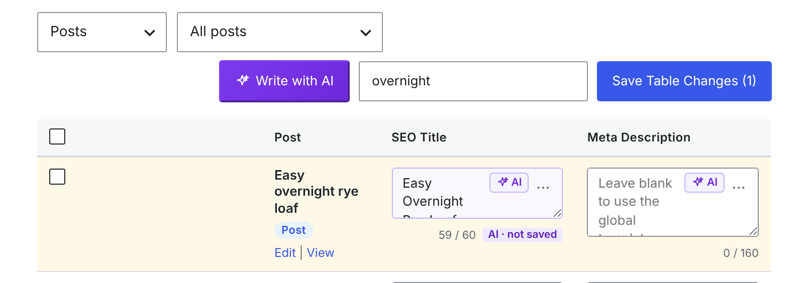
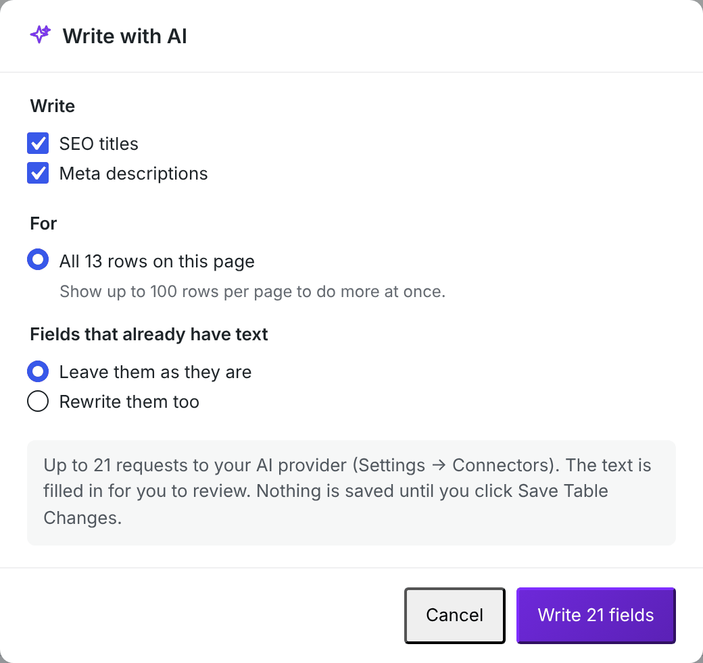
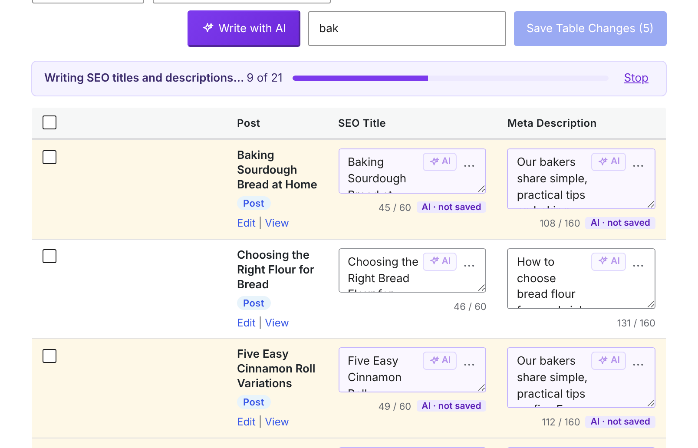
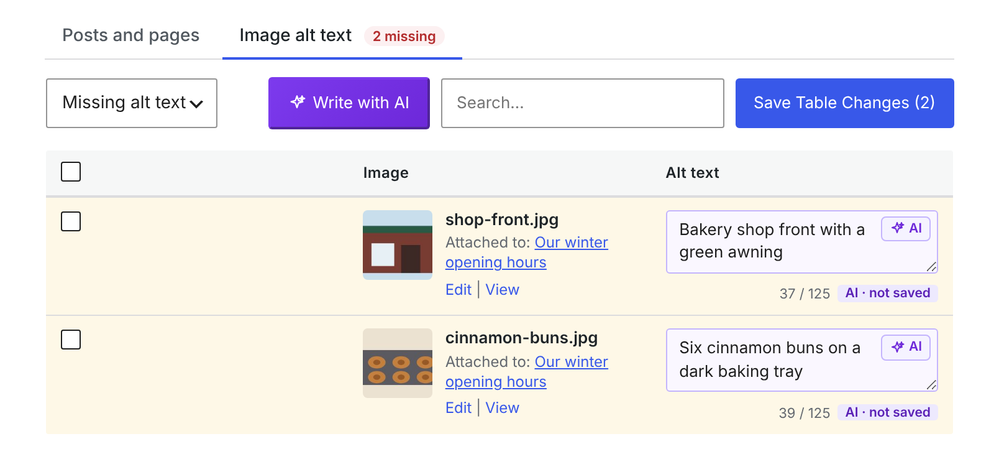

# Writing titles, descriptions and alt text in bulk with AI

Writing a title and description for every post, and alt text for every image, takes hours. The Bulk Editor can ask AI to write them for you, right in the table. You review the text, change what you like, and save.

**Note:** Writing one field with the **AI** button is free. **Write with AI** for many rows at once needs CrawlWP Premium.

**Before you start:** Connect an AI provider in WordPress under **Settings » Connectors**. CrawlWP uses that connection; it has no AI service of its own. Until a provider is connected, the **AI** buttons don't appear. For more on how CrawlWP writes with AI, see [Generating SEO titles and descriptions with AI](https://crawlwp.com/article/generating-seo-titles-and-descriptions-with-ai/).

In this article:

- [How to write one field with AI](#how-to-write-one-field-with-ai)
- [How to write many rows at once](#how-to-write-many-rows-at-once)
- [Writing image alt text](#writing-image-alt-text)
- [Saving the results](#saving-the-results)
- [What stops a run](#what-stops-a-run)
- [Limits](#limits)
- [Troubleshooting](#troubleshooting)
- [Related articles](#related-articles)

## How to write one field with AI

1. Go to **CrawlWP » Settings** and click **Bulk Editor** in the list of sections on the left.
2. Find the post, and the **SEO Title** or **Meta Description** field you want to fill.
3. Click the **AI** button next to the field.
4. Wait while it says **Writing…**. The new text appears in the field, tagged **AI · not saved**.
5. Edit the text if you like, then click **Save Table Changes**.

Click **AI** again on a field that already has text to get a new version in different words.

### How titles and descriptions are written

- **Titles** are written to fit your title template. The AI writes the post's part of the title, and CrawlWP puts it where `{{ post.title }}` is, keeping your separator and site name around it. Titles aim for 60 characters or fewer in total.
- **Descriptions** are written from the post's content, up to 160 characters.
- If the post has a focus keyword, the AI is asked to include it naturally.
- The text is written in the language of the post.

For more on how the AI writes, see [Generating SEO titles and descriptions with AI](https://crawlwp.com/article/generating-seo-titles-and-descriptions-with-ai/).

## How to write many rows at once

**Note:** This needs CrawlWP Premium. Without it, the **Write with AI** button shows a **Premium** badge, and clicking it explains that this is part of CrawlWP Premium.

1. Go to **CrawlWP » Settings** and click **Bulk Editor** in the list of sections on the left.
2. Use the filters to show the rows you want. For example, choose **Missing meta description**.
3. To do more at once, set the page to show 100 items per page.
4. Optionally, tick the rows you want to write for.
5. Click **Write with AI**.
6. In the dialog, choose the options (see the table below).
7. Click **Write … fields**.

A progress bar shows **Writing SEO titles and descriptions…** with how many fields are done. The fields are written one after another, and fill in as they are written.

When the run finishes, you see: **Wrote … fields. … could not be written. Review the text, then click Save Table Changes.**

### Options in the Write with AI dialog

| Option | Choices |
|---|---|
| **Write** | **SEO titles**, **Meta descriptions**, or both. In the **Image alt text** view, this is always **Alt text**. |
| **For** | **The … selected rows on this page**, or **All … rows on this page**. A run covers the current page only. |
| **Fields that already have text** | **Leave them as they are** (default) only fills empty fields. **Rewrite them too** writes new text for every chosen field. |

The dialog shows how many requests the run will send to your AI provider. If every chosen field already has text, it says: **Nothing to write: the chosen fields already have text. Choose "Rewrite them too" to replace it.**

**Tip:** With **Leave them as they are**, you can run **Write with AI** again later on the same page, and it only fills in what is still empty.

## Writing image alt text

Alt text describes an image for people who can't see it, and helps Google understand it. The Bulk Editor has a separate view for it.

1. Go to **CrawlWP » Settings**, click **Bulk Editor** in the list of sections on the left, then click **Image alt text**.
2. The view opens on **Missing alt text**. Choose **All images** to see every image.
3. Click **AI** next to one image, or use **Write with AI** for the page (Premium).
4. Review the text, then click **Save Table Changes**.

The **Image alt text** button shows how many images have no alt text, for example **12 missing**. The badge is hidden when none are missing. An empty alt text counts as missing.

While AI writes alt text, the field says **Looking at the image…**. The AI looks at the image itself, and uses the page it is attached to, its title, caption and file name as hints. Alt text is kept to 125 characters or fewer.

### Supported images

| Requirement | Detail |
|---|---|
| Image types | JPEG, PNG, GIF and WebP. Other files show **AI can describe JPEG, PNG, GIF and WebP images only.** and are skipped in a run. |
| File size | Up to 4 MB. CrawlWP sends the large size of the image when there is one. |
| AI model | The connected model must be able to read images. Most current OpenAI, Anthropic and Google models can. |

**Note:** Only users who can upload files see the **Image alt text** view. Users who can't edit other people's posts, such as Authors, only see their own uploads.

## Saving the results

Nothing is saved until you click **Save Table Changes**. AI-written text is tagged **AI · not saved** until then.

- While a run is going, you can't save. Wait for it to finish, or click **Stop**.
- If you try to leave the page with unsaved changes, your browser asks you to confirm.
- After saving, you see how many posts or images were updated, for example **20 posts updated.**

This lets you check every piece of text before it goes live.

## What stops a run

| What happens | Message you see |
|---|---|
| You click **Stop**. | **Stopped. The text written so far is in the table, not saved yet.** |
| Three requests in a row fail to connect. | **Writing stopped after several errors in a row. Check your connection and try again.** |
| You hit the five-minute limit. | **Stopped: too many AI requests for now. Wait a few minutes, then run it again for the rest.** |
| The site or you reach the daily limit. | The daily limit message. See [Limits](#limits). |
| You are signed out, or the page is too old. | **Your session has expired or this page is too old. Reload the page and try again.** |
| No AI provider can be reached, or the model can't read images. | An error that points you to **Settings » Connectors**. |

A single field that fails, such as an unsupported image or a deleted post, doesn't stop the run. It is counted in "could not be written" and the run moves on.

## Limits

To protect your AI provider bill, CrawlWP limits how much AI text can be written. Only text that is written successfully counts. A failed request is given back.

| Limit | Free | With Premium |
|---|---|---|
| Per user, every 5 minutes (AI buttons in the Bulk Editor and the SEO box) | 20 | 20 |
| Per user, every 5 minutes, during a **Write with AI** run | Not available | 300 |
| Whole site, per day | 2,000 | 10,000 |
| One user, per day | Half the site's daily limit (1,000) | Half the site's daily limit (5,000) |

- A **Write with AI** run has its own five-minute count. A long run doesn't lock the AI buttons in the post editor.
- The daily limits reset at midnight UTC.
- A single run covers at most one page of rows: up to 100 rows, so up to 200 fields for titles and descriptions together.

When a daily limit is reached, you see one of these:

- **This site has used today's AI generations. The limit resets at midnight UTC.**
- **You have used your share of today's AI generations on this site. It resets at midnight UTC.**

**Note:** Premium only raises the limits if your site still uses the standard ones. A limit set by a developer stays as it is.

## Troubleshooting

**I don't see any AI buttons.**
No AI provider is connected, or the connected one can't write text. Connect one under **Settings » Connectors** in WordPress. A newly connected provider can take a few minutes to show up.

**Clicking Write with AI shows "Connect an AI provider in WordPress under Settings → Connectors to write with AI."**
Click **Open Connectors** in the message and connect a provider, then reload the Bulk Editor.

**The Write with AI button says "Update needed".**
You have CrawlWP Premium, but an older version. Update CrawlWP Premium to its latest version to write many fields at once.

**Alt text fails with "The connected AI model can't read images."**
The run stops, because every image would fail the same way. Connect a provider with a model that accepts images under **Settings » Connectors**.

**I can't open the Bulk Editor.**
By default only administrators can use the Bulk Editor. With CrawlWP Premium, an administrator can give other roles access. See [Choosing which roles can use CrawlWP](https://crawlwp.com/article/roles-and-permissions/).

## Related articles

- [Using the bulk SEO editor](https://crawlwp.com/article/using-the-bulk-seo-editor/)
- [Generating SEO titles and descriptions with AI](https://crawlwp.com/article/generating-seo-titles-and-descriptions-with-ai/)
- [Image SEO and automatic alt text](https://crawlwp.com/article/image-seo-and-automatic-alt-text/)
- [Choosing which roles can use CrawlWP](https://crawlwp.com/article/roles-and-permissions/)
